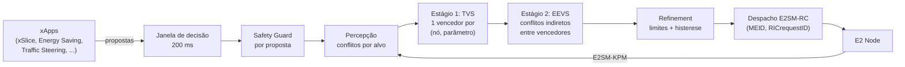

# xApp RDL — Resource and Decision Layer (Fase 1: H-RDL)

Camada de governança para o Near-RT RIC (O-RAN) que recebe as propostas de controle de várias xApps, detecta conflitos entre elas e decide, de forma determinística e com guardas de segurança, quais ações chegam à RAN.

Projeto de mestrado — PPGCOMP / UFPA. Autor: George Alexandro Ferreira Barbosa. Orientador: Prof. Dr. André Riker.

| Fase | Abordagem | Repositório |
| :-- | :-- | :-- |
| 1 — H-RDL | Heurísticas determinísticas (TVS/EEVS) + Safety Guard | este repositório |
| 2 — CA-RDL | Contexto + Safe-MARL (MAPPO com restrições) | [XApp-RDL-F2](https://github.com/georgebarbosa3090/XApp-RDL-F2) |
| 3 | RDL autônoma/federada (6G) | planejamento |

---

## Estado atual (2026-11-08)

O que existe e o que foi verificado, com a evidência correspondente. Os vereditos dos gates vêm do certificador ([`scripts/certification/certify_chain.py`](scripts/certification/certify_chain.py)); o relatório mais recente está em [`reports/certification/`](reports/certification/).

| Item | Situação | Evidência |
| :-- | :-- | :-- |
| Pipeline de decisão H-RDL (percepção, TVS/EEVS, Safety Guard, despacho) | implementado; 311 testes unitários passando | `tests/` |
| Conflitos aplicados na RAN simulada (ns-3.48 + 5G-LENA v5.1) | implementado para S0–S7 (PRB, potência, handover) | [`simulations/ns3/`](simulations/ns3/README.md) |
| Cenários de conflito S0–S8 na bancada NORI (E2 real) | implementado: a kpm-probe em modo `catalog` roda o H-RDL sobre o KPM real e atua a cota de PRB no gNB 0 (potência, handover e outros gNBs são decididos e registrados como não atuáveis). Campanha S0–S8 × 5 sementes (45 execuções): 30 com Control decidido pelo H-RDL sobre o KPM_t0 e ACK, 20 com efeito `CONSISTENT`; S3–S5 sem nada atuável. Pela regra v5, S7 sai `INCONSISTENT` (interpolação até um nível saturado) e a semente 1005 fica fora da calibração (vazão de base pela metade), mas a razão depois/antes é a mesma em todas as sementes (achados 41–43). Na avaliação pré-registrada da regra relativa ([v6](docs/07_preregistro_fase4_v6.md)), com as sementes novas 2001–2005, as 30 execuções saíram `CONSISTENT` (erro ≤ 0,03 %), inclusive os cinco S7. No desenho [v7](docs/07_preregistro_fase4_v7.md), com a banda reduzida a 50 MHz, as 30 execuções saíram `INCONSISTENT`: o teto age em PRBs absolutos da portadora, e a regra relativa só vale na banda da calibração | [resumo da campanha](reports/nori/resumo_campanha_nori_20261109T015402Z.md), [docs/11, seção 8](docs/11_observabilidade_e_campanhas.md) |
| Comparação de baselines B0–B3 nos cenários S0–S7 | campanha concluída: 160 execuções (5 sementes), malha aberta; resultados em [`docs/04`](docs/04_metodologia_experimental_e_resultados.md#4-resultados) e no [relatório da campanha](reports/conflicts/relatorio_campanha_20261108T110655Z.md) | `experiments/runs/nr_*`, [`reports/conflicts/`](reports/conflicts/) |
| Interoperabilidade E2 real (KPM/RC com NORI e Near-RT RIC) | **E2 Setup, E2SM-KPM e RIC Control E2SM-RC verificados** (NORI ↔ Near-RT RIC Release I no k3s). A xApp [`kpm-probe`](deploy/helm/xapp-kpm-probe/README.md) assina KPM v3.00 pelo SubMgr e envia um RIC Control E2SM-RC v3.01 (cotas de PRB por fatia) codificado por [`src/e2/v3/codec.py`](src/e2/v3/codec.py); o NORI devolve o ACK correlacionado. As mensagens E2AP são confirmadas pelo tshark 4.2.2 e casadas byte a byte com a xApp. O ACK do RC exige um [patch de 56 linhas no NORI](deploy/helm/nori-ns3/files/patches/0001-rc-control-ack.patch), registrado no lock | [`nori_rc_control_seed1`](experiments/runs/nori_rc_control_seed1/execution_manifest.json), [`nori_kpm_flowmon_seed1_p1s`](experiments/runs/nori_kpm_flowmon_seed1_p1s/execution_manifest.json), [`experiments/e2_dissection/`](experiments/e2_dissection/), [guia, seção 7](docs/02_guia_operacional_deploy_e_simulacao.md#7-pilha-nori-via-helm-e2-real) |
| Closed loop causal KPM → decisão → RC → KPM | **verificado (G4), com ressalvas**. No desenho v5 ([pré-registro](docs/07_preregistro_fase4_v5.md)), o H-RDL decidiu cotas de PRB a partir do KPM_t0 em três execuções; o Control E2SM-RC foi confirmado por ACK e a URLLC caiu de 151,5 para 76,4 Mb/s, a 1,3 % da previsão feita antes das execuções. Ressalvas: decisão igual nas três (o sinal de congestionamento do NORI é sempre verdadeiro), efeito medido no FlowMonitor (o KPM do NORI não mede vazão por UE), NORI com patch do ACK, cenário único. Histórico: a v1 não viu efeito (teto de 40 %, INCONSISTENT). Os desenhos v2 a v4 ([v2](docs/07_preregistro_fase4_v2.md), [v3](docs/07_preregistro_fase4_v3.md), [v4](docs/07_preregistro_fase4_v4.md)) pararam na calibração e as avaliações não foram rodadas. A análise exploratória da v4 mostrou a causa: a cota funciona e é linear, mas o NORI a aplica ~12 s simulados depois do Control (agendamento pelo relógio de parede no simulador em tempo real), fora da janela de análise | [`nori_hrdl_v5_seed1..3`](experiments/runs/nori_hrdl_v5_seed1/execution_manifest.json), [guia, seção 7.9](docs/02_guia_operacional_deploy_e_simulacao.md#79-resultado-da-fase-4-decisão-h-rdl-sobre-o-kpm_t0-e-efeito-na-ran-2026-11-08) | [`nori_hrdl_loop_seed1`](experiments/runs/nori_hrdl_loop_seed1/execution_manifest.json), [guia, seção 7.9](docs/02_guia_operacional_deploy_e_simulacao.md#79-resultado-da-fase-4-decisão-h-rdl-sobre-o-kpm_t0-e-efeito-na-ran-2026-11-08) |

| Gate | Exigência | Veredito |
| :-: | :-- | :-: |
| G0 | Ambiente reproduzível (versões e commits por execução) | CERTIFIED (pilhas nativa e NORI) |
| G1 | E2SM-KPM externo (E2 Setup, Subscription, Indication) | CERTIFIED (249 execuções NORI) |
| G2 | Decisão H-RDL funcional | LOCAL_ONLY (testes) |
| G3 | E2SM-RC externo (Control + ACK correlacionados) | CERTIFIED (230 execuções; NORI com patch do lock) |
| G4 | Closed loop causal (Control decidido pelo H-RDL a partir do KPM_t0, com efeito na RAN coerente com as cotas) | CERTIFIED (84 cadeias decididas pelo H-RDL: 3 da v5 e 20 da campanha S0–S8 pela regra v5; 30 da avaliação v6 e 31 do B3 da campanha do G5 pela regra v6, adotada sem efeito retroativo) |
| G5 | Campanha ≥ 30 sementes pareadas com E2 | CERTIFIED (S8: 30 pares B0–B3 com E2 real; [pré-registro e resultado](docs/07_preregistro_g5_campanha_s8.md)) |
| G6 | Artefato reproduzível por terceiros | NOT_CERTIFIED (falta reprodução independente) |

Importante para leitura de resultados antigos:

- Em 2026-11-09 saíram do repositório os dados sintéticos (as 210 execuções `S1_B0..B6`, geradas com `numpy.random` e não simuladas), as tabelas com números escritos à mão, os relatórios e auditorias antigos com números não verificados, os scripts legados e os cenários S9–S15 nunca executados ([docs/05, achado 45](docs/05_auditoria_e_conformidade_oran.md)). Eles continuam no histórico do git e não devem ser usados como evidência.
- As afirmações científicas C1–C6 permanecem `NOT_VERIFIED` em [`specs/claims.yaml`](specs/claims.yaml).

---

## Como a H-RDL decide



1. As propostas de cada janela de 200 ms são processadas em lote; uma proposta urgente (prioridade ≥ 80) antecipa o fechamento da janela.
2. Cada proposta fora dos limites físicos é descartada individualmente antes da arbitragem, para que uma xApp maliciosa não vete ações legítimas.
3. A percepção agrupa conflitos por alvo: um conflito **direto** por (nó, parâmetro) e um **indireto** por par de parâmetros do mesmo nó que afetam os mesmos KPIs. A última ação confirmada pela RAN entra como incumbente.
4. **TVS** escolhe um vencedor por alvo; **EEVS** resolve os conflitos indiretos só entre os vencedores. Se a incumbente vence, nada é reenviado.
5. O Refinement aplica limites, histerese de 1 s por alvo e, opcionalmente, *slew-rate*.
6. O despacho envia `RIC_CONTROL_REQUEST` com o MEID do E2 Node, acompanha ACK/Failure e, só em caso de timeout, envia rollback para o último valor confirmado.

Detalhes e fórmulas em [`docs/01_arquitetura_e_modelagem.md`](docs/01_arquitetura_e_modelagem.md).

**Limitação conhecida:** a percepção agrupa conflitos por gNB; conflitos **entre células** (handover para uma célula que outra xApp desliga, ping-pong entre duas células) não são detectados. Isso foi observado nos cenários S4 e S5.

---

## Simulação

Duas pilhas, porque o NORI oficial não compila sobre ns-3.48 / 5G-LENA v5.1 ([`reproducibility/versions.lock`](reproducibility/versions.lock)):

| Pilha | Versões | Uso |
| :-- | :-- | :-- |
| Nativa (`NS3_5GLENA`) | ns-3.48 `d2add90` + 5G-LENA v5.1 `cedcead` | Cenários de conflito S0–S7, sem E2 |
| NORI (`NORI_NS3`) | ns-3.42 `ab4cce0` + 5G-LENA `78b7179` + NORI `8a30867` (E2AP/E2SM v3.01) | E2 real e closed loop, via Helm; cenários S0–S8 portados (só a cota de PRB é atuável) |

Nos cenários S0–S7, as ações decididas são aplicadas na RAN durante a simulação por [`simulations/ns3/rdl-nr-common.h`](simulations/ns3/rdl-nr-common.h): cota de PRB pela máscara de RBGs do escalonador, potência do gNB e handover X2. Quatro baselines são comparados com as mesmas propostas e sementes:

| Baseline | Regra |
| :-- | :-- |
| B0 | sem coordenação: cada proposta é aplicada ao chegar |
| B1 | FIFO por janela e alvo |
| B2 | prioridade estática por janela e alvo |
| B3 | H-RDL: o pipeline real da xApp (`RDLxApp._process_action_group`) no relógio simulado |

Esta é uma avaliação em **malha aberta**: sem E2 e sem realimentação de KPM. Metodologia, métricas e resultados em [`docs/04_metodologia_experimental_e_resultados.md`](docs/04_metodologia_experimental_e_resultados.md).

---

## Início rápido

Pré-requisitos: Python 3.10+, [`uv`](https://docs.astral.sh/uv/), WSL2/Ubuntu com ns-3.48 + 5G-LENA v5.1 compilados (ver o [guia operacional](docs/02_guia_operacional_deploy_e_simulacao.md)).

```bash
uv sync --extra test                     # dependências
uv run pytest -q                         # testes (311)

# Um experimento de conflito, com saída ao vivo e evidência em experiments/runs/
python scripts/certification/run_conflict_experiment.py --scenario S1 --baseline B3 --seed 1001

# Campanha: cenários × baselines × sementes (retomável, paralela)
python scripts/certification/run_conflict_campaign.py --seeds 1001-1005 --jobs 2

# Análise por cenário × baseline e certificação dos gates
python scripts/certification/analyze_conflict_runs.py
python scripts/certification/certify_chain.py
python scripts/certification/generate_campaign_report.py   # relatório: hipóteses, tabelas por semente, conclusões, comandos

# Pilha E2 (NORI + Near-RT RIC + xApp kpm-probe no k3s): trazer uma execução, dissecar o E2 e certificar
bash scripts/collect_nori_run.sh nori_kpm_flowmon_seed1_p1s
python scripts/certification/certify_chain.py

# Cenários de conflito na bancada NORI, ao vivo (Ubuntu do WSL): um cenário, ou a campanha S0–S8 × 5 sementes com certificação
bash scripts/run_nori_scenario.sh S1 1001
bash scripts/run_nori_campaign.sh
bash scripts/run_native_campaign.sh        # campanha nativa S0–S7 × B0–B3 + análise, certificação e relatório
bash scripts/observe/panel.sh              # painel tmux: NORI, E2AP, xApp, RIC, Kubernetes, UEs (docs/11)
```

Executar a xApp (modo local, sem RIC):

```bash
python -m src.main
```

Variáveis principais: `RDL_MODE` (`OFFLINE_SIMULATION` ou `O_RAN_INTEROP`), `RAN_BACKEND`, `SUBMGR_URL` (subscrição E2SM-KPM pela API REST do Subscription Manager), `XAPP_HTTP_HOST`, `XAPP_HTTP_PORT`, `XAPP_RMR_PORT`. No modo `O_RAN_INTEROP` a xApp permanece bloqueada enquanto o codec E2 não for validado contra o ASN.1 oficial.

---

## Estrutura do repositório

| Caminho | Conteúdo |
| :-- | :-- |
| `src/` | xApp RDL: `rdl_xapp.py` (orquestração), `core/` (percepção, raciocínio, refinamento), `e2/` (E2AP, KPM, RC, despacho), `infrastructure/` (RMR, SubMgr, SDL), `observability/` |
| `tests/` | testes unitários, de codec, integração e interoperabilidade local |
| `simulations/ns3/` | cenários ns-3 S0–S7, cabeçalho de atuação, catálogo de conflitos (S0–S8; S8 só na bancada NORI) |
| `scripts/certification/` | executor com proveniência, driver de experimentos, campanha, análise e certificador |
| `experiments/runs/` | evidência por execução (manifesto, logs, saídas brutas, hashes) |
| `reports/` | relatórios gerados (`certification/`, `conflicts/`) |
| `reproducibility/` | política de proveniência, versões fixadas, roteiro de reprodução |
| `deploy/` | Helm e Kubernetes (xApp RDL, xApps de referência, bancada NORI) |
| `reference-xapps/` | implementações locais das xApps que geram propostas |
| `docs/` | documentação ([índice](docs/README.md)) |

---

## Documentação

- [Índice da documentação](docs/README.md)
- [Arquitetura e modelagem](docs/01_arquitetura_e_modelagem.md)
- [Guia operacional: instalação, simulação, campanha, implantação](docs/02_guia_operacional_deploy_e_simulacao.md)
- [Taxonomia de conflitos e cenários](docs/03_taxonomia_de_conflitos_e_cenarios.md)
- [Metodologia experimental e resultados](docs/04_metodologia_experimental_e_resultados.md)
- [Conformidade O-RAN e achados de auditoria](docs/05_auditoria_e_conformidade_oran.md)
- [Observabilidade ao vivo e campanhas (comandos por aba)](docs/11_observabilidade_e_campanhas.md)
- [Fluxo de mensagens (diagrama de sequência)](docs/23_diagrama_sequencia_fluxo_closed_loop_hrdl_fase1.md)

---

## Licença

Apache License 2.0 — ver [`LICENSE`](LICENSE).
