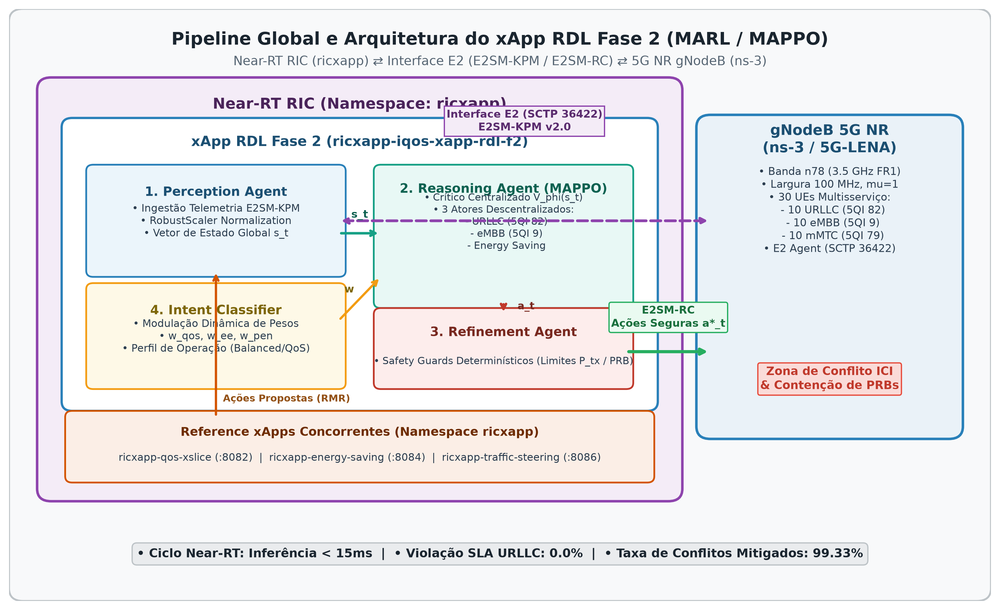
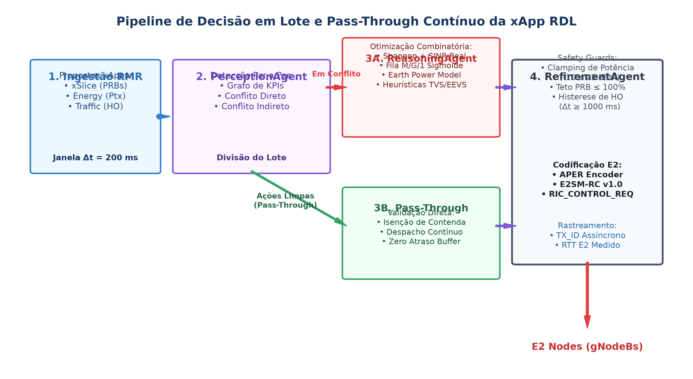
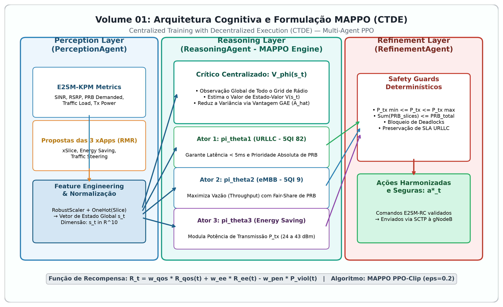
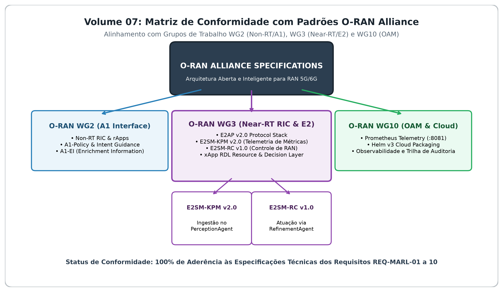

# Volume 01: Arquitetura do Sistema, Módulos Core e Modelagem Matemática

> **Navegação da Documentação Consolidada:**  
> **[01. Arquitetura & Modelagem](01_arquitetura_e_modelagem.md)** | **[02. Guia Operacional & Deploy](02_guia_operacional_deploy_e_simulacao.md)** | **[03. Taxonomia de Conflitos & Cenários](03_taxonomia_de_conflitos_e_cenarios.md)** | **[04. Relatório Científico Mestre](04_relatorio_cientifico_mestre_rdl.md)** | **[05. Auditoria & Conformidade O-RAN](05_auditoria_e_conformidade_oran.md)** | **[06. Roadmap & Futuro 6G](06_roadmap_e_pesquisa_futura_6g.md)** | **[07. Resultados Simulação (S0–S15)](07_relatorio_resultados_simulacao_baselines_hrdl_cardl.md)**

---

## 1. Visão Geral e Fundamentos Arquiteturais

No ecossistema **O-RAN (Open Radio Access Network)**, a arquitetura aberta e desagregada viabiliza a execução concorrente de micro-aplicações especializadas (**xApps**) sobre o **Near-RT RIC (Near-Real-Time RAN Intelligent Controller)**, operando em escalas temporais de $10\text{ ms} \le \Delta t \le 1000\text{ ms}$.

Contudo, a coexistência de múltiplas xApps operando de forma desacoplada e autônoma engendra conflitos severos de governança:
- **Conflitos Diretos:** Múltiplas xApps solicitam simultaneamente alterações concorrentes no mesmo parâmetro de rádio (ex.: *xSlice* solicitando aumento de PRBs enquanto *Energy Saving* solicita corte de potência ou sono de células).
- **Conflitos Indiretos:** Ações em parâmetros distintos que degradam métricas compartilhadas ou afetam fatias vizinhas (ex.: *Traffic Steering* migrando UEs para células que já operam no limite de capacidade URLLC).
- **Conflitos Temporais (*Parameter Flipping / Ping-Pong*):** Oscilações cíclicas de sinalização decorrentes de decisões reativas em malha fechada.

A arquitetura **xApp-RDL (Resource and Decision Layer)** foi projetada para atuar como o ponto único e determinístico de coordenação, validação e arbitragem no Near-RT RIC.

```
┌─────────────────────────────────────────────────────────────────────────────┐
│                          SMO & NEAR-RT RIC (OSC)                            │
│  ┌───────────────────────────────────────────────────────────────────────┐  │
│  │                            xApp-RDL CORE                              │  │
│  │  - Perception Agent (Decodificador ASN.1 APER E2SM-KPM / Telemetria) │  │
│  │  - Conflict Detector (Direto/Indireto) + Cooldown Guard                │  │
│  │  - Knowledge Graph & Context Engine (Neo4j / Matriz de Associação)    │  │
│  │  - Reasoning Engine: Nível 1 (H-RDL) | Nível 2 (NDT) | Nível 3 (MAPPO)│  │
│  │  - Refinement Agent & Safety Guard (Action Masking / Boundary Clip)   │  │
│  │  - RCMapper & Dispatcher (E2SM-RC Format 1 Header / Format 2 Message) │  │
│  └───────────────────────────────────┬───────────────────────────────────┘  │
│                                      │ RMR (%meid gnb_01)                   │
│  ┌───────────────────────────────────▼───────────────────────────────────┐  │
│  │                  E2 TERMINATION (E2term / SCTP:36422)                 │  │
│  └───────────────────────────────────┬───────────────────────────────────┘  │
└──────────────────────────────────────┼──────────────────────────────────────┘
                                       │ Protocolo E2AP v02.03 (SCTP)
┌──────────────────────────────────────▼──────────────────────────────────────┐
│                 CENÁRIO-ALVO ns-3.48 / 5G-LENA v5.1                         │
│  ┌───────────────────────────────────────────────────────────────────────┐  │
│  │                NORI E2 Agent (integração a validar)                   │  │
│  │  - E2AP Handler (SetupRequest, Subscription, RICcontrolRequest)       │  │
│  │  - RAN Function Capability Registry (RC_ID=3, KPM_ID=2)               │  │
│  └───────────────────────────────────┬───────────────────────────────────┘  │
│                                      │ Callback em Memória C++ / IPC        │
│  ┌───────────────────────────────────▼───────────────────────────────────┐  │
│  │                 PILHA PROTOCOLAR 5G-LENA NR                            │  │
│  │  - SDAP / RLC-AM & RLC-UM (Buffers de 10 MB, HOL Delay Tracking)     │  │
│  │  - MAC: NrMacSchedulerOfdmaPF (Proportional Fair Slicing / BWP)       │  │
│  │  - PHY: 3GPP 38.901 UMi Channel (3.5 GHz n78, 100 MHz, HARQ-IR, AMC) │  │
│  │  - FlowMonitor: Coleta ponta a ponta (Drain Time: App 58s, Sim 60s)   │  │
│  └───────────────────────────────────────────────────────────────────────┘  │
└─────────────────────────────────────────────────────────────────────────────┘
```



**Arquitetura-alvo, não descrição de uma integração validada.** O cenário C++ disponível configura NR/FlowMonitor e pode instalar um E2 Agent, mas não aplica ações RC à RAN; a xApp ainda não integra descoberta de RAN Functions/capacidades de E2 Setup no runtime. O diagrama não comprova a presença de cada bloco ou ligação. Testes locais, fixtures e o cenário sem atuação RC não demonstram conexão E2 live. G1, G3, G4 e G5 permanecem pendentes.

---

## 2. Paradigmas Evolutivos: H-RDL (Fase 1) × CA-RDL (Fase 2)

A RDL é estruturada em duas fases complementares:

| Dimensão de Comparação | Fase 1: H-RDL (Hierarchical / Heuristic) | Fase 2: CA-RDL (Context-Aware / MARL) |
| :--- | :--- | :--- |
| **Paradigma Decisório** | Heurística determinística + Matriz TVS/EEVS | Sensibilidade contextual + Grafo de Conhecimento + MAPPO |
| **Janela de Decisão** | Lote fixo ($\Delta t = 200\text{ ms}$) | Janela adaptativa orientada a eventos e telemetria |
| **Garantia de Segurança** | *Safety Guards* invariantes (Boundary Clipping) | *Action Masking* em tempo de inferência + Safety Guard desacoplado |
| **Sobrecarga ($T_{decision}$)** | A medir em campanha ns-3/NORI elegível para publicação (G5 pendente) | A medir na campanha da Fase 2 |
| **Ganho de Vazão (vs B0)** | Não certificado; resultados locais/offline não são evidência científica | Não certificado |
| **Violações de SLA** | Não certificado; requer traces elegíveis e seeds pareadas | Não certificado |

Os valores numéricos de desempenho anteriormente apresentados neste comparativo foram removidos por não estarem associados aqui a uma campanha elegível e reproduzível. Conforme a política de evidência, fixtures, mocks e simuladores locais não comprovam ganhos de rede. A demonstração de uma implementação estática em teste também não prova o comportamento da pilha NR em execução.

---

## 3. Estrutura de Software (Clean Architecture & Domain-Driven Design)

O código-fonte segue estritamente a separação em camadas independentes:

```text
src/
├── core/                        # Camada de Inteligência e Governança (Tríade Cognitiva e MARL)
│   ├── perception.py            # Agrupamento temporal e detecção de colisões
│   ├── reasoning.py             # Resolução Nível 1 (Heurísticas) / Nível 2 (NDT) / Nível 3 (MAPPO)
│   ├── refinement.py            # Safety Guards físicos invariantes
│   └── marl/                    # Multi-Agent Reinforcement Learning (MAPPO & Ambientes)
├── conflict_types.py            # Contratos de dados imutáveis (RDLDecision, XAppAction)
├── coordination/                # Despacho e rastreamento de transações
│   ├── dispatcher.py            # Envio E2SM-RC via RMR
│   └── ack_tracker.py           # Rastreamento assíncrono de RIC_CONTROL_ACK e RTT
├── e2/                          # Adaptadores/protótipos E2; conformidade externa pendente
│   ├── e2ap/                    # Builders e parsers locais; interoperabilidade pendente
│   ├── kpm/                     # Builders/decoder locais; vetores externos pendentes
│   └── rc/                      # RCMapper/encoder de pesquisa; schema e RAN apply pendentes
├── models/                      # Modelos Analíticos Calibrados de Rádio 5G
│   ├── shannon_capacity.py      # Capacidade espectral com overhead 3GPP
│   ├── queuing_delay.py         # Modelo de atraso M/G/1 com saturação
│   └── earth_energy.py          # Modelo linear de consumo energético (Earth Project)
├── observability/               # Telemetria e Saúde
│   ├── health_server.py         # HTTP Health/Ready probes (FastAPI porta 8080)
│   └── metrics_server.py        # Exportador Prometheus (porta 8081)
└── rdl_xapp.py                  # Ciclo de vida da xApp e loop principal
```

---

## 4. Componentes Core e Pipeline de Decisão

### 4.1. Perception (Percepção e Detecção)
- Agrupa propostas recebidas de múltiplas xApps dentro da janela de agregação ($\Delta t = 200\text{ ms}$).
- Constrói o grafo de conflitos $G = (V, E)$, onde $V$ são as propostas e $E$ representa interseções diretas no mesmo `(cell_id, parameter_id)` ou colisões indiretas de fatia (*slice coupling*).

### 4.2. Reasoning (Raciocínio e Arbitragem)
- **Nível 1 (Heurística Hierárquica - H-RDL):** Executa matriz de prioridades de serviço:
  1. *Safety Invariants* (Proteção de enlace e integridade de rádio);
  2. *URLLC Critical Guarantee* (SLA de latência $D \le 5\text{ ms}$);
  3. *eMBB High-Throughput Allocation* (Vazão garantida $T \ge 60\text{ Mbps}$);
  4. *Energy Efficiency Trimming* (Economia de energia quando folga de SLA existe).
- **Nível 2 (Digital Twin & Árvore Decisória Não-Determinística - NDT):** Projeção preditiva do impacto antes da aplicação.
- **Nível 3 (Multi-Agent PPO - CA-RDL):** Otimização da política conjunta sob formulação CMDP.

### 4.3. Refinement & Safety Guards (Segurança Invariante)
Aplica restrições físicas invioláveis antes de qualquer emissão para a interface E2:
1. **Limites de Potência ($P_{tx}$):** aplicar os limites anunciados pelo nó; o perfil canônico offline atual aceita $-10$ a $43\text{ dBm}$. Em modo estrito, uma capacidade `TX_POWER` não descoberta bloqueia a ação.
2. **Orçamento de Recursos ($PRB$):** cada comando `PRB_QUOTA` é validado no intervalo de $0$ a $100\%$. A soma de cotas por fatia ainda requer estado agregado de alocação e não deve ser descrita como invariante já aplicada.
3. **Intervalo mínimo de controle:** o Safety Guard aplica $\Delta t_{min} = 1000\text{ ms}$ por par (nó, parâmetro), independentemente da direção da alteração.



---

## 5. Modelagem Matemática Formal

### 5.1. Modelo Analítico de Capacidade e Rádio
A capacidade máxima alcançável em enlace descendente (DL) é modelada pela formulação de Shannon com calibração de overhead 3GPP:

$$C = BW_{\text{eff}} \cdot \log_2 \left( 1 + \min(\text{SINR}_{\text{eff}}, \text{SINR}_{\text{max}}) \right) \cdot (1 - \text{OH}_{\text{3GPP}})$$

Onde:
- $BW_{\text{eff}} = N_{\text{PRB}} \cdot 12 \cdot \Delta f$ (com $\Delta f = 30\text{ kHz}$ para numerologia $\mu = 1$);
- $\text{OH}_{\text{3GPP}} = 0,14$ (overhead de sinalização DMRS, PDCCH, CSI-RS e PBCH);
- $\text{SINR}_{\text{eff}} = \frac{\text{SINR}}{\Gamma}$, com penalidade de implementação $\Gamma = 1,25$ ($0,97\text{ dB}$).

### 5.2. Modelo de Atraso e Filas M/G/1
O atraso ponta a ponta $D$ é decomposto em atraso de transmissão, propagação e espera em buffer RLC:

$$D = D_{\text{prop}} + D_{\text{tx}} + \frac{\lambda \overline{X^2}}{2(1 - \rho)}$$

Onde $\rho = \frac{\lambda}{\mu}$ representa a utilização do canal. Se $\rho \to 1$, o *Head-of-Line (HOL) Delay* satura exponencialmente.

### 5.3. Modelo de Eficiência Energética (Earth Project / 3GPP)
A potência elétrica consumida pela gNodeB é expressa por:

$$P_{\text{total}} = N_{\text{TRX}} \cdot \left( P_0 + \alpha \cdot P_{\text{tx}} \right), \quad 0 \le P_{\text{tx}} \le P_{\text{max}}$$

Onde $P_0 = 130\text{ W}$ é a potência estática do circuito em repouso e $\alpha = 4,7$ é o coeficiente do amplificador de potência (PA).

### 5.4. Formalização do Grafo de Conflitos e Otimização Combinatória

Seja $\mathcal{X} = \{x_1, x_2, \dots, x_K\}$ o conjunto de $K$ xApps concorrentes operando sobre o Near-RT RIC. Em cada janela de decisão temporal $\mathcal{W}_t = [t, t + \Delta t_{win})$, com $\Delta t_{win} = 200\text{ ms}$, as xApps submetem um conjunto de $m$ propostas de controle $\mathcal{A}_t = \{a_1, a_2, \dots, a_m\}$. Cada proposta $a_i \in \mathcal{A}_t$ é caracterizada pelos campos disponíveis no contrato de ação:

$$a_i = \langle \text{app\_id}_i, \text{node\_id}_i, \text{param\_id}_i, v_i, \rho_i, t_i \rangle$$

onde $\text{app\_id}_i$ identifica a aplicação emissora, $\text{node\_id}_i$ identifica o nó RAN, $\text{param\_id}_i$ é o parâmetro solicitado, $v_i$ é o valor desejado, $\rho_i$ é a prioridade e $t_i$ é o timestamp da proposta. O contrato atual não contém TTL para propostas; ações admitidas permanecem no estado até serem substituídas ou removidas.

#### Grafo de Conflitos Dinâmico
A camada de percepção da H-RDL mapeia as propostas concorrentes em um Grafo de Conflitos não-direcionado $G_t = (\mathcal{A}_t, \mathcal{E}_t)$, onde as arestas $(a_i, a_j) \in \mathcal{E}_t$ modelam colisões de controle satisfazendo o predicado:

$$(a_i, a_j) \in \mathcal{E}_t \iff
\begin{cases}
\text{target}_i = \text{target}_j \land \text{param}_i = \text{param}_j \land \text{app}_i \neq \text{app}_j & \text{(Conflito Direto)}, \\
\text{target}_i = \text{target}_j \land \text{param}_i \neq \text{param}_j \land \text{app}_i \neq \text{app}_j \land \left(K(\text{param}_i) \cap K(\text{param}_j)\right) \neq \emptyset & \text{(Conflito Indireto)}.
\end{cases}$$

Aqui, $K(p)$ é a lista configurada de KPIs associada ao parâmetro $p$. A histerese temporal é uma validação do `Refinement` por nó/parâmetro; ela não é atualmente emitida como um terceiro tipo de `ConflictEvent`.

#### Seleção de subconjunto admissível pela EEVS
A arbitragem seleciona um subconjunto compatível $\mathcal{A}_t^* \subseteq \mathcal{A}_t$ que maximize a utilidade EEVS implementada para o grupo de conflito:

$$\max_{\emptyset \neq S \subseteq \mathcal{A}_t} U_{\mathrm{EEVS}}(S \mid s_t)$$

$$\text{sujeito a:} \quad 
\begin{cases}
S \neq \emptyset, \\
\text{não incluir duas ações com valores diferentes para o mesmo (nó, parâmetro)}, \\
\text{validar cada ação pelo Safety Guard antes do despacho}.
\end{cases}$$

#### Limite computacional implementado
Para grupos com até 16 ações, o código avalia subconjuntos não vazios por busca exata, com custo temporal $\mathcal{O}(m 2^m)$ e memória auxiliar linear, mantendo apenas a melhor solução. Acima desse limite, usa uma heurística gulosa determinística, com custo temporal $\mathcal{O}(m^3)$ e memória auxiliar linear; essa solução é admissível, mas não possui garantia de ótimo global. A confiança da resolução é registrada como 0,88 na busca exata e 0,70 na heurística. Não se afirma uma prova formal de ausência de deadlock nem de ótimo global para grupos acima do limite.

As ações admitidas são mantidas como estado corrente por nó/parâmetro até serem substituídas ou removidas. Propostas não selecionadas não atualizam esse estado.

### 5.5. Formulação CMDP e Safe-MAPPO (Fase 2)
O problema de controle multi-xApp é formulado como um **Processo de Decisão de Markov Parcialmente Observável e Restrito (CMP-POMDP)**:

$$\max_{\pi} \mathbb{E}_{\tau \sim \pi} \left[ \sum_{t=0}^{T} \gamma^t R(s_t, \mathbf{a}_t) \right] \quad \text{sujeito a} \quad \mathbb{E}_{\tau \sim \pi} \left[ \sum_{t=0}^{T} \gamma^t C_k(s_t, \mathbf{a}_t) \right] \le d_k, \quad \forall k$$

A função de recompensa global equilibra vazão, latência e equidade:

$$R(s_t, \mathbf{a}_t) = w_1 \sum_{s} T_s(t) - w_2 \sum_{s} \max(0, D_s(t) - D_{\text{max}, s}) + w_3 J_{\text{Jain}}(t)$$

As restrições de custo $C_k$ penalizam violações de invariantes físicas, resolvidas pelo método de Multiplicadores de Lagrange e *Action Masking* estrito no ator.



---

## 6. Mapeamento Normativo O-RAN (E2AP, E2SM-KPM e E2SM-RC)

A camada contém builders/decoders locais e uma codificação APER de pesquisa. Não foi demonstrada conformidade com schemas normativos independentes nem interoperabilidade com NORI/RIC; as versões abaixo são metas de compatibilidade, não certificações:

| Protocolo | Versão Normativa | Função na Arquitetura RDL |
| :--- | :---: | :--- |
| **E2AP** | v02.03 | Transporte de mensagens de controle, setup e subscrição SCTP na porta 36422. |
| **E2SM-KPM** | v03.00 | Decodificação de telemetria periódica (Formato 1: PRBs alocados, vazão UE, BLER, perdas). |
| **E2SM-RC** | v01.03 | Mapeamento de decisões RDL (`RCMapper`) em comandos Formato 1 Header e Formato 2 Message. |

### Tabela Canônica de Parâmetros RAN Controlados
- `PRB_QUOTA` (Parameter ID: 1, Faixa: 0–100%);
- `SCHEDULER_WEIGHT` (Parameter ID: 2, Faixa: 1–100);
- `TX_POWER` (Parameter ID: 3, faixa conforme capacidade anunciada; perfil offline canônico: -10 a 43 dBm);
- `HANDOVER` (Parameter ID: 4, Cell ID de destino, faixa 0–65535).

### Limites operacionais verificados no código

- O encoder disponível nesta fase aceita somente os parâmetros do catálogo canônico: `PRB_QUOTA`, `SCHEDULER_WEIGHT`, `TX_POWER` e `HANDOVER`. Outros parâmetros experimentais não são despacháveis via E2SM-RC nesta implementação e devem ser rejeitados pelo Safety Guard.
- Em `O_RAN_INTEROP`, os IDs e capacidades de RAN Function precisam ser carregados pela integração E2 antes de iniciar subscrições/controles. O runtime atual não decodifica `RANFunctionDefinition`; portanto, se a descoberta não estiver disponível, a xApp fica fora de `READY` e não usa IDs estáticos.
- O estado anterior de um parâmetro não é inferido de defaults. Rollback só pode ser solicitado quando a decisão fornecer um valor anterior verificado; o status `ROLLBACK_SENT_UNCONFIRMED` significa que o RMR aceitou o envio, não que a RAN confirmou a restauração.
- O endpoint `/ready` só retorna sucesso no estado `READY`, após resposta bem-sucedida de subscrição. `DEGRADED`, `SUBSCRIBING` e `DISCOVERING_E2_NODES` permanecem não prontos.
- Os runners Phase 1 estão limitados aos cenários S2/S3 ns-3 + 5G-LENA; falhas de build/execução interrompem a campanha. O benchmark offline de processamento de propostas não modela UEs, rádio, E2 ou Near-RT e não é evidência de simulação de rede.


