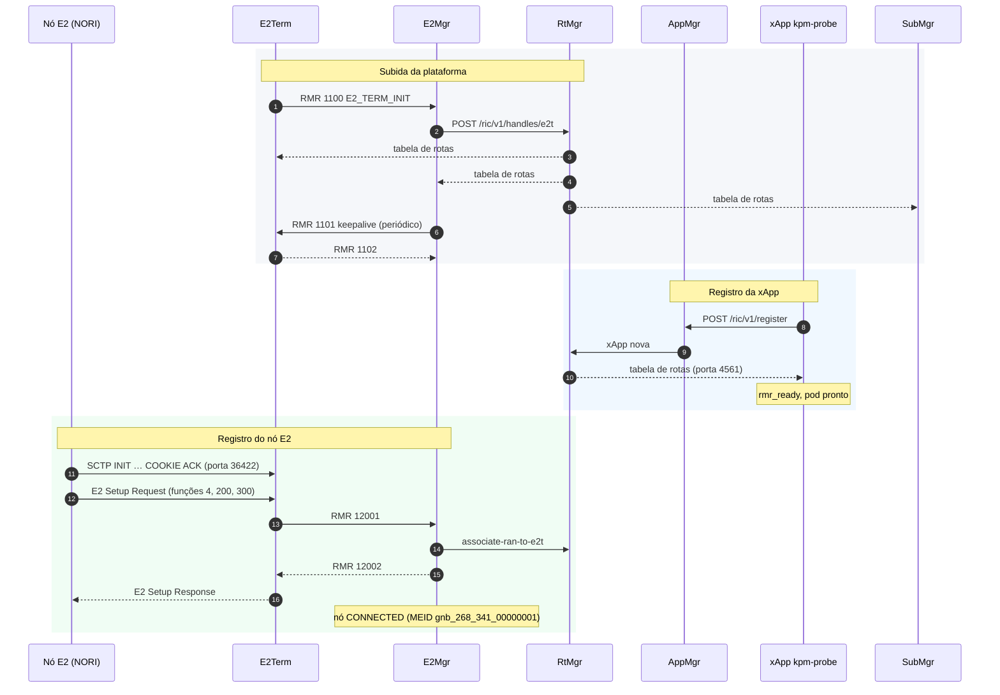
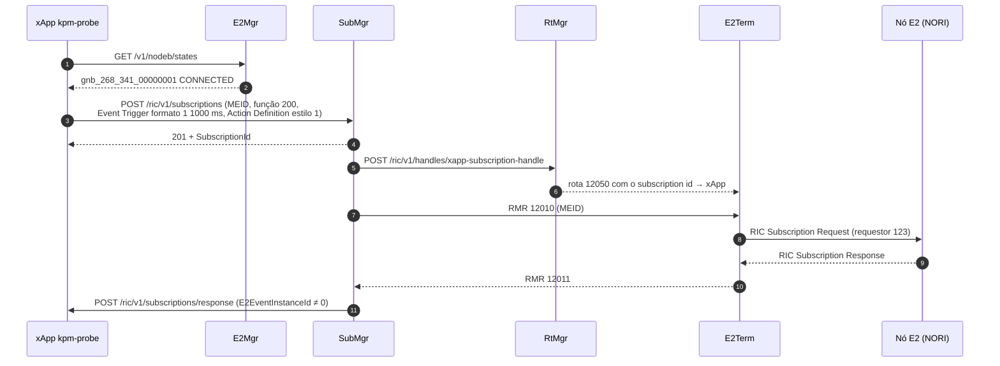
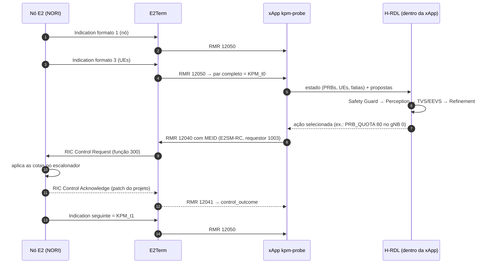
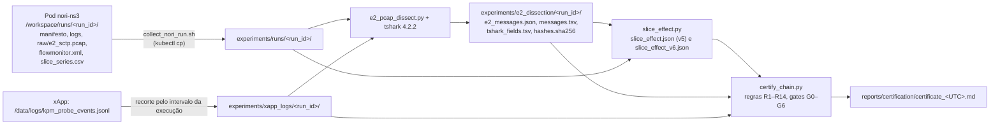
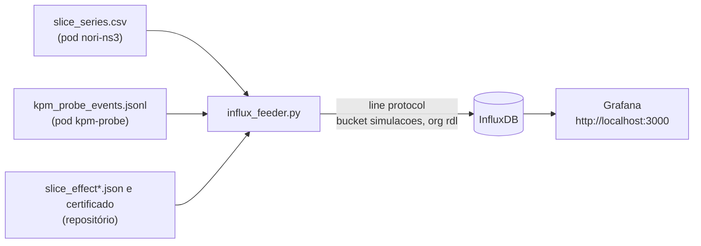
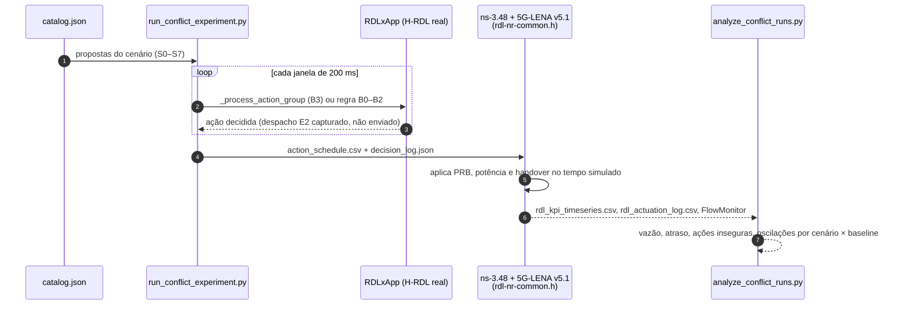

# 01 — Componentes e fluxos

Este é o mapa do projeto. Ele mostra:

- cada componente e se é simulado, emulado ou real;
- quem se registra em quem;
- os protocolos, as portas e os tipos de mensagem;
- o que cada ação faz em cada pilha;
- o papel do PCAP e do tshark;
- cada fluxo, da subida da bancada até o certificado.

Os detalhes ficam nos outros documentos:

- o algoritmo de decisão, em [02](02_modelo_de_decisao_h_rdl.md);
- os cenários, em [03](03_cenarios_e_conflitos.md);
- os comandos, em [04](04_instalacao_e_operacao.md) e [05](05_observabilidade_e_campanhas.md);
- os resultados, em [06](06_metodologia_e_resultados.md);
- os gates e os achados, em [07](07_certificacao_e_achados.md).

## 1. Visão geral

O projeto tem duas pilhas de simulação e uma xApp de decisão, a H-RDL.

| Pilha | O que é | E2 | Malha | Para que serve |
| :-- | :-- | :-: | :-: | :-- |
| **Bancada NORI** | ns-3.42 + 5G-LENA + módulo NORI, em tempo real, ligada a um Near-RT RIC O-RAN SC Release I de verdade | real (SCTP, E2AP v3.01) | fechada | certificar a cadeia KPM_t0 → H-RDL → E2SM-RC → ACK → KPM_t1 (gates G1–G5) |
| **Pilha nativa** | ns-3.48 + 5G-LENA v5.1, sem RIC | não há | aberta | comparar baselines B0–B3 em S0–S7 com cronograma de ações fixo (gate G0) |

```mermaid
flowchart LR
    subgraph WSL["WSL2 (Ubuntu 24.04) · k3s v1.26.5"]
        subgraph RICSIM["namespace ricsim"]
            NORI["Pod nori-ns3<br/>ns-3.42 + 5G-LENA + NORI<br/>(gNB e UEs simulados,<br/>agente E2 real)"]
            TCP["tcpdump<br/>raw/e2_sctp.pcap"]
        end
        subgraph RICPLT["namespace ricplt · Near-RT RIC Release I"]
            E2T["E2Term"]
            E2M["E2Mgr"]
            SUB["SubMgr"]
            RTM["RtMgr"]
            APP["AppMgr"]
            A1["A1 Mediator"]
            DB[("DBaaS<br/>(Redis / SDL)")]
        end
        subgraph RICXAPP["namespace ricxapp"]
            XA["xApp kpm-probe<br/>+ H-RDL embutida"]
        end
        subgraph MON["namespace monitoring"]
            INF[("InfluxDB")]
            GRA["Grafana"]
        end
    end
    subgraph REPO["Repositório (Windows / WSL)"]
        COL["collect_nori_run.sh"]
        DIS["e2_pcap_dissect.py<br/>+ tshark 4.2.2"]
        EFF["slice_effect.py"]
        CER["certify_chain.py<br/>(gates G0–G6)"]
    end

    NORI <-->|"SCTP 36422<br/>E2AP v3.01"| E2T
    TCP -. captura .- NORI
    E2T <-->|RMR| E2M
    E2T <-->|RMR| SUB
    E2T <-->|RMR| XA
    RTM -->|"tabelas de rota RMR"| E2T & SUB & E2M & XA
    XA -->|"REST /ric/v1/register"| APP
    XA -->|"REST /ric/v1/subscriptions"| SUB
    XA -->|"REST /v1/nodeb/states"| E2M
    E2M & SUB & APP --- DB
    RTM --- A1
    NORI -->|"PCAP, FlowMonitor,<br/>manifesto"| COL
    XA -->|"eventos JSONL"| COL
    COL --> DIS --> EFF --> CER
    NORI -. slice_series.csv .-> INF
    XA -. eventos .-> INF
    INF --> GRA
```

## 2. O que é simulado, emulado ou real

Três termos, usados sempre no mesmo sentido neste repositório:

- **Simulado:** existe só como modelo dentro do ns-3. Não há rádio, UE ou núcleo de verdade.
- **Emulado:** um componente simulado que expõe uma interface real para fora do simulador, em tempo real. Do lado de fora, ele se comporta como o equipamento de verdade.
- **Real:** o software de produção, sem modificação de comportamento, rodando como processo próprio.

| Componente | Natureza | Onde roda | Papel | Versão |
| :-- | :-- | :-- | :-- | :-- |
| gNB, UEs, canal de rádio, escalonador MAC (5G-LENA) | **simulado** | dentro do ns-3 do pod `nori-ns3` | a RAN 5G NR: um gNB, dois UEs (UE 0 na fatia SST 1 = eMBB, UE 1 na SST 2 = URLLC) | 5G-LENA `78b7179` |
| Núcleo EPC e host remoto (ns-3) | **simulado** | dentro do ns-3 | origem do tráfego UDP downlink para os UEs | ns-3.42 `ab4cce0` |
| Nó E2 do NORI (agente E2 do gNB) | **emulado** | dentro do ns-3, com `RealtimeSimulatorImpl` | o gNB simulado fala E2AP v3.01 real, por SCTP real, com o RIC; o tempo simulado segue o relógio de parede | NORI `8a30867` + patch `0001-rc-control-ack` |
| Near-RT RIC (E2Term, E2Mgr, SubMgr, RtMgr, AppMgr, A1 Mediator, DBaaS) | **real** | k3s, namespace `ricplt` | plataforma O-RAN SC: termina o E2, roteia RMR, gerencia subscrições e nós | Release I (`ric-dep` `0a6f18e`) |
| xApp `kpm-probe` | **real** | k3s, namespace `ricxapp` | assina KPM, decide com a H-RDL e envia o RIC Control | código do `src/` do commit implantado |
| H-RDL (núcleo de decisão) | **real** | biblioteca dentro da `kpm-probe` (e dentro do driver da pilha nativa) | Safety Guard → Perception → TVS/EEVS → Refinement | `src/core/`, `src/rdl_xapp.py` |
| xApps que propõem ações (xSlice, Energy Saving, Traffic Steering, …) | **emuladas por propostas** | não rodam como processos nos experimentos | as propostas vêm do catálogo (`conflicts/catalog.json`) ou de duas políticas de referência (`hrdl_slice_loop.py`), sempre iguais entre baselines e sementes | — |
| Pilha nativa (ns-3.48 + 5G-LENA v5.1) | **simulada** | WSL, fora do k3s | RAN e atuação inteiras dentro do simulador; sem E2 | ns-3.48 `d2add90`, 5G-LENA `cedcead` |
| `tcpdump` | **real** | pod `nori-ns3` | grava o SCTP/E2 do fio em `raw/e2_sctp.pcap` | do Ubuntu 20.04 |
| `tshark` | **real** | WSL (local) | decodificador independente do E2AP, gerado do ASN.1 oficial pelo Wireshark | 4.2.2 |
| InfluxDB e Grafana | **real** | k3s, namespace `monitoring` | séries ao vivo das simulações e vereditos | InfluxDB 2.7.4, Grafana 12.3.1 |

Duas consequências práticas:

- O que o PCAP mostra é tráfego E2 de verdade entre processos de verdade. Só a RAN atrás do nó E2 é modelo.
- O NORI aplica o Control a partir da thread do E2, enquanto o simulador corre em tempo real. Por isso o efeito começa quando o tempo simulado alcança o relógio de parede do instante do Control. A janela de medição é ancorada nesse instante (desenho v5, [06 §5.4](06_metodologia_e_resultados.md#54-fase-4-decisão-do-h-rdl-sobre-o-kpm_t0-e-efeito-na-ran-desenhos-v1v5-2026-11-08)).

## 3. Componentes do NORI

Tudo abaixo roda dentro de um único pod (`deploy/helm/nori-ns3`), compilado no próprio pod, sem Docker. O detalhe de cada peça está no [README do chart](../deploy/helm/nori-ns3/README.md).

| Peça | O que faz |
| :-- | :-- |
| ns-3.42 + `RealtimeSimulatorImpl` | núcleo de eventos discretos, sincronizado com o relógio de parede |
| 5G-LENA (`nr`) | gNB, UEs, canal, PHY/MAC; escalonador `NrRLMacSchedulerOfdma`, que recebe as cotas de PRB por fatia |
| NORI (`contrib/nori`), classe `E2Interface` | agente E2 do gNB: faz o E2 Setup, responde subscrições, envia KPM a cada `E2Interface::E2Periodicity` e aplica o RIC Control |
| Função RAN 4: E2SM-CCC | configuração em JSON; confirma o Control com ACK (já no NORI original) |
| Função RAN 200: E2SM-KPM v3.00 | relatórios KPM: formato 1 (métricas do nó) e formato 3 (métricas por UE), enviados em par a cada período |
| Função RAN 300: E2SM-RC v3.01 | Control estilo 2, ação 6: cotas de PRB por fatia. O patch do projeto faz esta função responder com ACK |
| `e2sim` (`da6f82f`) + `asn1c` (Nokia `8b8028a`) | pilha E2AP/SCTP usada pelo NORI, com o código ASN.1 v3.01 gerado pelo `asn1c` |
| Exemplo `nori-rc-slicing-demo` | o cenário base: um gNB, dois UEs, duas fatias, tráfego UDP |
| Variante `nori-rc-slicing-flowmon` (gerada em `scratch/`) | o exemplo, mais três saídas: `flowmonitor.xml` no fim, `slice_series.csv` a cada 0,5 s simulado, e linhas `[RDL-UE]` com o registro RRC dos UEs |
| `run.sh` | resolve o IP do E2Term, inicia o `tcpdump`, roda o cenário e grava `execution_manifest.json`, `logs/`, `raw/` e `hashes.sha256` em `/workspace/runs/<run_id>/` |
| `entrypoint.sh` | prepara dependências, compila nos commits fixados, aplica os patches de `files/patches/` e grava `BUILD_INFO.json` |

Parâmetros que a bancada fixa em toda execução:

- `--ns3::E2Interface::E2Periodicity=1`: um par KPM por segundo. O NORI ignora o Event Trigger da subscrição; o padrão (10 ms) gera ~12 mil Indications por minuto.
- `--ipE2TermRic=<IP>`: o NORI só aceita IP; `run.sh` resolve o serviço do E2Term.
- 300 Mb/s oferecidos por UE nos desenhos de efeito (saturação), e 50 MHz na avaliação v7.

O sensor KPM do NORI tem limites conhecidos, listados em [06 §5.4](06_metodologia_e_resultados.md#54-fase-4-decisão-do-h-rdl-sobre-o-kpm_t0-e-efeito-na-ran-desenhos-v1v5-2026-11-08):

- `RRU.PrbUsedDl` passa dos PRBs disponíveis;
- `DRB.UEThpDl` sai sempre 0.

Por isso o efeito do Control é medido no FlowMonitor (`slice_series.csv`), não no KPM.

## 4. Quem registra em quem

| # | Quem | Registra-se em / anuncia para | Como | Resultado |
| --: | :-- | :-- | :-- | :-- |
| 1 | E2Term | E2Mgr | RMR 1100 (`E2_TERM_INIT`), depois keepalive RMR 1101/1102 | o E2Mgr conhece a instância do E2Term |
| 2 | E2Mgr | RtMgr | REST `POST /ric/v1/handles/e2t` | o RtMgr cria as rotas de e para o E2Term e as distribui |
| 3 | RtMgr | todos os endpoints RMR (E2Term, E2Mgr, SubMgr, xApps) | tabela de rotas pela porta de rotas do RMR (4561 nas xApps) | cada processo sabe para onde mandar cada tipo de mensagem |
| 4 | xApp `kpm-probe` | AppMgr | REST `POST /ric/v1/register` | o AppMgr avisa o RtMgr, que passa a incluir a xApp nas rotas; a xApp só fica pronta quando recebe a tabela |
| 5 | Nó E2 do NORI | E2Term | SCTP para 36422; E2AP `E2 Setup Request` com as funções 4, 200 e 300 | o E2Term repassa ao E2Mgr (RMR 12001), que responde (12002); o nó fica `CONNECTED` com MEID `gnb_268_341_00000001` |
| 6 | E2Mgr | RtMgr | REST `associate-ran-to-e2t` | o RtMgr passa a rotear mensagens com esse MEID para o E2Term certo |
| 7 | xApp `kpm-probe` | E2Mgr (consulta) | REST `GET /v1/nodeb/states` | a xApp descobre os nós `CONNECTED` |
| 8 | xApp `kpm-probe` | SubMgr | REST `POST /ric/v1/subscriptions` (porta 8088) | o SubMgr pede a rota da subscrição ao RtMgr e faz a subscrição E2 no nó |
| 9 | SubMgr | xApp `kpm-probe` | REST `POST /ric/v1/subscriptions/response` (porta 8080 da xApp) | a xApp recebe o `E2EventInstanceId`; a subscrição está ativa |

O RtMgr da Release I tem o A1 Mediator fixo entre os componentes de plataforma. Sem o A1 Mediator implantado, cada distribuição de rotas espera um timeout. A criação da rota de subscrição estoura então o prazo do SubMgr ([04 §7.2](04_instalacao_e_operacao.md#72-near-rt-ric-o-ran-sc-release-i)).

Os registros 1, 2 e 3 precisam acontecer antes do 5. Depois de reinícios do WSL, o E2Mgr e o E2Term podem ficar prontos antes do RtMgr. Nesse caso o RtMgr não recebe o registro do E2Term, a rota 1101 não existe e o E2 Setup do NORI fica sem resposta. A correção é reiniciar em ordem: RtMgr (esperar ficar pronto), depois E2Mgr, depois E2Term ([04 §9](04_instalacao_e_operacao.md#9-solução-de-problemas), achado 51 de [07](07_certificacao_e_achados.md#4-registro-de-achados-e-correções-novembro-de-2026)).



## 5. Protocolos, portas e mensagens

### 5.1 Protocolos

| Protocolo | Entre | Uso |
| :-- | :-- | :-- |
| **E2AP v3.01** sobre **SCTP** (PPID 70), codificação APER | nó E2 ↔ E2Term | E2 Setup, Subscription, Indication, Control, ACK/Failure |
| **E2SM-KPM v3.00** (dentro do E2AP) | nó → xApp | conteúdo das Indications: métricas do nó (formato 1) e por UE (formato 3) |
| **E2SM-RC v3.01** (dentro do E2AP) | xApp → nó | conteúdo do Control: cotas de PRB por fatia |
| **RMR** (RIC Message Router, TCP) | componentes do RIC ↔ xApps | transporte interno; cada mensagem tem um tipo (`mtype`) e, quando vai para um nó, o MEID |
| **REST/HTTP** | xApp ↔ AppMgr, E2Mgr, SubMgr; E2Mgr ↔ RtMgr | registro, consulta de nós, pedido e notificação de subscrição |
| **Redis (SDL)** | E2Mgr, SubMgr, AppMgr ↔ DBaaS | estado persistente da plataforma |
| **Kubernetes API** | scripts ↔ k3s | implantação (Helm), `exec` no pod do NORI, cópia da evidência |
| **HTTP (line protocol)** | `influx_feeder.py` → InfluxDB | séries para o Grafana |

### 5.2 Portas

| Serviço | Endereço | Porta |
| :-- | :-- | :-- |
| E2Term SCTP | `service-ricplt-e2term-sctp-alpha.ricplt` | 36422 (NodePort 32222) |
| SubMgr REST | `service-ricplt-submgr-http.ricplt` | 8088 (a 8080 só responde ao health check) |
| E2Mgr REST | `service-ricplt-e2mgr-http.ricplt` | 3800 |
| AppMgr REST | `service-ricplt-appmgr-http.ricplt` | 8080 |
| xApp `kpm-probe` | `service-ricxapp-kpm-probe-http` / `-rmr` | 8080 (HTTP), 4560 (RMR dados), 4561 (RMR rotas) |
| InfluxDB | `svc/influxdb2.monitoring` (port-forward local) | 80 → 18086 |
| Grafana | `svc/grafana.monitoring` (port-forward local) | 80 → 3000 |

### 5.3 Tipos de mensagem RMR

| `mtype` | Nome | De → para | Papel na cadeia |
| --: | :-- | :-- | :-- |
| 1100 | `E2_TERM_INIT` | E2Term → E2Mgr | registro do E2Term |
| 1101 / 1102 | `E2_TERM_KEEP_ALIVE_REQ` / `_RESP` | E2Mgr ↔ E2Term | vida do E2Term |
| 12001 / 12002 | `RIC_E2_SETUP_REQ` / `_RESP` | E2Term ↔ E2Mgr | registro do nó E2 |
| 12010 | `RIC_SUB_REQ` | SubMgr → E2Term | pedido de subscrição para o nó |
| 12011 / 12012 | `RIC_SUB_RESP` / `RIC_SUB_FAILURE` | E2Term → SubMgr | resposta do nó |
| 12020 / 12021 | `RIC_SUB_DEL_REQ` / `_RESP` | SubMgr ↔ E2Term | remoção quando o nó cai ou a xApp para |
| 12050 | `RIC_INDICATION` | E2Term → xApp | KPM do nó, roteado pelo subscription id |
| 12040 | `RIC_CONTROL_REQ` | xApp → E2Term | Control para o nó (buffer RMR com o MEID) |
| 12041 / 12042 | `RIC_CONTROL_ACK` / `RIC_CONTROL_FAILURE` | E2Term → xApp | desfecho do Control |
| 30000 | `RDL_ACTION_PROPOSAL` (do projeto) | xApps → xApp RDL completa | proposta em JSON; só na `RDLxApp`, não na bancada ([seção 10](#10-xapp-rdl-completa-rdlxapp-projeto-sem-e2-real)) |

### 5.4 Identificadores E2

| Identificador | Valor na bancada | Origem |
| :-- | :-- | :-- |
| MEID do nó | `gnb_268_341_00000001` | nome que o E2Mgr dá ao nó a partir do Global gNB ID (PLMN e gNB ID) do E2 Setup |
| RAN function KPM | 200 | anunciada no E2 Setup; usada na subscrição |
| RAN function RC | 300 | anunciada no E2 Setup; usada no Control |
| RAN function CCC | 4 | anunciada no E2 Setup; fora da cadeia. O item dela traz o OID do KPM, e o dissecador a classifica como KPM |
| RICrequestID da subscrição | requestor 123 (SubMgr), instância = subscription id | atribuído pelo SubMgr |
| RICrequestID do Control | requestor 1003 (xApp), instância 1, 2, … | atribuído pela xApp; no B0 cada Control tem instância própria |
| OID do E2SM-RC anunciado | `1.3.6.1.4.1.53148.1.3.2.3` (NORI) | o tshark 4.2 só conhece `…53148.1.1.2.3` e cai no dissector KPM (aviso "Dissector version mismatch") |

## 6. Tabela de ações

### 6.1 Parâmetros e o que cada pilha faz com eles

O catálogo canônico de parâmetros está em `src/e2/rc/control_parameter.py`. Qualquer outro parâmetro é recusado (*default-deny*).

| Parâmetro | Faixa | Pilha nativa (dentro do ns-3) | Bancada NORI (E2SM-RC) |
| :-- | :-- | :-- | :-- |
| `PRB_QUOTA` | 0–100 % | máscara de RBGs do escalonador do gNB alvo | **atuável só no gNB 0:** Control com cotas por fatia; eMBB (SST 1) recebe o teto `v`, URLLC (SST 2) recebe `100 − v` |
| `TX_POWER` | −10 a 43 dBm | `NrGnbPhy::SetTxPower` | não atuável: o E2SM-RC do NORI não tem potência; decidida e registrada em `not_actuated` |
| `HANDOVER` | ID da célula | handover X2, escalonado em 10 ms por UE | não atuável: o NORI tem um único gNB e só registra handover em log |
| `SCHEDULER_WEIGHT` | 1–100 | não usado nos cenários | não atuável |
| qualquer parâmetro nos gNBs 1–3 | — | atuado no gNB correspondente | não atuável (um único gNB) |

Conteúdo do Control E2SM-RC que a xApp envia (o que o NORI decodifica em `model/ric-control-message.cc`):

- Control Header Format 1, estilo 2, ação 6;
- Control Message Format 1, parâmetro 1 (lista de políticas);
- por fatia: 3 = SST, 4 = PRB máximo (o teto), 5 = PRB mínimo, 6 = PRB dedicado.

O codec é [`src/e2/v3/codec.py`](../src/e2/v3/codec.py).

### 6.2 Modos de decisão da xApp `kpm-probe`

| `rc.decision` | Quem decide | Propostas | `decision_source` | Aceito no G4 |
| :-- | :-- | :-- | :-- | :-: |
| `hrdl` | H-RDL sobre o KPM_t0 ([`hrdl_slice_loop.py`](../src/closed_loop/hrdl_slice_loop.py)) | duas políticas de referência: `xapp-qos-xslice` (prioridade 90) e `xapp-embb-throughput` (prioridade 60) | `H_RDL` | sim |
| `catalog` + baseline B3 | H-RDL ([`catalog_loop.py`](../src/closed_loop/catalog_loop.py)) | as do cenário do catálogo (`/data/rdl_scenario`) | `H_RDL` | sim |
| `catalog` + B0/B1/B2 | `decide_baseline` | as do cenário do catálogo | `BASELINE_B0` / `_B1` / `_B2` | não (são os comparadores do G5) |
| `fixed` | ninguém: cotas de `rc.sliceQuotas` | — | `FIXED_PROBE` | não |

### 6.3 Baselines

| Baseline | Regra | Pilha nativa | Bancada NORI |
| :-: | :-- | :-- | :-- |
| B0 | sem coordenação: cada proposta é aplicada na chegada | ação aplicada na chegada | um Control por proposta atuável, em sequência; cada ACK correlacionado pelo `RICInstanceID` |
| B1 | FIFO por janela e alvo | aplicada no fechamento da janela de 200 ms | um Control com a primeira proposta |
| B2 | prioridade estática por janela e alvo | idem | um Control com a de maior prioridade |
| B3 | H-RDL (Safety Guard, TVS, EEVS, Refinement) | idem | um Control com a ação selecionada pela H-RDL |

A decisão de cada cenário (S0–S8) na bancada está em [03 §4](03_cenarios_e_conflitos.md#4-cenários-na-bancada-nori-porte-de-s0s8-com-e2-real).

## 7. PCAP ou tshark?

Os dois. São coisas diferentes e a certificação exige ambos.

| | O que é | Quem produz | Papel |
| :-- | :-- | :-- | :-- |
| **PCAP** (`raw/e2_sctp.pcap`) | os bytes do fio: todo o SCTP entre o nó E2 e o E2Term | `tcpdump -i any "sctp or port 36422"`, dentro do pod do NORI, iniciado pelo `run.sh` | a **evidência**; seu sha256 vai para `hashes.sha256` e o certificador confere |
| **Dissecador próprio** (`e2_pcap_dissect.py`) | leitor de PCAP, remontagem SCTP e cabeçalho APER do E2AP-PDU | o projeto, só com a biblioteca padrão; não usa o codec da xApp | classifica cada mensagem (Setup, Subscription, Indication, Control, ACK) e acha a cadeia KPM_t0 → Control → ACK → KPM_t1 |
| **tshark** (Wireshark 4.2.2) | decodificador gerado do ASN.1 oficial do E2AP | terceiros, independente do projeto | **confirmação independente**: mensagem a mensagem, compara tipo de PDU, código de procedimento, RICrequestID e RANfunctionID |

Regras:

- O R14 só fica `PASS` quando o dissecador e o tshark concordam em todas as mensagens e o hash do PCAP confere.
- Sem tshark, o R14 fica `WARN` e os gates E2 (G1, G3, G4) não são certificados.
- Cada Indication do PCAP é casada por sha256 com a recebida pela xApp (`kpm_probe_events.jsonl`). O Control e o ACK também são casados byte a byte com o registro da xApp.
- O tshark confirma o E2AP do Control. O conteúdo E2SM-RC não, por causa do OID: ele é conferido pelo codec, nos testes de ida e volta, e pelo próprio NORI, que só envia o ACK depois de decodificar ao menos uma cota.
- Ao vivo, o `e2ap_live.sh` canaliza o `tcpdump` do pod direto para o tshark local ([05 §2.2](05_observabilidade_e_campanhas.md#22-protocolo-e2ap-tcpdump-do-pod-direto-para-o-tshark-local)). Isso serve só para acompanhar: a evidência é o PCAP gravado.

## 8. Fluxos

### 8.1 Subida e registro

Ver a [seção 4](#4-quem-registra-em-quem). Comandos: [04 §7](04_instalacao_e_operacao.md#7-bancada-e2-real-near-rt-ric-nori-e-xapp).

### 8.2 Subscrição KPM



O Event Trigger e a Action Definition são codificados em APER com `asn1tools`, a partir do ASN.1 do próprio NORI, baixado no commit fixado e conferido por sha256. Se o nó cai, a xApp apaga a subscrição (RMR 12020/12021, via SubMgr).

### 8.3 Indications KPM e o par do período

1. A cada `E2Periodicity`, o NORI envia duas Indications com menos de 1 ms entre elas: formato 1 (nó) e formato 3 (UEs).
2. O E2Term as entrega à xApp por RMR 12050. A ordem pode vir trocada.
3. A xApp decodifica as duas e registra cada uma no evento `kpm`, com o sha256 do payload.
4. A decisão só dispara quando a Indication recebida **completa o par do período**: nó e UEs, em qualquer ordem, chegados a no máximo 0,5 s um do outro (`kpm_pairing.pair_complete`, achado 48).
5. O gatilho é a N-ésima Indication (`rc.afterIndications`, 12 nas campanhas).
6. A decisão registra o sha256 das duas Indications usadas: `kpm_node_sha256` e `kpm_ues_sha256`.

### 8.4 Decisão, Control e ACK (o closed loop)



Tempos medidos:

| Medida | Valor | Fonte |
| :-- | :-- | :-- |
| Decisão do H-RDL (TVS) | 1,3 ms | `nori_hrdl_loop_seed1` |
| Control → ACK, sem decisão (cotas fixas) | 1,9 ms | `nori_rc_control_seed1` |
| Control → ACK, incluindo a decisão | 14,8 ms | `nori_hrdl_loop_seed1` |
| Período KPM | 1 s (um par) | `E2Periodicity=1` |
| Início do efeito na RAN | quando o tempo simulado alcança o relógio de parede do Control (~12 s simulados depois, em 40 s de simulação) | desenho v4/v5 |

Se o nó responder RIC Control Failure (12042), a xApp registra `control_outcome` com a falha. Se não houver nada atuável, a xApp registra `control_decision` e não envia Control.

### 8.5 Medição do efeito na RAN

1. A variante do NORI grava `raw/slice_series.csv` a cada 0,5 s simulado: contadores do FlowMonitor por UE/fatia, com o tempo simulado e o relógio de parede.
2. `slice_effect.py` toma o instante do Control no PCAP, converte para tempo simulado e acha o instante de aplicação.
3. As cotas vêm dos bytes do Control no PCAP, não do log da xApp.
4. A vazão antes e depois é comparada com a previsão. O resultado sai como `CONSISTENT` ou `INCONSISTENT`.
5. Há duas regras:
   - **v5:** curva absoluta de ~3,8 Mb/s por ponto percentual de PRB.
   - **v6:** razão relativa à vazão sem restrição. É a regra adotada no G4 para execuções a partir de 2026-11-09T02:51:46Z.

A regra v7 mostrou que a cota age sobre PRBs absolutos da portadora ([06 §5.7](06_metodologia_e_resultados.md#57-avaliação-do-desenho-v7-banda-de-50-mhz-sementes-40014005-2026-11-09)).

### 8.6 Coleta da evidência e certificação



| Gate | O que exige | Onde vem a prova |
| :-: | :-- | :-- |
| G0 | manifestos completos, commits iguais ao `versions.lock` | manifesto + `BUILD_INFO.json` |
| G1 | E2 Setup, Subscription e Indication externos | PCAP + tshark (R14) |
| G2 | decisão H-RDL funcional | testes (só local) |
| G3 | Control e ACK/Failure correlacionados | PCAP + registro da xApp |
| G4 | cadeia KPM_t0 → decisão H-RDL → Control → ACK → KPM_t1, em ordem, com efeito `CONSISTENT` | PCAP + xApp + `slice_effect` |
| G5 | ≥ 30 unidades (cenário, semente) pareadas em B0–B3 com E2 real | campanha do G5 |
| G6 | G4 + G5 + reprodução independente | — |

O estado de cada gate está em [07 §3](07_certificacao_e_achados.md#3-gates-de-evidência).

### 8.7 Observabilidade ao vivo



| Measurement | Origem | Conteúdo |
| :-- | :-- | :-- |
| `nori_slice` | `slice_series.csv` | vazão e atraso por fatia, com o tempo simulado |
| `xapp_kpm_node`, `xapp_kpm_ue` | eventos `kpm` | KPM decodificado do nó e por UE |
| `xapp_indication` | eventos `rmr_message` | chegada das Indications |
| `xapp_decision`, `xapp_control`, `xapp_control_outcome` | eventos da decisão, do Control e do desfecho | decisão, cotas enviadas e ACK/Failure |
| `campanha_execucao` | `slice_effect.json` / `slice_effect_v6.json` | veredito de efeito por execução |
| `certificado` | certificado mais recente | estado dos gates |

As abas de terminal (NORI, E2AP pelo tshark, xApp, RIC, Kubernetes, registro de UEs) estão em [05](05_observabilidade_e_campanhas.md).

### 8.8 Pilha nativa (offline, sem E2)



A pilha nativa roda em malha aberta: o cronograma é calculado antes e não há KPM nem realimentação. O relógio do Refinement é trocado pelo relógio simulado. Ela só pode certificar o G0. Detalhes em [06 §2](06_metodologia_e_resultados.md#2-desenho).

## 9. Onde está cada coisa

| Área | Caminho |
| :-- | :-- |
| H-RDL (núcleo) | `src/core/` (Perception, Reasoning TVS/EEVS, Refinement), `src/rdl_xapp.py` |
| Laços da bancada | `src/closed_loop/` (`hrdl_slice_loop.py`, `catalog_loop.py`, `kpm_pairing.py`) |
| Codec E2 v3.01 da bancada | `src/e2/v3/codec.py` |
| Codec E2 local da `RDLxApp` (não normativo) | `src/e2/e2ap/`, `src/e2/kpm*`, `src/e2/rc_encoder.py` |
| Charts Helm | `deploy/helm/nori-ns3`, `deploy/helm/xapp-kpm-probe`, `deploy/helm/observability`, `deploy/ric/` |
| Cenários e catálogo | `simulations/ns3/`, `simulations/ns3/conflicts/catalog.json` |
| Execução e campanhas | `scripts/run_nori_scenario.sh`, `scripts/run_nori_campaign.sh`, `scripts/collect_nori_run.sh` |
| Certificação | `scripts/certification/` (`e2_pcap_dissect.py`, `slice_effect.py`, `certify_chain.py`) |
| Observabilidade | `scripts/observe/` |
| Política e versões | `reproducibility/provenance_policy.yaml`, `reproducibility/versions.lock` |
| Evidência | `experiments/runs/`, `experiments/xapp_logs/`, `experiments/e2_dissection/`, `reports/` |

## 10. xApp RDL completa (`RDLxApp`): projeto sem E2 real

A `RDLxApp` (`src/rdl_xapp.py`, chart `deploy/helm/iqos-xapp-rdl`) é a xApp completa do projeto:

- recebe propostas de outras xApps por RMR 30000;
- assina KPM pela REST do SubMgr;
- despacha o Control pelo `ControlDispatcher`, com timeout e rollback.

O pipeline de decisão dela é o mesmo que a `kpm-probe` chama na bancada. O transporte e o codec dela, porém, **nunca foram exercitados contra um nó E2 e um RIC reais**. Os codecs são locais e não normativos ([02 §6.4](02_modelo_de_decisao_h_rdl.md#64-codecs)). Na bancada, quem fala E2 é a `kpm-probe`, com o codec v3.01. Os tempos abaixo são parâmetros de configuração, não medições.

```mermaid
sequenceDiagram
    autonumber
    participant X as xApps (xSlice, Energy Saving, Traffic Steering)
    participant R as xApp RDL
    participant S as SubMgr
    participant T as E2Term
    participant N as Nó E2

    R->>S: POST /ric/v1/subscriptions (KPM a cada 200 ms)
    S-->>R: SubscriptionId (SUBSCRIBING)
    S->>T: RIC Subscription Request
    T->>N: RIC Subscription Request
    N-->>T: RIC Subscription Response
    S->>R: POST /ric/v1/subscriptions/response → READY
    N->>T: RIC Indication (KPM)
    T->>R: RMR 12050
    par propostas concorrentes (RMR 30000, JSON)
        X->>R: xSlice: PRB_QUOTA 75 %, prioridade 90
    and
        X->>R: Energy Saving: PRB_QUOTA 30 %, prioridade 65
    end
    Note over R: janela de 200 ms (fecha antes se prioridade ≥ 80);<br/>Safety Guard → Perception → TVS → EEVS → Refinement
    R->>T: RMR 12040 com MEID
    T->>N: RIC Control Request
    alt aceito
        N-->>T: ACK → RMR 12041: ação vira estado confirmado
    else recusado
        N-->>T: Failure → RMR 12042: FAILED, sem rollback
    else sem resposta em 5 s
        R->>T: rollback ao último valor confirmado (novo RICrequestID, noAck)
    end
```

| Mensagem | Transporte | Identificador | Origem → destino | Código |
| :-- | :-- | :-- | :-- | :-- |
| Pedido de subscrição | REST | `POST /ric/v1/subscriptions` | xApp → SubMgr | `src/infrastructure/subscription_manager.py` |
| Notificação de subscrição | REST | `POST /ric/v1/subscriptions/response` | SubMgr → xApp | `src/observability/health_server.py`, `RDLxApp._subscription_notification_handler` |
| RIC Indication | RMR | 12050 | E2Term → xApp | `RDLxApp._kpm_indication_handler` |
| Proposta de ação | RMR | 30000 | xApp → xApp RDL | `RDLxApp._action_proposal_handler` |
| RIC Control Request | RMR com MEID | 12040 | xApp RDL → E2Term | `ControlDispatcher.dispatch_control`, `rmr_transport.send_rmr_message` |
| RIC Control Acknowledge | RMR | 12041 | E2Term → xApp RDL | `ControlDispatcher.handle_ack` |
| RIC Control Failure | RMR | 12042 | E2Term → xApp RDL | `ControlDispatcher.handle_failure` |

| Parâmetro de tempo | Valor | Onde |
| :-- | :-- | :-- |
| Janela de decisão | 200 ms | `RDLxApp.WINDOW_DURATION_MS` |
| Histerese por alvo | 1000 ms | `Refinement.config["minimum_control_interval_ms"]` |
| Timeout de controle | 5 s | `ControlDispatcher(default_timeout_s=5.0)` |
| Período KPM pedido | 200 ms | backend (`default_kpm_period_ms`) |
| Retenção de transações finalizadas | 5 min | `ControlDispatcher.prune_finalized` |

Versões das figuras para a dissertação: [`figures/diagrama_sequencia_compacto_dissertacao.mermaid`](figures/diagrama_sequencia_compacto_dissertacao.mermaid), [`.puml`](figures/diagrama_sequencia_compacto_dissertacao.puml) e [`.tex`](figures/diagrama_sequencia_compacto_dissertacao.tex).
