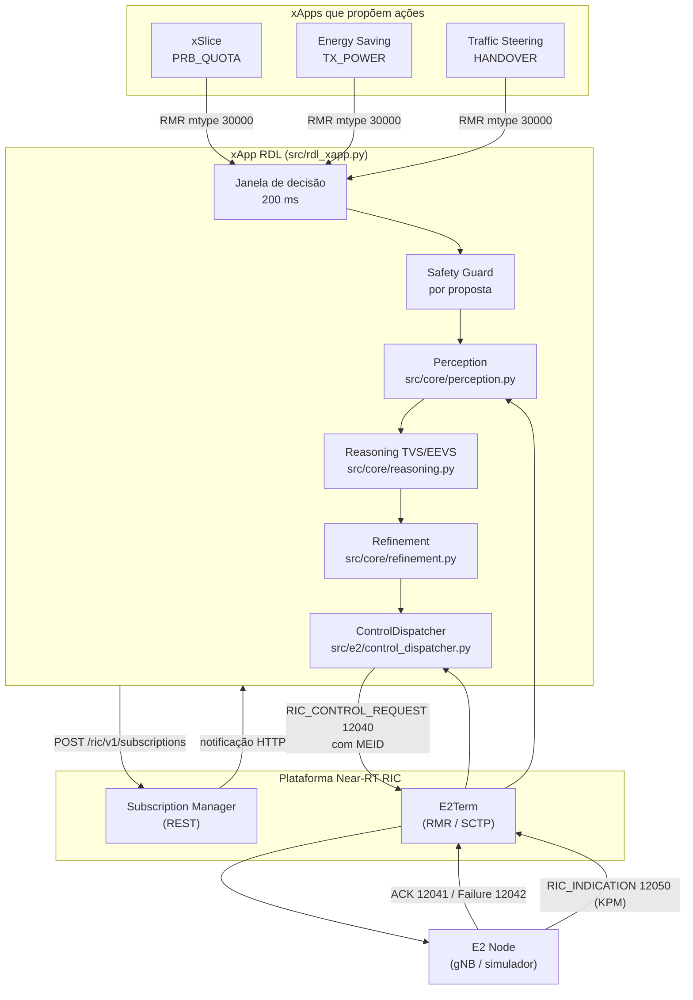

# 02 — Modelo de decisão da H-RDL

Este documento descreve o modelo de decisão da xApp RDL na Fase 1 (H-RDL). O mapa dos componentes, protocolos e fluxos da bancada está em [01](01_componentes_e_fluxos.md). Cada seção indica os arquivos de referência; quando o texto e o código divergirem, o código prevalece e o documento deve ser corrigido.

## 1. Papel no Near-RT RIC

A xApp RDL fica entre as xApps que querem controlar a RAN e o E2 Node. Ela recebe propostas de controle, detecta conflitos, decide quais ações aplicar e as envia como E2SM-RC. Também consome telemetria E2SM-KPM, usada pelos modelos de decisão.



## 2. Modos de operação

| Modo (`RDL_MODE`) | Comportamento |
| :-- | :-- |
| `OFFLINE_SIMULATION` (padrão) | RMR simulado que nunca reporta envio com sucesso; memória local em vez de SDL; capacidades estáticas registradas para `gnb_01`; subscrição só se `SUBMGR_URL` estiver definido. Usado em testes e nos experimentos de simulação. |
| `O_RAN_INTEROP` | Exige `ricxappframe`/RMR, SDL e `RAN_BACKEND` explícito; rejeita propostas externas (o transporte não autentica a xApp emissora); **bloqueia despacho e fica fora de `READY`** enquanto `protocol_interoperability_verified` for falso no backend, isto é, enquanto o codec E2 não for validado contra o ASN.1 oficial e uma implementação independente. |

Estados de saúde (`src/observability/health_server.py`): `STARTING`, `SUBSCRIBING`, `READY`, `DEGRADED`, `ERROR`, `STOPPED`. O endpoint `/ready` só responde 200 em `READY`.

## 3. Entrada de propostas

As propostas chegam por RMR (`RDL_ACTION_PROPOSAL`, mtype 30000) como JSON:

```json
{"xapp_id": "xslice", "node_id": "gnb_01", "parameter": "PRB_QUOTA", "value": 75, "priority": 90}
```

Validação na entrada (`RDLxApp._action_proposal_handler`): payload em bytes de até 64 KiB, objeto JSON, `xapp_id`/`node_id` não vazios de até 128 caracteres, `value` numérico finito (constantes como `NaN` são rejeitadas), `priority` inteiro em [0, 100]. O buffer da janela aceita até 4096 propostas.

O campo `xapp_id` é declarado pelo cliente e **não é credencial**; por isso o modo estrito rejeita propostas externas.

## 4. Pipeline de decisão

Implementado em `RDLxApp._process_action_group`. A cada fechamento de janela (200 ms após a primeira proposta, ou antes, se chegar proposta com prioridade ≥ 80):

### 4.0 Safety Guard por proposta

Cada proposta passa por `Refinement.check_bounds` antes de qualquer arbitragem: parâmetro conhecido, valor finito, prioridade válida, formato (inteiro para `PRB_QUOTA`, `SCHEDULER_WEIGHT` e `HANDOVER`; no máximo uma casa decimal para `TX_POWER`) e limites (seção 5). Propostas reprovadas são descartadas individualmente.

Motivo: antes desse passo, uma ação insegura que conflitasse com uma legítima fazia a validação rejeitar a resolução inteira, e uma xApp maliciosa conseguia vetar ações legítimas (observado no cenário S7).

### 4.1 Percepção: conflitos agrupados por alvo

`Perception.detect_action_group` não compara proposta a proposta; agrupa por alvo, o que mantém o número de eventos limitado por O(P²) por nó (P = parâmetros), independentemente do volume de propostas.

- Propostas repetidas da mesma xApp para o mesmo (nó, parâmetro) são deduplicadas (vale a mais recente).
- **Conflito direto:** um evento por (nó, parâmetro) quando há candidatos de xApps diferentes com valores diferentes. A última ação confirmada pela RAN para aquele alvo (a *incumbente*) entra como candidata, salvo se a própria dona fez nova proposta.
- **Conflito indireto:** um evento por par de parâmetros do mesmo nó que compartilham KPIs no grafo de dependências abaixo, com pelo menos um parâmetro com proposta nova e xApps diferentes envolvidas.

| Parâmetro | KPIs afetados |
| :-- | :-- |
| `PRB_QUOTA` | `DRB.UEThpDl`, `RRU.PrbUsedDl` |
| `SCHEDULER_WEIGHT` | `DRB.UEThpDl`, `DRB.RlcSduDelayDl` |
| `TX_POWER` | `L1M.DL-sinr`, `DRB.UEThpDl` |
| `HANDOVER` | `DRB.UEThpDl`, `RRU.PrbUsedDl` |
| `VERTICAL_DOWNTILT`, `BEAM_WEIGHTS` | `L1M.DL-sinr`, `DRB.UEThpDl` |
| `SENSING_RATIO`, `LOAD_THRESHOLD` | `RRU.PrbUsedDl`, `DRB.UEThpDl` |
| `PING_INTERVAL` | `DRB.RlcSduDelayDl` |

**Limitação:** os conflitos são agrupados por `node_id`. Conflitos entre células — por exemplo, Traffic Steering movendo UEs para uma célula que o Energy Saving desliga, ou ping-pong de handover entre duas células — não são detectados.

### 4.2 Estágio 1 — TVS (conflitos diretos)

Para cada conflito direto, `Reasoning._resolve_direct_conflict` escolhe **um** vencedor maximizando

$$U_{TVS}(a) = 0{,}40\,s_{SLA} + 0{,}25\,s_{vazão} + 0{,}15\,s_{energia} + 0{,}10\,s_{estab} + 0{,}10\,s_{prio}$$

com desempate determinístico por (utilidade, prioridade, menor |valor|, `action_id`). As componentes são heurísticas calibradas à mão, não modelos analíticos completos:

| Componente | Regra no código |
| :-- | :-- |
| $s_{vazão}$ | `PRB_QUOTA`: v/100 limitado a [0,05; 1]; `TX_POWER`: 0,4 + 0,6·(v + 10)/(P_max + 10) limitado a [0,1; 1]; demais: 0,70 |
| $s_{SLA}$ | prioridade ≥ 90: 0,98 se PRB ≥ 70, 0,45 se potência < 15 dBm, senão 0,85; ≥ 75: 0,82; ≥ 60: 0,75; senão 0,65. Zera para xApps de energia quando o KPM do nó indica atraso acima de 5 ms. |
| $s_{energia}$ | `TX_POWER`: modelo linear de potência (4 TRX, P₀ = 130 W, ΔP = 4,7) normalizado entre consumo mínimo e máximo; `PRB_QUOTA`: max(0,2; 1 − v/150); demais: 0,60 |
| $s_{estab}$ | 0,75 para `HANDOVER`, 0,90 para os demais |
| $s_{prio}$ | prioridade/100 limitada a [0,1; 1] |

### 4.3 Estágio 2 — EEVS (conflitos indiretos)

Os conflitos indiretos são resolvidos só entre os vencedores do estágio 1 (perdedores não voltam a competir). `Reasoning._resolve_indirect_conflict` escolhe o subconjunto S que maximiza

$$U_{EEVS}(S) = 0{,}45\,QoS(S) + 0{,}20\,\overline{energia}(S) + 0{,}15\,J(S) - 0{,}35\,viol(S)$$

- $QoS$: SLA médio ponderado pela prioridade; $J$: índice de Jain sobre os SLAs; $viol$: (prioridade máxima do conflito − prioridade máxima de S)/30, mais 0,20 se S combina uma xApp de energia com uma ação de prioridade ≥ 90.
- Subconjuntos com dois valores diferentes para o mesmo (nó, parâmetro) valem −∞.
- A busca exata enumera só subconjuntos compatíveis (no máximo uma ação por alvo): $\prod_k (n_k+1) - 1$ combinações. Acima de `max_exact_subsets` (padrão $2^{16}-1$) usa-se uma heurística gulosa determinística, sem garantia de ótimo.
- Alvos sem vencedor no EEVS são bloqueados no lote.

Se o vencedor de um alvo é a incumbente, o valor atual é mantido e nada é reenviado.

Confiança registrada: 0,92 (TVS), 0,88 (EEVS exato), 0,70 (EEVS guloso). A resolução por histórico (`_resolve_by_history`) existe no código, mas a memória sempre retorna lista vazia, então ela não é usada.

### 4.4 Refinement

`Refinement.validate` (resoluções) e `validate_single_action` (propostas sem conflito) verificam:

- limites e formato (seção 5);
- **histerese**: no máximo um controle por alvo a cada 1000 ms (`minimum_control_interval_ms`);
- **slew-rate** (desligado por padrão): variação máxima de 3 dB em `TX_POWER` e 30 pontos em `PRB_QUOTA` em relação ao último valor confirmado pela RAN, lido da Perception. Ligado sem fonte de estado confirmado, falha fechado.

Os carimbos de tempo da histerese só são gravados depois que o lote inteiro é decidido.

### 4.5 Seleção e despacho

Uma ação por alvo é selecionada: o vencedor arbitrado ou, sem conflito, a proposta de maior prioridade (convergentes têm o mesmo valor). A `RDLDecision` é formalizada antes do despacho e cada ação gera um `RIC_CONTROL_REQUEST`.

## 5. Parâmetros controláveis

Catálogo canônico (`src/e2/rc/control_parameter.py`); outros parâmetros são rejeitados (*default-deny*).

| Parâmetro | ID | Faixa | Unidade |
| :-- | :-: | :-- | :-- |
| `PRB_QUOTA` | 1 | 0–100 | % |
| `SCHEDULER_WEIGHT` | 2 | 1–100 | peso |
| `TX_POWER` | 3 | −10 a 43 (ou o máximo anunciado pela capacidade do nó) | dBm |
| `HANDOVER` | 4 | 0–65535 | ID da célula de destino |

## 6. Integração E2

### 6.1 Subscrição E2SM-KPM

`SubscriptionManager` (`src/infrastructure/subscription_manager.py`) usa a API REST do Subscription Manager do O-RAN SC:

1. `POST /ric/v1/subscriptions` com corpo `SubscriptionParams` (`ClientEndpoint` com host e portas, `Meid`, `RANFunctionID`, Event Trigger e Action Definition E2SM-KPM como listas de octetos, `TimeToWait` válido).
2. A resposta só traz o `SubscriptionId`; a xApp fica em `SUBSCRIBING`.
3. O resultado E2 chega por `POST /ric/v1/subscriptions/response` no servidor HTTP da xApp. Com `E2EventInstanceId` > 0 e sem `ErrorCause`, a xApp passa a `READY`; caso contrário, a subscrição é descartada e, sem nenhuma ativa, a xApp vai a `DEGRADED`.

### 6.2 Controle E2SM-RC

`ControlDispatcher.dispatch_control`:

- valida o parâmetro e a capacidade anunciada pelo nó, aloca `RICrequestID` (correlação por nó, RAN Function, requestor e instância) e codifica pelo backend;
- envia por `send_rmr_message` (`src/infrastructure/rmr_transport.py`), que aloca o buffer RMR **com o MEID** do E2 Node. O `rmr_send(payload, mtype, retries)` do `ricxappframe` não define MEID e, sem ele, o E2Term não roteia a mensagem;
- ACK e Failure são correlacionados pela chave completa; RICrequestID duplicado enquanto pendente é rejeitado.

### 6.3 Timeout, falha e rollback

| Evento | Ação |
| :-- | :-- |
| `RIC_CONTROL_ACK` | transação `ACKNOWLEDGED`; a ação passa a ser o estado confirmado (incumbente) |
| `RIC_CONTROL_FAILURE` | transação `FAILED`; **sem rollback** (`NOT_REQUIRED`), pois o E2 Node não aplicou o controle |
| timeout (padrão 5 s) | transação `TIMEOUT`; rollback para o último valor confirmado, se conhecido e dentro dos limites |

O rollback é uma nova transação (RICrequestID próprio, `noAck`) codificada pelo mesmo backend; `SENT_UNCONFIRMED` significa só que o RMR aceitou o envio. Transações finalizadas são removidas após 5 minutos e os históricos têm tamanho máximo.

### 6.4 Codecs

| Codec | Situação |
| :-- | :-- |
| E2AP (`src/e2/e2ap/`) | módulo pycrate reduzido escrito no projeto, não gerado do ASN.1 oficial |
| E2SM-KPM (`src/e2/kpm*`) | codec local; os *golden vectors* foram gerados pelo próprio encoder (validação circular) |
| E2SM-RC (`src/e2/rc_encoder.py`) | **perfil simplificado, não normativo**: falta o CHOICE `controlHeader-Format1` com UEID e os `RANParameter-ValueType`; `ranParameterName` não existe na norma |

Um E2 Node conforme rejeitaria os controles. O NORI oficial usa E2AP/E2SM **v3.01**; a interoperabilidade exige substituir os codecs por código gerado do ASN.1 oficial e validá-los contra implementação independente.

## 7. Observabilidade

| Interface | Porta | Conteúdo |
| :-- | :-: | :-- |
| HTTP (`/health`, `/ready`, `/status`, `/ric/v1/subscriptions/response`) | 8080 | saúde e callback do SubMgr |
| Prometheus | 8081 | contadores de KPM, conflitos, resoluções, controles, ACKs, falhas e timeouts |

O `CausalTracker` (`src/observability/causal_tracker.py`) registra propostas, conflitos, decisões e respostas de controle por correlação.

O receptor A1 (`src/interfaces/a1_policy_receiver.py`) valida e armazena políticas, mas **não está conectado ao pipeline de decisão**.

## 8. Limitações conhecidas

1. Interoperabilidade E2 não demonstrada; codecs não normativos (seção 6.4).
2. Conflitos entre células não detectados (seção 4.1).
3. Identidade das xApps não autenticada no transporte de propostas.
4. As utilidades TVS/EEVS são heurísticas com pesos fixos, sem calibração experimental publicada.
5. Descoberta E2 (RAN Function Definition) não implementada: no modo estrito a xApp não obtém os IDs de função e permanece fora de `READY`.
6. Políticas A1 não influenciam a decisão.
