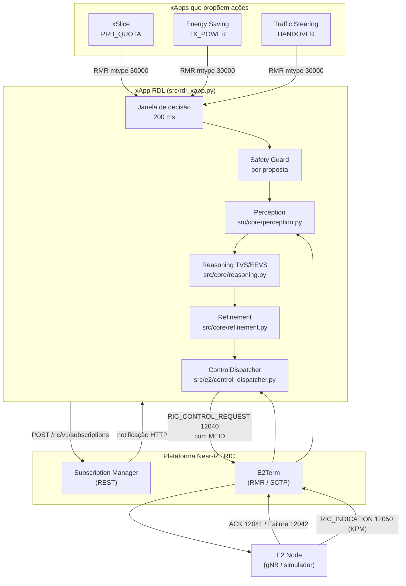

# 02 — Modelo de decisão da H-RDL

Este documento descreve o modelo de decisão da xApp RDL na Fase 1 (H-RDL). O mapa dos componentes, protocolos e fluxos da bancada está em [01](01_componentes_e_fluxos.md). Cada seção indica os arquivos de referência; quando o texto e o código divergirem, o código prevalece e o documento deve ser corrigido.

## 1. Papel no Near-RT RIC

A xApp RDL fica entre as xApps que querem controlar a RAN e o E2 Node. Ela recebe propostas de controle, detecta conflitos, decide quais ações aplicar e as envia como E2SM-RC. Também consome telemetria E2SM-KPM, usada pelos modelos de decisão.



## 2. Modos de operação

| Modo (`RDL_MODE`) | Comportamento |
| :-- | :-- |
| `OFFLINE_SIMULATION` (padrão) | RMR simulado que nunca reporta envio com sucesso; memória local em vez de SDL; capacidades estáticas registradas para `gnb_01`; subscrição só se `SUBMGR_URL` estiver definido. Usado em testes e nos experimentos de simulação. |
| `O_RAN_INTEROP` | Exige `ricxappframe`/RMR, SDL e `RAN_BACKEND` explícito; rejeita propostas externas (o transporte não autentica a xApp emissora); **bloqueia despacho e fica fora de `READY`** enquanto `protocol_interoperability_verified` for falso no backend, isto é, enquanto o codec E2 não for validado contra o ASN.1 oficial e uma implementação independente. |

Estados de saúde (`src/observability/health_server.py`): `STARTING`, `SUBSCRIBING`, `READY`, `DEGRADED`, `ERROR`, `STOPPED`. O endpoint `/ready` só responde 200 em `READY`.

## 3. Entrada de propostas

As propostas chegam por RMR (`RDL_ACTION_PROPOSAL`, mtype 30000) como JSON:

```json
{"xapp_id": "xslice", "node_id": "gnb_01", "parameter": "PRB_QUOTA", "value": 75, "priority": 90}
```

Validação na entrada (`RDLxApp._action_proposal_handler`): payload em bytes de até 64 KiB, objeto JSON, `xapp_id`/`node_id` não vazios de até 128 caracteres, `value` numérico finito (constantes como `NaN` são rejeitadas), `priority` inteiro em [0, 100]. O buffer da janela aceita até 4096 propostas (somadas às adiadas).

Campos opcionais (desde 2026-11-11): `defer_ok` (bool) pede que a proposta recusada só pela histerese seja reavaliada quando o bloqueio expirar; `ttl_ms` (até 60000) pede validade maior, limitada por `RDL_DEFER_MAX_TTL_MS` (seção 3.2).

O campo `xapp_id` é declarado pelo cliente e **não é credencial**; por isso o modo estrito rejeita propostas externas.

### 3.1 Classes de urgência e janela adaptativa

Desde 2026-11-10 (`src/core/decision_window.py`; motivação e alternativas fora da RDL no [doc 09 §2](09_frameworks_e_acoes_criticas.md)):

| Classe | Critério | Tratamento |
| :-- | :-- | :-- |
| `CRITICAL` | prioridade ≥ 95 (`RDL_CRITICAL_PRIORITY`) ou (xApp, parâmetro) marcado como crítico (`RDL_CRITICAL_TARGETS="xapp:PARAM,*:PARAM"` ou política A1 `critical_targets`) | **caminho rápido**: decidida assim que chega, junto com as propostas pendentes para o mesmo nó ou para nós vizinhos (que saem da janela para competir com ela); passa pelo Safety Guard e pela arbitragem normalmente, com intervalo mínimo próprio de 100 ms no alvo (`critical_control_interval_ms`), não o de 1000 ms. Cota de `RDL_CRITICAL_MAX_PER_S` (5) críticas por segundo por xApp; o excedente vira `URGENT`. A decisão sai com `reason = CRITICAL_FAST_PATH` e fica no `CausalTracker` (`fast_path_decisions`) |
| `URGENT` | prioridade ≥ 80 | janela fixa: fecha a janela na hora (comportamento anterior); janela adaptativa: espera no máximo 20 ms |
| `NORMAL` | demais | 200 ms; com `RDL_ADAPTIVE_WINDOW=true`, o tempo para acumular 8 propostas à taxa de chegada recente, entre 50 e 500 ms |

A janela adaptativa está **ligada por padrão desde 2026-11-11** (`RDL_ADAPTIVE_WINDOW=false` volta à janela fixa). As campanhas nativas e NORI não passam por ela: o harness chama o pipeline direto, por janela do catálogo. O laço de decisão acorda a cada 50 ms ou na hora, quando chega uma proposta `CRITICAL` ou `URGENT`; a janela normal de 200 ms fecha, portanto, entre 200 e 250 ms.

### 3.2 Propostas não atendidas: registro, aviso, adiamento e validade

Desde 2026-11-11 (`src/core/proposal_registry.py`; doc 09 §2.4). Toda proposta que não vira RIC Control é registrada com o motivo:

| Motivo | Quando |
| :-- | :-- |
| `SAFETY` | Safety Guard: limites físicos, política A1, destino de handover fora da topologia |
| `HYSTERESIS` | o alvo recebeu controle há menos que o intervalo mínimo; vem com `retry_after_ms` |
| `LOST_ARBITRATION` | perdeu no TVS/EEVS ou para a ação já confirmada; vem com a vencedora |
| `STALE` | esperou mais que a validade antes de ser decidida (`RDL_PROPOSAL_MAX_AGE_MS`, 1000 ms) |
| `OVERFLOW` | fila cheia na chegada |
| `DISPATCH_FAILED` | admitida, mas o RIC Control não foi enviado |
| `UNAUTHORIZED` | xApp fora do registro no modo estrito, origem RMR que não confere ou xApp em quarentena ([doc 11](11_governanca_hierarquica_xapps.md)) |

- **Consulta:** `GET /rejections?xapp_id=&node_id=&reason=&since=&limit=` (porta 8080) devolve as entradas mais recentes e o resumo por motivo e por xApp; `GET /decisions?node=&since=` é o atalho por nó. O registro guarda `RDL_REJECTION_LOG_SIZE` (5000) entradas; cada uma também vai para a memória da RDL (`save_rejection`: SDL na implantação, `MemoryModule` em teste).
- **Aviso à xApp:** RMR `RDL_ACTION_RESULT` (mtype 30001), JSON com `status = REJECTED`, motivo, `retry_after_ms`, `deferred` e a xApp vencedora. Cada xApp filtra pelo próprio `xapp_id`; a rota do 30001 tem de chegar a todas as xApps que propõem. Desligável com `RDL_NOTIFY_XAPPS=false`.
- **Adiamento:** só para `HYSTERESIS` e só se a xApp pediu (`defer_ok`). A proposta volta para a janela quando o bloqueio expira, se ainda estiver na validade (padrão 2000 ms, máximo `RDL_DEFER_MAX_TTL_MS` = 3000 ms), e é reavaliada do zero, contra o estado atual. A RDL não executa depois uma ação decidida antes.
- **Validade:** medida no relógio monotônico da RDL, desde a chegada. A idade não usa o relógio de quem enviou.
- **Métricas:** `rdl_proposals_rejected_total{reason}`, `rdl_proposals_deferred_total`, `rdl_critical_path_decisions_total`, `rdl_critical_downgraded_total`.

## 4. Pipeline de decisão

Implementado em `RDLxApp._process_action_group`. A cada fechamento de janela (200 ms após a primeira proposta, ou antes, se chegar proposta com prioridade ≥ 80):

### 4.0 Safety Guard por proposta

Cada proposta passa por `Refinement.check_bounds` antes de qualquer arbitragem: parâmetro conhecido, valor finito, prioridade válida, formato (inteiro para `PRB_QUOTA`, `SCHEDULER_WEIGHT` e `HANDOVER`; no máximo uma casa decimal para `TX_POWER`) e limites (seção 5). Propostas reprovadas são descartadas individualmente.

Motivo: antes desse passo, uma ação insegura que conflitasse com uma legítima fazia a validação rejeitar a resolução inteira, e uma xApp maliciosa conseguia vetar ações legítimas (observado no cenário S7).

### 4.1 Percepção: conflitos agrupados por alvo

`Perception.detect_action_group` não compara proposta a proposta; agrupa por alvo, o que mantém o número de eventos limitado por O(P²) por nó (P = parâmetros), independentemente do volume de propostas.

- Propostas repetidas da mesma xApp para o mesmo (nó, parâmetro) são deduplicadas (vale a mais recente).
- **Conflito direto:** um evento por (nó, parâmetro) quando há candidatos de xApps diferentes com valores diferentes. A última ação confirmada pela RAN para aquele alvo (a *incumbente*) entra como candidata, salvo se a própria dona fez nova proposta.
- **Conflito indireto:** um evento por par de parâmetros do mesmo nó que compartilham KPIs no grafo de dependências abaixo, com pelo menos um parâmetro com proposta nova e xApps diferentes envolvidas.

| Parâmetro | KPIs afetados |
| :-- | :-- |
| `PRB_QUOTA` | `DRB.UEThpDl`, `RRU.PrbUsedDl` |
| `SCHEDULER_WEIGHT` | `DRB.UEThpDl`, `DRB.RlcSduDelayDl` |
| `TX_POWER` | `L1M.DL-sinr`, `DRB.UEThpDl` |
| `HANDOVER` | `DRB.UEThpDl`, `RRU.PrbUsedDl` |
| `VERTICAL_DOWNTILT`, `BEAM_WEIGHTS` | `L1M.DL-sinr`, `DRB.UEThpDl` |
| `SENSING_RATIO`, `LOAD_THRESHOLD` | `RRU.PrbUsedDl`, `DRB.UEThpDl` |
| `PING_INTERVAL` | `DRB.RlcSduDelayDl` |
| `CELL_STATE` | `DRB.UEThpDl`, `RRU.PrbUsedDl`, `L1M.DL-sinr` |

**Conflitos entre células** (`ConflictType.INTER_CELL`, desde 2026-11-10; regras em `src/core/inter_cell.py`). Os conflitos acima são agrupados por `node_id`; os entre células são detectados à parte, indexando só as ações relevantes (`HANDOVER`, `CELL_STATE` e `TX_POWER` abaixo do limiar) e gerando um evento por (regra, par de nós). Só valem entre xApps diferentes e nós diferentes:

| Regra | Condição | Severidade |
| :-- | :-- | :-: |
| `HANDOVER_INTO_REDUCED_CELL` | uma xApp move UEs para a célula X enquanto outra desliga X (`CELL_STATE = 0`) ou reduz a potência de X para ≤ `low_power_threshold_dbm` (padrão 10 dBm) | HIGH |
| `HANDOVER_PING_PONG` | handovers em sentidos opostos entre o mesmo par de células, de xApps diferentes, a até `pingpong_window_s` (padrão 5 s) um do outro | MEDIUM |
| `NEIGHBOR_SLEEP` | duas células vizinhas desligadas por xApps diferentes na mesma decisão; só com topologia configurada e `allow_neighbor_sleep = false` | MEDIUM |

- A célula de destino de um `HANDOVER` é obtida trocando o índice final do nó de origem pelo valor (`gnb_0` com valor 1 → `gnb_1`; `…#g0` → `…#g1`), como no catálogo de cenários.
- Para alvos sem proposta na janela entra a última ação confirmada pela RAN: estados persistentes (célula desligada, potência reduzida) sempre. O handover é um evento, mas seu efeito (UEs servidos pela célula de destino) persiste: um handover confirmado protege a célula de destino até ser substituído por outro handover do mesmo nó de origem, ou por `handover_hold_s` segundos quando configurado. O ping-pong exige os dois handovers a até `pingpong_window_s` um do outro.
- No experimento nativo (B3), a Percepção e o Refinement usam o relógio simulado e cada proposta recebe o instante simulado do fechamento da janela (`scripts/certification/run_conflict_experiment.py`).
- A topologia (vizinhança) e os parâmetros vêm de um JSON em `RDL_TOPOLOGY_FILE` (exemplo em `configs/testbed_ufpa/topology.example.json`). Sem arquivo, as duas regras de handover continuam ativas e a de vizinhas dormindo fica inativa.
- **Limitação:** quando a incumbente perde a arbitragem (por exemplo, a potência reduzida já aplicada numa célula para a qual um handover vence), a H-RDL não a reverte por conta própria: só arbitra propostas. Restaurar a célula exige uma proposta de outra xApp.

### 4.2 Estágio 1 — TVS (conflitos diretos)

Para cada conflito direto, `Reasoning._resolve_direct_conflict` escolhe **um** vencedor maximizando

$$U_{TVS}(a) = 0{,}40\,s_{SLA} + 0{,}25\,s_{vazão} + 0{,}15\,s_{energia} + 0{,}10\,s_{estab} + 0{,}10\,s_{prio}$$

com desempate determinístico por (utilidade, prioridade, menor |valor|, `action_id`). As componentes são heurísticas calibradas à mão, não modelos analíticos completos:

| Componente | Regra no código |
| :-- | :-- |
| $s_{vazão}$ | `PRB_QUOTA`: v/100 limitado a [0,05; 1]; `TX_POWER`: 0,4 + 0,6·(v + 10)/(P_max + 10) limitado a [0,1; 1]; demais: 0,70 |
| $s_{SLA}$ | prioridade ≥ 90: 0,98 se PRB ≥ 70, 0,45 se potência < 15 dBm, senão 0,85; ≥ 75: 0,82; ≥ 60: 0,75; senão 0,65. Zera para xApps de energia quando o KPM do nó indica atraso acima de 5 ms. |
| $s_{energia}$ | `TX_POWER`: modelo linear de potência (4 TRX, P₀ = 130 W, ΔP = 4,7) normalizado entre consumo mínimo e máximo; `PRB_QUOTA`: max(0,2; 1 − v/150); demais: 0,60 |
| $s_{estab}$ | 0,75 para `HANDOVER`, 0,90 para os demais |
| $s_{prio}$ | (prioridade + reforço A1)/100 limitada a [0,1; 1]; o reforço (`urllc_priority_boost`) só vale para prioridade ≥ 90 |

Para `CELL_STATE`: $s_{vazão}$ = 0,20 (desligada) ou 0,80 (ativa); $s_{energia}$ = 1 − P_sleep/P₀ ≈ 0,97 (desligada) ou 0,30 (ativa); o $s_{SLA}$ de um desligamento zera quando o KPM do nó indica atraso acima do limite, como para as xApps de energia.

Os pesos de TVS e EEVS podem ser ajustados por política A1 (seção 7.1).

### 4.3 Estágio 2 — EEVS (conflitos indiretos)

Os conflitos indiretos são resolvidos só entre os vencedores do estágio 1 (perdedores não voltam a competir). `Reasoning._resolve_indirect_conflict` escolhe o subconjunto S que maximiza

$$U_{EEVS}(S) = 0{,}45\,QoS(S) + 0{,}20\,\overline{energia}(S) + 0{,}15\,J(S) - 0{,}35\,viol(S)$$

- $QoS$: SLA médio ponderado pela prioridade; $J$: índice de Jain sobre os SLAs; $viol$: (prioridade máxima do conflito − prioridade máxima de S)/30, mais 0,20 se S combina uma xApp de energia com uma ação de prioridade ≥ 90.
- Subconjuntos com dois valores diferentes para o mesmo (nó, parâmetro), ou que violam uma regra entre células (seção 4.1), valem −∞. Os conflitos `INTER_CELL` são resolvidos pelo EEVS depois dos indiretos, com a mesma redução aos vencedores do estágio 1.
- A busca exata enumera só subconjuntos compatíveis (no máximo uma ação por alvo): $\prod_k (n_k+1) - 1$ combinações. Acima de `max_exact_subsets` (padrão $2^{16}-1$) usa-se uma heurística gulosa determinística, sem garantia de ótimo.
- Alvos sem vencedor no EEVS são bloqueados no lote.

Se o vencedor de um alvo é a incumbente, o valor atual é mantido e nada é reenviado.

Confiança registrada: 0,92 (TVS), 0,88 (EEVS exato), 0,70 (EEVS guloso). A resolução por histórico (`_resolve_by_history`) existe no código, mas a memória sempre retorna lista vazia, então ela não é usada.

### 4.4 Refinement

`Refinement.validate` (resoluções) e `validate_single_action` (propostas sem conflito) verificam:

- limites e formato (seção 5);
- **histerese**: no máximo um controle por alvo a cada 1000 ms (`minimum_control_interval_ms`); para ações da classe `CRITICAL`, 100 ms (`critical_control_interval_ms`);
- **slew-rate** (desligado por padrão): variação máxima de 3 dB em `TX_POWER` e 30 pontos em `PRB_QUOTA` em relação ao último valor confirmado pela RAN, lido da Perception. Ligado sem fonte de estado confirmado, falha fechado.
- **destino de HANDOVER**: com topologia configurada, o destino tem de ser uma célula conhecida; um handover para fora da topologia é rejeitado (cenário S15);
- **restrições de política A1** (seção 7.1): teto de `PRB_QUOTA` (`max_cell_prb_limit`), proibição de desligar células (`energy_saving_allowed = false`) e intervalo mínimo de controle (`cooling_lockout_ms`). Uma política só restringe dentro dos limites físicos, nunca os amplia.

Os carimbos de tempo da histerese só são gravados depois que o lote inteiro é decidido.

### 4.5 Grafo de conhecimento

`src/core/knowledge_graph.py`: grafo de propriedades em memória, sem dependências externas, compartilhado com a Fase 2. Guarda:

- células e vizinhança (`NEIGHBOR_OF`);
- parâmetros e os KPIs que afetam (`AFFECTS`);
- propostas (`PROPOSED`, `TARGETS`);
- conflitos (`INVOLVES`) e decisões (`RESOLVED_BY`, `SELECTED`), com a política A1 efetiva no momento (`GOVERNS`).

A Percepção o preenche com a topologia e o grafo parâmetro → KPI. A `RDLxApp` registra cada conflito e cada decisão; eventos antigos saem com as arestas depois de `RDL_KG_MAX_EVENTS` (padrão 5000). Consulta: `GET /kg` (contagens) e `GET /kg?full=true` (grafo em JSON) na porta 8080. Na Fase 2, `context_features` dá ao MAPPO o histórico de conflitos e decisões por alvo.

### 4.6 Seleção e despacho

Uma ação por alvo é selecionada: o vencedor arbitrado ou, sem conflito, a proposta de maior prioridade (convergentes têm o mesmo valor). A `RDLDecision` é formalizada antes do despacho e cada ação gera um `RIC_CONTROL_REQUEST`.

## 5. Parâmetros controláveis

Catálogo canônico (`src/e2/rc/control_parameter.py`); outros parâmetros são rejeitados (*default-deny*).

| Parâmetro | ID | Faixa | Unidade |
| :-- | :-: | :-- | :-- |
| `PRB_QUOTA` | 1 | 0–100 | % |
| `SCHEDULER_WEIGHT` | 2 | 1–100 | peso |
| `TX_POWER` | 3 | −10 a 43 (ou o máximo anunciado pela capacidade do nó) | dBm |
| `HANDOVER` | 4 | 0–65535 | ID da célula de destino |
| `CELL_STATE` | 5 | 0 (desligada) ou 1 (ativa) | estado |

`CELL_STATE` atende à economia de energia por desligamento de células do GreenRAN (atividade A1.3 da proposta). O E2SM-RC não tem um Control Style padrão para isso; o caminho normativo provável é o E2SM-CCC (Cell Configuration and Control). Por isso não há capacidade padrão registrada: a H-RDL decide sobre `CELL_STATE`, mas o despacho falha fechado até que o nó anuncie a capacidade.

## 6. Integração E2

### 6.1 Subscrição E2SM-KPM

`SubscriptionManager` (`src/infrastructure/subscription_manager.py`) usa a API REST do Subscription Manager do O-RAN SC:

1. `POST /ric/v1/subscriptions` com corpo `SubscriptionParams` (`ClientEndpoint` com host e portas, `Meid`, `RANFunctionID`, Event Trigger e Action Definition E2SM-KPM como listas de octetos, `TimeToWait` válido).
2. A resposta só traz o `SubscriptionId`; a xApp fica em `SUBSCRIBING`.
3. O resultado E2 chega por `POST /ric/v1/subscriptions/response` no servidor HTTP da xApp. Com `E2EventInstanceId` > 0 e sem `ErrorCause`, a xApp passa a `READY`; caso contrário, a subscrição é descartada e, sem nenhuma ativa, a xApp vai a `DEGRADED`.

### 6.2 Controle E2SM-RC

`ControlDispatcher.dispatch_control`:

- valida o parâmetro e a capacidade anunciada pelo nó, aloca `RICrequestID` (correlação por nó, RAN Function, requestor e instância) e codifica pelo backend;
- envia por `send_rmr_message` (`src/infrastructure/rmr_transport.py`), que aloca o buffer RMR **com o MEID** do E2 Node. O `rmr_send(payload, mtype, retries)` do `ricxappframe` não define MEID e, sem ele, o E2Term não roteia a mensagem;
- ACK e Failure são correlacionados pela chave completa; RICrequestID duplicado enquanto pendente é rejeitado.

### 6.3 Timeout, falha e rollback

| Evento | Ação |
| :-- | :-- |
| `RIC_CONTROL_ACK` | transação `ACKNOWLEDGED`; a ação passa a ser o estado confirmado (incumbente) |
| `RIC_CONTROL_FAILURE` | transação `FAILED`; **sem rollback** (`NOT_REQUIRED`), pois o E2 Node não aplicou o controle |
| timeout (padrão 5 s) | transação `TIMEOUT`; rollback para o último valor confirmado, se conhecido e dentro dos limites |

O rollback é uma nova transação (RICrequestID próprio, `noAck`) codificada pelo mesmo backend; `SENT_UNCONFIRMED` significa só que o RMR aceitou o envio. Transações finalizadas são removidas após 5 minutos e os históricos têm tamanho máximo.

### 6.4 Codecs

| Codec | Situação |
| :-- | :-- |
| E2AP (`src/e2/e2ap/`) | módulo pycrate reduzido escrito no projeto, não gerado do ASN.1 oficial |
| E2SM-KPM (`src/e2/kpm*`) | codec local; os *golden vectors* foram gerados pelo próprio encoder (validação circular) |
| E2SM-RC (`src/e2/rc_encoder.py`) | **perfil simplificado, não normativo**: falta o CHOICE `controlHeader-Format1` com UEID e os `RANParameter-ValueType`; `ranParameterName` não existe na norma |

Um E2 Node conforme rejeitaria os controles. O NORI oficial usa E2AP/E2SM **v3.01**; a interoperabilidade exige substituir os codecs por código gerado do ASN.1 oficial e validá-los contra implementação independente.

## 7. Observabilidade

| Interface | Porta | Conteúdo |
| :-- | :-: | :-- |
| HTTP (`/health`, `/ready`, `/status`, `/ric/v1/subscriptions/response`, `/kg`, `/rejections`, `/decisions`, `/governance`) | 8080 | saúde, callback do SubMgr, grafo de conhecimento, propostas não atendidas e relatório de governança para o SMO ([doc 11](11_governanca_hierarquica_xapps.md)) |
| Prometheus | 8081 | contadores de KPM, conflitos, resoluções, controles, ACKs, falhas, timeouts, recusas por motivo, adiamentos e caminho crítico |

O `CausalTracker` (`src/observability/causal_tracker.py`) registra propostas, conflitos, decisões e respostas de controle por correlação.

### 7.1 Políticas A1

O receptor A1-P (`src/interfaces/a1_policy_receiver.py`) valida as políticas e, desde 2026-11-10, está ligado à decisão: a cada criação, atualização ou remoção, a `RDLxApp` aplica a **política efetiva** (união das políticas ativas; a mais recente prevalece por campo) sobre a configuração de base. Remover todas as políticas restaura a base. O servidor HTTP só sobe com `A1_RECEIVER_PORT` e só aceita *loopback* (não tem autenticação); serve para testes locais.

**Caminho O-RAN** (`src/interfaces/a1_rmr.py`, doc 10): o A1-PMS do Non-RT RIC cria a instância no A1 Mediator, que a entrega à xApp por RMR `A1_POLICY_REQUEST` (20010); a xApp aplica e responde `A1_POLICY_RESPONSE` (20011). Na partida, pede as instâncias existentes com `A1_POLICY_QUERY` (20012). Os tipos são registrados no mediador por `scripts/a1/register_policy_types.py`.

| Tipo | Campo | Efeito |
| :-- | :-- | :-- |
| 20000 `ORAN_RDL_Governance_Policy` | `urllc_priority_boost` (0–50) | soma à prioridade de ações com prioridade ≥ 90 no $s_{prio}$ |
| | `energy_saving_allowed` (bool) | `false` bloqueia `CELL_STATE = 0` no Refinement |
| | `max_cell_prb_limit` (10–100) | teto de `PRB_QUOTA` no Refinement |
| | `cooling_lockout_ms` (100–5000) | intervalo mínimo de controle por alvo |
| | `critical_targets` (lista `xapp:PARAM` ou `*:PARAM`, até 32) | marca alvos como `CRITICAL` (substitui `RDL_CRITICAL_TARGETS` enquanto a política vale) |
| | `critical_control_interval_ms` (20–1000) | intervalo mínimo da classe `CRITICAL` |
| | `xapp_modes` (lista `xapp:MANAGED\|ON_DEMAND\|QUARANTINED`) | modo de supervisão por xApp ([doc 11 §3](11_governanca_hierarquica_xapps.md)) |
| | `xapp_priority_caps` (lista `xapp:N`) | teto de prioridade por xApp |
| 20001 `GreenRAN_Intent_Policy` | `energy_weight` (0–0,6) | peso de energia no TVS e no EEVS |
| | `sla_weight` (0,1–0,8) | peso de SLA no TVS e de QoS no EEVS |
| | `allow_neighbor_sleep` (bool) | desliga a regra `NEIGHBOR_SLEEP` |
| | `low_power_threshold_dbm` (−10 a 43) | limiar de potência reduzida das regras entre células |
| 20002 `CARDL_Model_Policy` | `marl_enabled` (bool), `min_confidence` (0–1) | só a CA-RDL (Fase 2) usa: liga o MAPPO e define a confiança mínima; a H-RDL armazena e ignora |

O tipo 20001 é o ponto de contato previsto com o rApp-ResourceOptimizer do GreenRAN (ver [`compliance/GREENRAN_UFPA_TESTBED_PROFILE.md`](compliance/GREENRAN_UFPA_TESTBED_PROFILE.md)); os campos são uma proposta a combinar com a equipe do rApp.

## 8. Limitações conhecidas

1. Interoperabilidade E2 não demonstrada; codecs não normativos (seção 6.4).
2. Conflitos entre células: detectados para handover × célula desligada/reduzida, ping-pong e vizinhas dormindo (seção 4.1), sem reverter a incumbente que perde; outros acoplamentos entre células (interferência, balanceamento de carga) não são modelados.
3. Identidade das xApps não autenticada no transporte de propostas.
4. As utilidades TVS/EEVS são heurísticas com pesos fixos, sem calibração experimental publicada.
5. Descoberta E2 (RAN Function Definition) não implementada: no modo estrito a xApp não obtém os IDs de função e permanece fora de `READY`.
6. Políticas A1 ligadas à decisão (seção 7.1), mas o receptor não tem autenticação e o tipo 20001 ainda não foi combinado com o rApp do GreenRAN.
