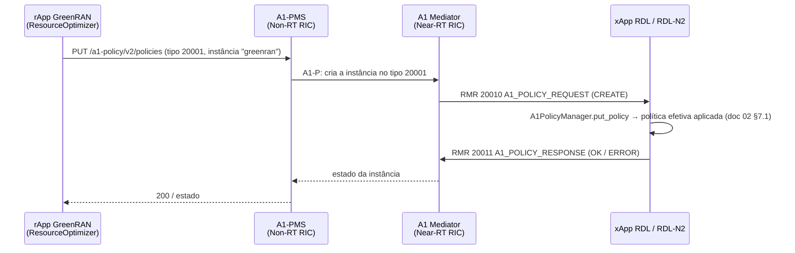

# 10 — SMO, Non-RT RIC e rApp: ligação da RDL ao GreenRAN

Escolha de 2026-11-10: na bancada, o Non-RT RIC é o **A1 Policy Management Service (A1-PMS) do O-RAN SC** no k3s, ligado ao A1 Mediator do Near-RT RIC Release I já instalado. O SMO completo (ONAP + O-RAN SC) fica documentado na seção 4 como alternativa para o testbed UFPA: não cabe nesta máquina (7,7 GB de RAM no host, 5 GB no WSL).

## 1. Caminho de uma política A1 até a RDL



- **Tipos de política:** a xApp declara os tipos no descritor (`configs/xapp_descriptor.json`). `scripts/a1/register_policy_types.py` os registra no A1 Mediator (`PUT /A1-P/v2/policytypes/{id}`), com os esquemas de `src/interfaces/a1_policy_receiver.py`.
- **Recepção:** a `RDLxApp` trata o RMR 20010 e responde 20011 (`src/interfaces/a1_rmr.py`). O servidor HTTP próprio (`A1_RECEIVER_PORT`) continua só para testes locais; não é o caminho O-RAN.

| Tipo | Nome | Quem publica |
| :-: | :-- | :-- |
| 20000 | `ORAN_RDL_Governance_Policy` | operador / rApp |
| 20001 | `GreenRAN_Intent_Policy` | rApp-ResourceOptimizer |
| 20002 | `CARDL_Model_Policy` (Fase 2) | fluxo de ML no SMO (liga o MAPPO depois de validado) |

## 2. MAPPO e o SMO (fluxo de AI/ML)

Segue a divisão do O-RAN WG2 entre treino e inferência:

1. **Treino no SMO / Non-RT RIC:** `python -m cardl.marl.train` (repositório da Fase 2), no ambiente calibrado com as medições do NORI. Gera checkpoint e manifesto com sha256.
2. **Publicação do modelo:** o checkpoint vai para a xApp como volume (ConfigMap ou PVC no Helm) com o sha256 esperado (`CARDL_CHECKPOINT`, `CARDL_CHECKPOINT_SHA256`). A xApp recusa um checkpoint com sha256 diferente.
3. **Ativação por A1:** a política 20002 liga o MARL (`marl_enabled`) e define a confiança mínima. Sem ela, ou com o MARL desligado, decide a RDL-N1.
4. **Monitoramento:** cada decisão registra a origem (MAPPO ou RDL-N1) e o motivo da reserva.

## 3. Implantação na bancada (A1-PMS no k3s)

Pré-requisitos: RIC Release I no namespace `ricplt` com o A1 Mediator (docs/04 §7), cerca de 1 GB livre no WSL. Os comandos testados ficam em `scripts/smo/deploy_a1pms.sh`; o roteiro abaixo é o que o script faz.

1. Criar o namespace `nonrtric`.
2. Instalar o A1-PMS a partir do chart do O-RAN SC (`it/dep`, `nonrtric/helm/a1policymanagementservice`, na versão do lock) com a configuração do RIC:

   ```json
   {"config": {"ric": [{"name": "ric1",
                         "baseUrl": "http://service-ricplt-a1mediator-http.ricplt:10000",
                         "managedElementIds": ["gnb_268_341_00000001"]}]}}
   ```

3. Registrar os tipos 20000–20002 no A1 Mediator (`scripts/a1/register_policy_types.py`).
4. Conferir que o A1-PMS enxerga o RIC e os tipos: `GET /a1-policy/v2/rics` e `GET /a1-policy/v2/policy-types`.
5. Rodar o rApp de exemplo (`rapps/greenran_resource_optimizer.py`), que publica a política 20001 conforme o período do dia (noite: mais peso de energia e sleep de vizinhas permitido).

## 4. Alternativa: SMO completo (ONAP + O-RAN SC) no testbed UFPA

Para o testbed, onde o GreenRAN prevê SMO, Non-RT RIC, rApps e *data lake*. O O-RAN SC distribui o pacote `smo-install` no repositório `it/dep` ([guia da comunidade](https://lf-o-ran-sc.atlassian.net/wiki/spaces/IAT/pages/14516593)), organizado em camadas:

| Passo | Comando (em `it/dep/smo-install`) | O que faz |
| :-: | :-- | :-- |
| 0 | `scripts/layer-0/0-setup-charts-museum.sh` e `scripts/layer-0/0-setup-helm3.sh` (ou `0-setup-microk8s.sh` num nó novo) | Helm 3, ChartMuseum e, opcionalmente, um MicroK8s |
| 1 | `scripts/layer-1/1-build-all-charts.sh` | constrói os charts de ONAP, Non-RT RIC e auxiliares |
| 2 | `scripts/layer-2/2-install-oran.sh` | instala SMO (ONAP: Policy, SDNC, Kafka/Strimzi), Non-RT RIC (A1-PMS, Control Panel, rApp manager) e componentes auxiliares |
| 3 | `scripts/layer-2/2-install-simulators.sh` (opcional) | simuladores de RIC e de O-RU/O-DU para testar sem RAN |

Recomendações para o testbed:

1. Conferir os requisitos de CPU, memória e disco no `README.md` do `smo-install` da versão escolhida e reservar um servidor só para o SMO. A instalação do ONAP é longa e costuma parar no meio; usar *overrides* mínimos e instalar por partes.
2. Usar a mesma release do O-RAN SC para Near-RT RIC e SMO; a bancada usa a Release I.
3. Apontar o A1-PMS do SMO para o A1 Mediator do Near-RT RIC do testbed, como na seção 3, e registrar os tipos 20000–20002.
4. Implantar o rApp-ResourceOptimizer (UFRGS) no gerenciador de rApps do SMO. O rApp de exemplo deste repositório serve de teste de integração.
5. O *data lake* do GreenRAN (UEPA) pode receber as decisões da RDL (log causal) e o KPM para o retreino do MAPPO.
