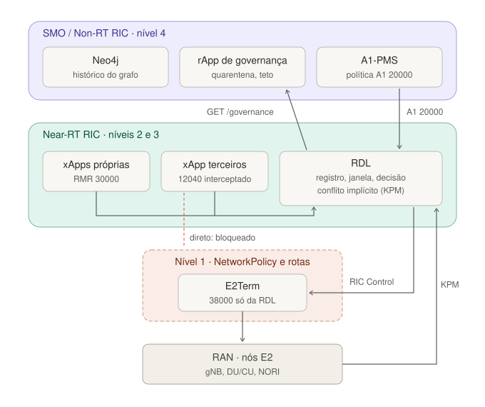
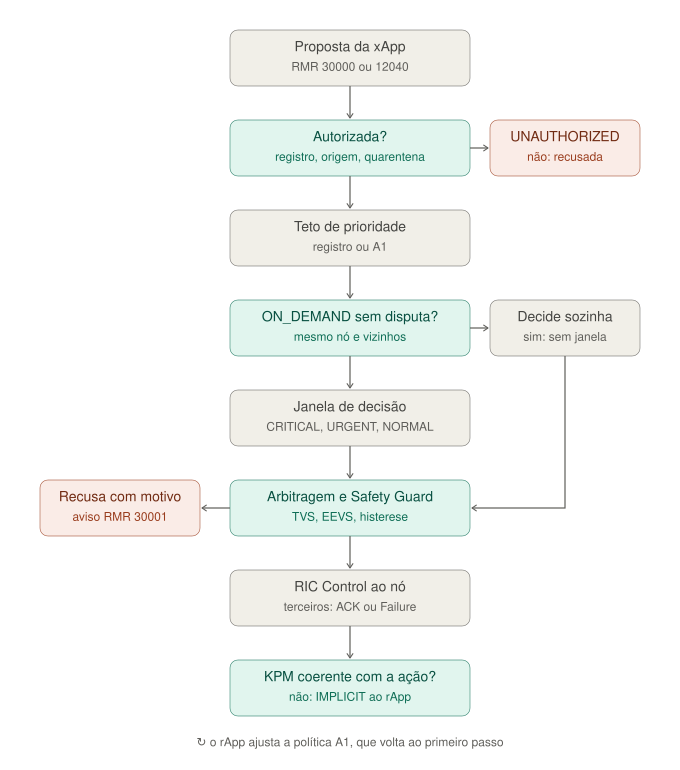

# 11 — Governança hierárquica das xApps sob a RDL

Implementado em 2026-11-11 (achado 62 de [`07`](07_certificacao_e_achados.md)). Responde a duas perguntas:

1. Como garantir que nenhuma xApp mande RIC Control por fora da RDL?
2. Como supervisionar uma xApp só quando é preciso?

A governança tem quatro níveis. Cada nível cobre o que o anterior não alcança, e o mais lento fica no Non-RT RIC. Um quinto aspecto trata do conflito entre **rApps** (seção 5.1): dois rApps, ou um rApp e o operador, escrevendo o mesmo campo da política A1.

| Nível | Onde atua | Mecanismo | Escala de tempo | Código |
| :-: | :-- | :-- | :-- | :-- |
| 1 | plataforma (Kubernetes + RMR) | registro de xApps, descritores, NetworkPolicy e tabela de rotas | implantação | `src/governance/xapp_registry.py`, `deploy/helm/ric-governance` |
| 2 | Near-RT RIC (RMR) | interceptação por rota do RIC Control de xApps de terceiros | ms | `src/governance/interception.py` |
| 3 | Near-RT RIC (KPM) | conflito implícito: KPM incoerente com a ação confirmada | segundos | `src/core/implicit_conflict.py` |
| 4 | Non-RT RIC / SMO | rApp de governança: quarentena e teto de prioridade por A1, recomendação de retirada | segundos a minutos | `rapps/governance_rapp.py` |
| 5.º aspecto | A1 (entre Non-RT e Near-RT) | dono e precedência por campo da política A1; conflito entre rApps detectado e reportado | a cada escrita A1 | `src/interfaces/a1_policy_receiver.py` |

### Figuras

**Onde cada nível fica na arquitetura:**

- **Nível 1:** a barreira em volta do E2Term; o RIC Control direto de uma xApp de terceiros é cortado ali.
- **Nível 2:** o 12040 interceptado chega à RDL.
- **Nível 3:** dentro da RDL, alimentado pelo KPM que volta da RAN.
- **Nível 4:** o rApp, que lê `GET /governance` e responde com a política A1 20000.



**O que acontece com uma proposta:**

- **Ordem das verificações:** a do código (`RDLxApp._action_proposal_handler` → `_enqueue` → `_process_action_group`).
- **Teto de prioridade antes da urgência:** é aplicado antes da classificação, então uma xApp com teto abaixo de 95 não chega ao caminho crítico.
- **`ON_DEMAND` sem disputa:** pula só a janela; a arbitragem e o Safety Guard continuam valendo.



## 1. Nível 1 — plataforma: a RDL é o único caminho de RIC Control

**Registro de xApps** (`RDL_XAPP_REGISTRY`, exemplo em [`configs/xapp_registry.example.json`](../configs/xapp_registry.example.json)). Para cada xApp:

- `sources`: expressões regulares para a origem RMR do remetente (`hostname:porta`);
- `mode`: modo de supervisão (seção 3);
- `max_priority`: teto de prioridade;
- `intercept_requestor_ids` e `default_priority`: dados para o nível 2.

Como o registro decide se uma proposta entra:

- **Modo estrito (`O_RAN_INTEROP`):** a proposta só entra se a xApp está registrada e a origem confere. Sem registro configurado, toda proposta externa é descartada, como antes.
- **Fora do modo estrito:** xApps não registradas são aceitas, como na bancada. Uma origem que contradiz o registro é recusada.
- **Toda recusa** é registrada como `UNAUTHORIZED` (`GET /rejections`).

**Por que a NetworkPolicy é necessária.** A origem RMR pode ser declarada pelo próprio remetente (`RMR_SRC_ID`), e uma xApp pode forjar a própria tabela de rotas. O registro, sozinho, não basta. O chart [`deploy/helm/ric-governance`](../deploy/helm/ric-governance) instala:

| Objeto | Efeito |
| :-- | :-- |
| `NetworkPolicy e2term-rmr-data-rdl-only` (ricplt) | a porta RMR de dados do E2Term (38000) só aceita a plataforma (ricplt), a RDL e a kpm-probe da bancada; o E2 Setup (SCTP 36422), as métricas e o namespace do NORI (`ricsim`) continuam abertos |
| `NetworkPolicy rdl-rmr-data-proposers-only` (ricxapp) | a porta RMR de dados da RDL (4560) só aceita a plataforma e os pods com o rótulo `rdl.governance/proposer: "true"`, que os charts das xApps de referência agora aplicam |
| `ConfigMap rdl-governance-routes` | tabela de rotas RMR (`RMR_SEED_RT`): 30000 → RDL, 30001 → xApps proponentes, 12040 de cada xApp interceptada → RDL, 12040 da RDL → E2Term |

O descritor da RDL ([`configs/xapp_descriptor.json`](../configs/xapp_descriptor.json)) é o único que declara `RIC_CONTROL_REQ` em `txMessages`. Ele também recebe `RIC_CONTROL_REQ`, por causa da interceptação.

**Modo catálogo (kpm-probe da bancada NORI) e a NetworkPolicy.** A kpm-probe embute o H-RDL e envia o RIC Control ela mesma. Por isso ela está na lista de controladores autorizados do E2Term (`ricxapp.e2Controllers`), e o teste no cluster confirmou o acesso (tabela abaixo).

- **O catálogo não é tráfego de rede.** As propostas vêm de `simulations/ns3/conflicts/catalog.json`, dentro do processo da kpm-probe; o cenário e o baseline vêm de arquivos no volume dela. A NetworkPolicy não se aplica a eles.
- **Não passam pelos níveis 1 e 3 da RDL.** As propostas do catálogo não passam pelo RMR 30000 nem pelo registro de xApps: `decide_catalog` chama o pipeline direto. Assim, também não há recusa `UNAUTHORIZED` nem modo `ON_DEMAND` no modo catálogo.
- **O que a NetworkPolicy garante na bancada:** só a RDL e a kpm-probe alcançam a porta RMR de dados do E2Term. A kpm-probe não tem política própria; ela recebe as Indications e o A1 da plataforma sem restrição adicional.

**Verificado no cluster da bancada** (k3s, O-RAN SC Release I), em 2026-11-11:

| Origem → E2Term:38000 | Sem a política | Com a política |
| :-- | :-: | :-: |
| kpm-probe (ricxapp, autorizada) | aberta | aberta |
| a1pms-osc-adapter (nonrtric, não autorizada) | aberta | **recusada** (`ConnectionRefused`) |

O controlador de NetworkPolicy do k3s (kube-router) aplica a regra. **Não verificado:** o E2 Setup do NORI com a política ativa. A regra libera o namespace `ricsim` inteiro justamente para não depender de a implementação reconhecer SCTP.

## 2. Nível 2 — interceptação por rota (xApps de terceiros)

Para xApps que não podem ser alteradas, uma rota com remetente (`mse|12040,<origem>|-1|<RDL>`) entrega o RIC Control Request delas à RDL em vez do E2Term. A RDL então:

1. Decodifica o E2AP e o E2SM-RC. Formatos entendidos:
   - E2SM-RC v03.01 do NORI, Style 2 / Action 6 (cotas por fatia → `PRB_QUOTA` com o teto da SST 1);
   - o perfil próprio da RDL (um parâmetro por mensagem).
   Outros formatos recebem Failure.
2. Cria a proposta com a identidade e a prioridade do registro (`intercept_requestor_ids`). Um RICrequestorID desconhecido recebe Failure e entra no registro como `UNAUTHORIZED`.
3. Arbitra a proposta como qualquer outra. Se ela vence, a RDL envia o controle ao nó com o próprio RICrequestID.
4. Responde à xApp por *return to sender*, com o RICrequestID e o RANfunctionID que ela usou:
   - **Acknowledge**, quando o nó confirma o controle da RDL;
   - **Failure** (Cause `ricRequest / control-failed-to-execute`), quando a proposta é recusada, o nó falha ou o tempo esgota;
   - **Failure** com Cause `unspecified`, depois de 10 s sem desfecho.

**Verificado:** decodificação dos dois formatos, montagem do ACK e do Failure, e o fluxo completo com RMR simulado (`tests/unit/test_governance.py`). **Não verificado:** com RMR real, uma xApp de terceiros e uma rota de remetente no RtMgr. A sintaxe de rota com remetente é a do RMR; a forma de expressá-la no RtMgr (rotas de plataforma) precisa ser confirmada no testbed.

## 3. Supervisão sob demanda: gerenciar uma xApp só quando é preciso

Cada xApp tem um modo, definido no registro ou na política A1 20000 (`xapp_modes`):

| Modo | Tratamento |
| :-- | :-- |
| `MANAGED` (padrão) | toda proposta passa pela janela de decisão |
| `ON_DEMAND` | a proposta é decidida **na chegada, sozinha** (Safety Guard e intervalo mínimo valem). Vai para a janela só quando há disputa: outra xApp propôs para o mesmo nó ou para um vizinho nos últimos `RDL_ON_DEMAND_LOOKBACK_S` (2 s), há proposta pendente nesses nós ou o grafo registra conflito recente no alvo |
| `QUARANTINED` | toda proposta é recusada como `UNAUTHORIZED` |

**Para que serve o `ON_DEMAND`.** Uma xApp que raramente disputa recursos (por exemplo, o EnergySaver à noite) não paga a espera da janela. A RDL passa a supervisioná-la quando aparece concorrência e, depois disso, a trata como `MANAGED` enquanto a disputa durar. A decisão sai com `reason = ON_DEMAND` e conta em `rdl_on_demand_decisions_total`.

**Fora da RDL: ligar e desligar a própria xApp.** Isso é o ciclo de vida da xApp, papel do SMO:

- um rApp pede ao AppMgr (ou ao Helm) para implantar a xApp quando um gatilho de negócio aparece (horário, intenção A1, alarme) e para retirá-la depois;
- dá para escalar a zero por evento (por exemplo, KEDA);
- a xApp implantada sob demanda ainda passa pela RDL, nos modos acima.

**Teto de prioridade** (`max_priority` no registro, `xapp_priority_caps` na A1). A proposta é rebaixada ao teto, e a prioridade pedida fica em `requested_priority`. Um teto abaixo de 95 impede a xApp de usar o caminho crítico pela prioridade.

## 4. Nível 3 — conflito implícito

A RDL confere cada relatório KPM contra as ações que o nó confirmou:

| Ação confirmada | Violação |
| :-- | :-- |
| `CELL_STATE = 0` | vazão DL > 0,5 Mb/s ou PRBs em uso |
| `PRB_QUOTA = q` | fatia SST 1 com mais de q + 10 % dos PRBs (só quando o KPM traz a fatia: `sst1_prb_share_pct`) |

Para não confundir transitório com conflito, a verificação começa `RDL_IMPLICIT_GRACE_S` (2 s) depois do ACK. A violação precisa se repetir em `RDL_IMPLICIT_PERSISTENCE` (3) relatórios seguidos, e cada episódio gera um único achado.

O achado vira `ConflictType.IMPLICIT`. Ele fica no grafo de conhecimento, nas métricas (`rdl_implicit_conflicts_total`) e no relatório `GET /governance`, com uma lista de suspeitas:

- xApps interceptadas ou que propuseram para o nó nos últimos 30 s;
- ou `out-of-band`, se não houver nenhuma.

`TX_POWER`, `SCHEDULER_WEIGHT` e `HANDOVER` ficam sem verificação: o KPM disponível não mede potência nem célula servidora por UE.

## 5. Nível 4 — Non-RT RIC / SMO

`GET /governance` (porta 8080) devolve:

- recusas por motivo e por xApp;
- conflitos implícitos;
- rebaixamentos de ações críticas por xApp;
- o registro, com os modos efetivos;
- interceptações pendentes;
- o estado da janela.

O [`rapps/governance_rapp.py`](../rapps/governance_rapp.py) lê esse relatório e aplica regras fixas:

| Evidência | Ação |
| :-- | :-- |
| ≥ 5 recusas `SAFETY` | `QUARANTINED` |
| ≥ 20 recusas `UNAUTHORIZED` | `QUARANTINED` |
| ≥ 10 ações críticas acima da cota | teto de prioridade 94 |
| xApp registrada suspeita de conflito implícito | `QUARANTINED` e candidata à retirada |
| xApp fora do registro suspeita | recomendação de retirada |
| `out-of-band` | investigação pelo operador |

As ações sobre a RDL saem numa única instância A1 20000 (`rdl-governance`), publicada no A1-PMS. A retirada (`DELETE /ric/v1/xapps/{nome}` no AppMgr) só acontece com `--undeploy`; sem isso, a recomendação é só impressa. **Sair da quarentena é decisão do operador.** Perder arbitragem não é falta: o rApp não pune quem perde.

### 5.1 Quinto aspecto: conflito entre rApps na política A1

Antes de 2026-11-11, a RDL juntava as instâncias A1 ativas e, num mesmo campo, valia a escrita mais recente. Se dois rApps, ou um rApp e o operador, ajustassem o mesmo campo (por exemplo `cooling_lockout_ms` ou `energy_weight`), vencia quem escreveu por último, sem aviso (achado 64). É o conflito **horizontal** entre rApps; o tratamento dele no SMO ainda é pouco padronizado (relatório [`reports/avaliacao/relatorio_tecnico_rapps_governanca_20261111.md`](../reports/avaliacao/relatorio_tecnico_rapps_governanca_20261111.md)).

**Mapa de donos** (`RDL_A1_FIELD_OWNERS`, exemplo em [`configs/a1_field_owners.example.json`](../configs/a1_field_owners.example.json)):

- **Formato:** para cada tipo e campo, uma lista de padrões (glob) de `policy_instance_id`, em ordem de precedência.
- **Identidade:** o A1 Mediator repassa à xApp só o ID da instância, que é o `policy_id` dado pelo rApp no A1-PMS, e não o serviço do A1-PMS. Por isso o dono é identificado pelo ID da instância. Convenção: instâncias do operador começam com `operator`.

| Situação | O que a RDL faz |
| :-- | :-- |
| instância fora da lista de donos escreve o campo | recusa a instância inteira (`put_policy` falso; resposta A1 20011 com `status = ERROR` e o motivo, o que deixa a política `NOT_ENFORCED` no A1-PMS) |
| dois donos escrevem o mesmo campo | vence o de maior precedência (o primeiro da lista), mesmo que tenha escrito antes; entre donos de mesma precedência, a escrita mais recente |
| campo fora do mapa | livre; vale a escrita mais recente, como antes |
| duas instâncias com valores diferentes no mesmo campo | **conflito entre rApps**: aparece em `GET /governance` (`rapp_conflicts`: campo, regra aplicada, vencedor, valor efetivo e escritores em ordem de precedência), no log e em `rdl_a1_field_conflicts` |
| a instância vencedora é removida | a próxima na precedência passa a valer; o conflito some se sobrar um só valor |

O rApp de governança transforma cada `rapp_conflicts` numa recomendação `RESOLVE_A1_FIELD_CONFLICT` para o operador. Ele não decide quem fica: a RDL já aplica a precedência, e mudar o mapa de donos é decisão de operação.

**Limites:**

- A identidade é o ID da instância, que o rApp escolhe. Um rApp que use o nome de outra instância a sobrescreve. Isso só se fecha no SMO, com a autorização da R1 (CAPIF) no testbed, e não na RDL.
- Os campos de tipos diferentes são juntados por nome. Hoje 20000, 20001 e 20002 não compartilham nomes de campo.

## 6. Onde ficam o estado e o grafo

| Pergunta | Resposta |
| :-- | :-- |
| O dbaas (Redis) é do Near-RT ou do Non-RT? | Do **Near-RT RIC**: o `dbaas` roda no namespace `ricplt` e é o SDL das xApps. O Non-RT RIC (A1-PMS) tem banco próprio, desligado na bancada. |
| O modo catálogo fica no dbaas? | **Não.** O cenário e o baseline da kpm-probe ficam em arquivos no volume dela (`/data/rdl_scenario`, `/data/rdl_baseline`). No modo `O_RAN_INTEROP`, a RDL grava no SDL (dbaas) os pedidos de controle, as decisões e as recusas (`rejection:<id>`). |
| Onde atua o grafo de conhecimento próprio? | Dentro da RDL, no Near-RT RIC: em memória, consultado a cada decisão (contexto da CA-RDL, disputa do modo sob demanda) e exposto em `GET /kg`. |
| Onde atua o NetworkX? | **Fora do laço de decisão:** análise do grafo exportado (centralidade, componentes, caminhos de conflito) num notebook, num teste ou no rApp (`src/core/kg_export.py: to_networkx`; extra `kg`). |
| Onde atua o Neo4j? | **No SMO / Non-RT RIC:** histórico persistente, que sobrevive ao reinício da RDL e é consultado pelos rApps. A RDL não depende dele. Um banco de grafos externo no caminho de cada decisão poria latência de rede dentro da janela de 200 ms. Na bancada, roda pelo chart `kg-neo4j` (seção 6.1); para uma exportação avulsa, há `scripts/kg/export_kg.py` (Cypher para `cypher-shell`, ou gravação direta com `--neo4j-uri` e senha em `NEO4J_PASSWORD`). |

### 6.1 Histórico no Neo4j: chart `kg-neo4j`

O chart [`deploy/helm/kg-neo4j`](../deploy/helm/kg-neo4j) instala, no namespace do SMO (`nonrtric` na bancada):

| Objeto | Função |
| :-- | :-- |
| Deployment `kg-neo4j` | Neo4j 5.26 Community: heap de 256 MiB, page cache de 64 MiB, limite de 768 MiB; `emptyDir` por padrão (`neo4j.persistence.enabled=true` usa PVC `local-path`) |
| Secret `kg-neo4j-auth` | senha do usuário `neo4j`, gerada na primeira instalação e mantida nas atualizações |
| CronJob `kg-neo4j-export` | a cada minuto, lê `GET /kg?full=true` da RDL e grava pela API HTTP transacional do Neo4j. Usa `python:alpine` e só a biblioteca padrão; o script é `files/export_kg_job.py`, com os mesmos comandos de `src/core/kg_export.py`, o que um teste garante |
| `kg-test-source` (opcional) | para a bancada sem RDL implantada: serve um grafo gravado por `scripts/kg/dump_catalog_kg.py`, produzido pelo H-RDL real decidindo o catálogo (sem ns-3). Não é evidência experimental, e as células de cenários diferentes se fundem |

```bash
python scripts/kg/dump_catalog_kg.py --out kg_catalogo.json
helm upgrade --install kg-neo4j deploy/helm/kg-neo4j -n nonrtric --set testSource.enabled=true --set-file testSource.kgJson=kg_catalogo.json
# com a RDL implantada: sem testSource; o CronJob lê service-ricxapp-iqos-xapp-rdl-http.ricxapp:8080
```

**Verificado na bancada em 2026-11-11:**

- **Primeira exportação:** gravou os 531 nós (198 ações, 167 conflitos, 138 decisões, 10 xApps, 10 parâmetros, 4 células, 4 KPIs) e as 1016 arestas do grafo de teste, em 8,3 s.
- **Idempotência:** a exportação seguinte não duplicou nada (531 / 1016).
- **Memória:** o Neo4j ocupou 376 MiB.
- **Arranque:** as duas primeiras execuções do CronJob falharam com `Connection refused`, enquanto o Neo4j subia. O CronJob não tenta de novo na mesma execução e se recupera na seguinte.

**Limites:**

- **Cópias, não sincronia contínua.** Um evento que entra e sai da RDL entre duas exportações (mais de `RDL_KG_MAX_EVENTS` eventos num minuto) não chega ao Neo4j.
- **Nada é apagado.** O histórico cresce sem limite. Com `emptyDir`, ele se perde quando o pod do Neo4j é recriado.

## 7. Configuração

| Variável | Padrão | Efeito |
| :-- | :-- | :-- |
| `RDL_XAPP_REGISTRY` | — | arquivo JSON do registro |
| `RDL_ADAPTIVE_WINDOW` | `true` (desde 2026-11-11) | janela adaptativa; `false` volta à janela fixa de 200 ms |
| `RDL_ON_DEMAND_LOOKBACK_S` | 2,0 | quanto tempo uma disputa mantém a xApp `ON_DEMAND` na janela |
| `RDL_IMPLICIT_GRACE_S` / `RDL_IMPLICIT_PERSISTENCE` | 2,0 / 3 | período de graça e persistência do conflito implícito |
| `RDL_A1_FIELD_OWNERS` | — | mapa de donos e precedência por campo da A1 (seção 5.1) |

Na política A1 20000, os campos `xapp_modes` (lista `xapp:MODO`) e `xapp_priority_caps` (lista `xapp:N`) sobrepõem o registro enquanto a política vale.
