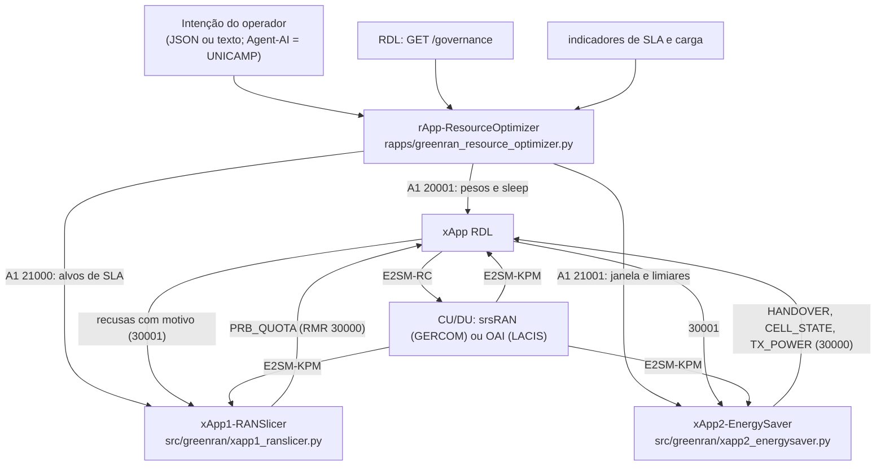

# 12 — xApps do GreenRAN, rApp-ResourceOptimizer e backends do testbed UFPA

Implementado em 2026-11-11, conforme a proposta GreenRAN (atividades A1.5, A1.6 e A1.7) e o relatório de adequação ([`reports/avaliacao/adequacao_f1_f2_greenran_ufpa_20261110.md`](../reports/avaliacao/adequacao_f1_f2_greenran_ufpa_20261110.md)). Autor: George Barbosa ([`AUTHORS.md`](../AUTHORS.md)).

**Estado:** testado em unidade e integrado ao pipeline real de decisão da RDL; **sem execução em RAN real**. No GreenRAN, o xApp1 é entregável da UFRGS e o xApp2 da UFPA. As versões daqui servem para integrar e testar a coordenação até as definitivas chegarem; elas usam o mesmo contrato (RMR 30000/30001 e A1).

## 1. Arquitetura

As escalas de tempo se dividem assim:

- **xApps:** propõem a cada período.
- **RDL:** coordena as duas em cada janela de decisão. Arbitra os conflitos diretos, indiretos e entre células, e aplica Safety Guard, governança e política A1.
- **rApp:** coordena em escala Non-RT (> 1 s), ajustando objetivos e limites de cada uma.

## 2. xApp1-RANSlicer (A1.5)

| Item | Implementação |
| :-- | :-- |
| Entrada | KPM por UE e fatia (`normalize_kpm`); intenção A1 21000 (`embb_min_thp_mbps`, `embb_max_delay_ms`, `mmtc_min_prb_pct`, `slice_safety_margin`, `ranslicer_learned_policy`) |
| Decisão | eficiência medida da fatia eMBB (Mb/s por ponto de PRB, média móvel) → teto = alvo × (1 + margem) ÷ eficiência; se o atraso passou do limite, sobe pelo menos 10 pontos |
| *Safe RL* | uma política aprendida opcional (por exemplo, o ator MAPPO da CA-RDL) pode propor o teto, mas a saída é recortada ao intervalo seguro [necessidade, 100 − piso mMTC]. É um escudo de segurança, testado |
| Saída | `PRB_QUOTA` (eMBB recebe v, a outra fatia 100 − v), prioridade 90 com SLA em risco e 75 sem; `defer_ok`; mudanças < 2 pontos não são propostas |

## 3. xApp2-EnergySaver (A1.6)

| Item | Implementação |
| :-- | :-- |
| Entrada | carga por célula (KPM de nó), UEs por célula, vizinhança (`RDL_TOPOLOGY_FILE`); política A1 21001 (`es_sleep_threshold_pct`, `es_wake_threshold_pct`, `es_min_active_cells`, janela `es_sleep_start_hour`–`es_sleep_end_hour`, `es_tx_power_reduction`, `es_reduced_tx_power_dbm`) |
| Padrões sazonais | carga esperada por hora do dia e por célula (`SeasonalProfile`, 24 faixas) |
| Borda entre duas RUs | desligamento em dois passos: `HANDOVER` dos UEs para a vizinha que os absorve, depois `CELL_STATE = 0`; uma célula por período; mínimo de células ativas respeitado |
| Religamento | `CELL_STATE = 1` (prioridade 85) quando a janela acaba, uma vizinha passa do limiar ou a carga esperada sobe |
| Potência | `TX_POWER` reduzida com carga moderada, se a política permitir |
| Recusa da RDL | volta a célula a ativa (por exemplo, quando a regra `HANDOVER_INTO_REDUCED_CELL` barra o desligamento) |

## 4. rApp-ResourceOptimizer (A1.7)

[`rapps/greenran_resource_optimizer.py`](../rapps/greenran_resource_optimizer.py) publica três políticas no A1-PMS, com as instâncias `greenran-rdl`, `greenran-ranslicer` e `greenran-energysaver`. Os donos dos campos estão no mapa `RDL_A1_FIELD_OWNERS` (doc 11 §5.1).

| Regra | Efeito |
| :-- | :-- |
| período (noite × dia) | noite prioriza energia; dia prioriza SLA |
| intenção (`energy_priority`, câmeras × Mb/s, atraso, células mínimas) | alvos do RANSlicer e janela/limiares do EnergySaver |
| SLA da fatia de câmeras em risco (`--kpi-url`/`--kpi-file`) | sobe o peso de SLA, proíbe desligar vizinhas, aumenta a margem do RANSlicer e torna o EnergySaver conservador |
| EnergySaver perdendo a arbitragem à noite sem risco de SLA (relatório da RDL) | mais peso de energia na RDL |
| conflito implícito reportado pela RDL | suspende os desligamentos |

A intenção em texto passa por um analisador de palavras-chave (`parse_intent_text`). A tradução de linguagem natural do GreenRAN (Agent-AI) é entregável da UNICAMP.

## 5. Backends do testbed: srsRAN (GERCOM) e OAI (LACIS)

Os dois laboratórios usam pilhas diferentes, e a escolha fica para depois da implantação. A RDL, a kpm-probe e as xApps não mudam entre eles; muda o perfil ([`configs/testbed_ufpa/backends/`](../configs/testbed_ufpa/backends/)).

| Perfil | Pilha | Estado |
| :-- | :-- | :-- |
| `nori_ns3.yaml` | NORI (ns-3.42 + 5G-LENA + E2 real) | verificado (G1–G5); pronto para o TB0 |
| `srsran_gercom.yaml` | srsRAN Project (gNB com agente E2 próprio) + Open5GS | 14 campos `A_CONFIRMAR` |
| `oai_lacis.yaml` | OpenAirInterface com agente E2 do FlexRIC | 15 campos `A_CONFIRMAR` |

O carregador ([`src/e2/backends/testbed_profiles.py`](../src/e2/backends/testbed_profiles.py)) fornece:

- os nomes das métricas KPM;
- os IDs dos RAN Parameters da cota de PRB;
- a lista de pendências: com qualquer `A_CONFIRMAR`, o TB0 não passa.

A kpm-probe lê o perfil por `RDL_BACKEND_PROFILE`. Sem IDs de RC confirmados, ela **não envia** o controle (evento `control_blocked`).

**Limite do codec:** hoje só o leiaute plano do NORI é implementado. Se o agente E2 do srsRAN ou do OAI usar o leiaute aninhado da norma E2SM-RC, ou o modelo de serviço de fatiamento próprio do FlexRIC, o codec precisa de uma extensão, que só pode ser escrita e verificada com o agente real.

**Passo a passo em cada laboratório:**

1. Preencher o perfil com a equipe: versões e commits, endereço do E2Term, RAN Function IDs anunciados no E2 Setup, nomes das métricas KPM por fatia, Style/Action e IDs da cota de PRB, canais de potência e de desligamento. Fecha o gate TB0.
2. Subir o Near-RT RIC (O-RAN SC; a bancada usa a Release I, `scripts/deploy_ric_i_release.sh`) e ligar o agente E2 da CU/DU ao E2Term. Gates TB1–TB4: E2 Setup, subscrição e KPM.
3. Implantar a kpm-probe com `RDL_BACKEND_PROFILE` e conferir RIC Control e ACK de cota de PRB (TB5–TB6).
4. Implantar a xApp RDL, o xApp1 e o xApp2 (papéis `ranslicer` e `energysaver` em `src/main.py`), o chart `ric-governance` e o registro de xApps; conferir a arbitragem entre as duas (TB7).
5. Implantar o A1-PMS (chart `a1pms`) e o rApp-ResourceOptimizer; conferir a política mudando a decisão (GR1).
6. Rodar o cenário GreenRAN pré-registrado com energia medida (GR4).

## 6. Testes

- `tests/unit/test_greenran_xapps.py`:
  - KPM normalizado e perfil sazonal;
  - quotas do RANSlicer e escudo da política aprendida;
  - evacuação, desligamento e religamento do EnergySaver, janela, mínimo de células e recusa da RDL;
  - propostas das duas xApps decididas pelo pipeline real da RDL;
  - políticas do rApp aceitas pelo esquema A1 e pelo mapa de donos.
- `tests/unit/test_testbed_profiles.py`: perfis e IDs de RC configuráveis no codec.
