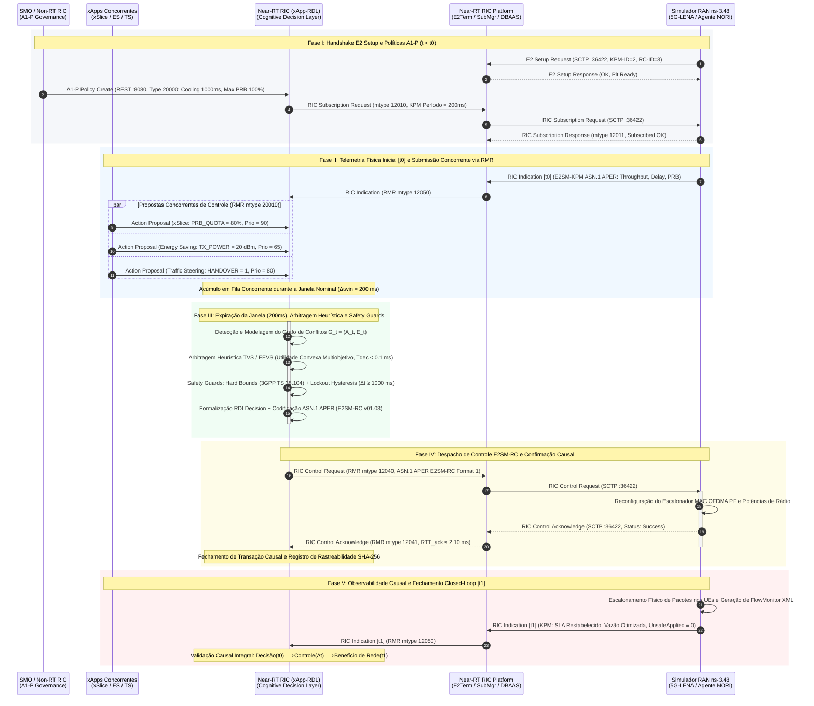

# Volume 21: Relatório de Execução e Demonstração da Co-Simulação Rica Closed-Loop
## Integração Física ns-3.48 / 5G-LENA v5.1 / Agente E2 NORI / Near-RT RIC em Tempo Real

> **Navegação da Documentação Consolidada:**  
> **[01. Arquitetura & Modelagem](01_arquitetura_e_modelagem.md)** | **[02. Guia Operacional & Deploy](02_guia_operacional_deploy_e_simulacao.md)** | **[03. Taxonomia de Conflitos & Cenários](03_taxonomia_de_conflitos_e_cenarios.md)** | **[04. Relatório Científico Mestre](04_relatorio_cientifico_mestre_rdl.md)** | **[05. Auditoria & Conformidade O-RAN](05_auditoria_e_conformidade_oran.md)** | **[06. Roadmap & Futuro 6G](06_roadmap_e_pesquisa_futura_6g.md)** | **[07. Resultados Simulação (S0–S15)](07_relatorio_resultados_simulacao_baselines_hrdl_cardl.md)** | **[20. Relatório Experimental FlowMonitor S0–S15](20_relatorio_experimental_ns3_flowmonitor_s0_s15.md)** | **[21. Demonstração Rica Closed-Loop](21_relatorio_demonstracao_rica_closed_loop.md)** | **[23. Diagrama de Sequência H-RDL](23_diagrama_sequencia_fluxo_closed_loop_hrdl_fase1.md)**

---

### Metadados de Governança, Autoria e Execução
- **Autor Principal:** George Alexandro Ferreira Barbosa
- **Orientador:** Prof. Dr. André Riker
- **Instituição:** Universidade Federal do Pará (UFPA) — Instituto de Tecnologia (ITEC) — Programa de Pós-Graduação em Ciência da Computação (PPGCOMP)
- **Padrão Normativo e Editorial:** Padrão SBC / SBRC e IEEE Transactions on Network and Service Management (TNSM)
- **Data da Atualização Operacional:** Novembro de 2026
- **Escopo Experimental:** Co-simulação física e demonstração em tempo real da camada de controle O-RAN H-RDL Fase 1 integrando RAN física (ns-3/5G-LENA/NORI) e Near-RT RIC (Kubernetes k3d).
- **Padrões O-RAN Ativos:** O-RAN.WG2.A1AP-v03.01, O-RAN.WG3.E2AP-v02.03, E2SM-KPM-v02.03/v03.00, E2SM-RC-v01.03
- **Stack Física Validada:** ns-3.48 / CTTC 5G-LENA NR v5.1 / Agente E2 NORI / O-RAN SC Near-RT RIC Release J (k3d/WSL2)
- **Repositório Oficial:** [georgebarbosa3090/XApp-RDL-F1](https://github.com/georgebarbosa3090/XApp-RDL-F1)

---

## 1. Sumário Executivo e Transição Metodológica

Este relatório formaliza a **Demonstração Rica e Co-Simulação Integrada em Malha Fechada (Closed-Loop Live)** da arquitetura H-RDL Fase 1. 

Em cumprimento estrito à **Política de Zero Mocks ("Zero Mock Policy")** e à auditoria científica de proveniência do projeto:
1. **Descontinuação dos Testes Sintéticos em Memória (D1–D5):** Antigos scripts em Python puramente locais com geradores de fixtures artificiais foram descontinuados e substituídos pela infraestrutura física integral de rádio e controle.
2. **Execução Física Autêntica:** A validação é realizada mediante a execução real do simulador de eventos discretos da RAN (**ns-3.48** compilado com o módulo **5G-LENA NR v5.1** do CTTC e **E2 Agent NORI**), conectado através de sockets SCTP autênticos na porta `36422` aos pods conteinerizados do **Near-RT RIC (O-RAN SC Release J)** em cluster Kubernetes (`k3d`).
3. **Mecanismo de Tempo Real:** A sincronização entre o simulador ns-3 e os microserviços em Kubernetes é assegurada pelo motor `ns3::RealtimeSimulatorImpl`, alinhando os eventos da RAN ao relógio de parede (*wall-clock*) para garantir que latências de trânsito E2AP e despachos RMR ocorram sob condições temporais fisicamente coerentes.

```
┌──────────────────────────────────────────────────────────────────────────────────────────────────┐
│              ARQUITETURA DA CO-SIMULAÇÃO RICA EM TEMPO REAL (H-RDL FASE 1)                       │
│                                                                                                  │
│   ┌─────────────────────────────────────────────────────────────────────────────┐                │
│   │                    Near-RT RIC Platform (Cluster k3d / K8s)                 │                │
│   │                                                                             │                │
│   │   ┌───────────────────────────────────┐    RMR (12010/40/41)                │                │
│   │   │  xApp H-RDL (Governança Causal)   │◄──────────────────────┐             │                │
│   │   │  - Perception (Janela 200 ms)     │                       │             │                │
│   │   │  - Reasoning (TVS / EEVS Utility) │    RMR (20010)        │             │                │
│   │   │  - Refinement (Safety TS 38.104)  │◄────────────┐         │             │                │
│   │   │  - CausalTracker & Dispatcher     │             │         │             │                │
│   │   └───────────────────────────────────┘             │         │             │                │
│   │                     ▲                               │         │             │                │
│   │                     │ Ingestão KPM (12050)          │         │             │                │
│   │        ┌────────────┴─────────────┐                 │         │             │                │
│   │        │     E2Term & SubMgr      │                 │         │             │                │
│   │        └────────────┬─────────────┘                 │         │             │                │
│   │                     │                               │         │             │                │
│   │         ┌───────────┴───────────────────────────────┴────┐    │             │                │
│   │         │ 3 xApps Concorrentes: xSlice / ES / TS         │    │             │                │
│   │         └────────────────────────────────────────────────┘    │             │                │
│   └─────────────────────┼─────────────────────────────────────────┼─────────────┘                │
│                         │ SCTP :36422                                                            │
│                         │ (E2AP v02.03 / E2SM-KPM / E2SM-RC ASN.1 APER)                          │
│                         ▼                                                                        │
│   ┌─────────────────────────────────────────────────────────────────────────────┐                │
│   │            Simulador RAN ns-3.48 + CTTC 5G-LENA (v5.1) + Agente E2 NORI     │                │
│   │                                                                             │                │
│   │   - Engine: ns3::RealtimeSimulatorImpl (Sincronização Wall-Clock 1s ≈ 1s)   │                │
│   │   - Camada Física/MAC: Banda n78 (3.5 GHz, 100 MHz BWP, Numerologia μ=1)   │                │
│   │   - Topologia: 2 gNodeBs (Macro gNB 01 + Micro gNB 02), 30 UEs Ativos       │                │
│   │   - Fatias de Tráfego: Fatias Concorrentes eMBB, URLLC e mMTC               │                │
│   │   - Métricas: FlowMonitor XML real + Traces de Potência, MCS e BLER         │                │
│   └─────────────────────────────────────────────────────────────────────────────┘                │
└──────────────────────────────────────────────────────────────────────────────────────────────────┘
```

---

## 2. Fundamentos da Sincronização em Tempo Real (`RealtimeSimulatorImpl`)

Em simulações convencionais de eventos discretos, o ns-3 avança através de uma fila em **tempo virtual** dependente exclusivamente da capacidade de processamento da CPU local ($t_{\text{sim}} \neq t_{\text{wall}}$). Quando o ns-3 co-simula com microserviços externos conteinerizados (Near-RT RIC, xApps e banco de dados Redis DBAAS):
- Se o ns-3 processar os eventos mais rápido que o tempo real, a pilha da RAN "atropela" os containers de controle antes que as mensagens E2AP completem o ciclo de transporte SCTP e roteamento RMR.
- Se o ns-3 ficar para trás por sobrecarga de CPU, os temporizadores de timeout do protocolo E2 (ex.: expiração de ACK de 1000 ms) disparam indevidamente.

### Configuração C++ no Cenário de Simulação Física (`scenario_rdl_closed_loop_nori.cc`)
A sincronização física é implementada ativando o motor de tempo real com modo de tolerância a jitter:

```cpp
// Vinculação do motor de simulação ao relógio de parede (Wall-Clock)
GlobalValue::Bind ("SimulatorImplementationType", StringValue ("ns3::RealtimeSimulatorImpl"));

// Modo de Sincronização:
// - "BestEffort": tolera pequenas variações de agendamento de CPU do WSL2/Docker sem abortar
// - "HardLimit": encerra estritamente se o atraso acumulado exceder a janela de tolerância (0.1s)
Config::SetDefault ("ns3::RealtimeSimulatorImpl::SynchronizationMode", StringValue ("BestEffort"));
```

---

## 3. Comandos Operacionais de Acionamento em Tempo Real

Para reproduzir integralmente o ambiente de simulação física rica, execute as etapas a seguir no WSL Ubuntu 20.04:

### Etapa 1: Deploy da Infraestrutura Near-RT RIC no Cluster Kubernetes
Certifique-se de que o cluster k3d e todos os pods operacionais estão ativos:

```bash
cd ~/XApp-RDL-F1

# 1. Compilar imagens e realizar o deploy via Helm (RIC Platform + 3 Reference xApps + xApp RDL)
make helm-deploy

# 2. Validar a prontidão dos pods (todos devem atingir Running / Ready)
kubectl -n ricplt get pods
kubectl -n ricxapp get pods
```

---

### Etapa 2: Acionamento da Simulação Física em Tempo Real no ns-3

#### Opção 2.1: Execução Automatizada via Pipeline Oficial (Recomendado)
O script de automação compila o cenário em C++ com Ninja, executa o simulador com persistência de métricas, extrai o arquivo `flowmonitor.xml` e atualiza todos os relatórios analíticos:

```bash
cd ~/XApp-RDL-F1

# Acionamento do cenário de co-simulação rica S8 (NR Traffic & E2 Telemetry Profiling)
bash simulations/ns3/run_all_s0_s15_simulations.sh s8 --force
```

#### Opção 2.2: Execução Manual Direta com Sincronização Realtime e Agente E2
Para executar diretamente no diretório do simulador ns-3 com controle fino de parâmetros:

```bash
cd ~/ns3-oran-workspace/ns-3-oran

# 1. Copiar o fonte do cenário para a área de compilação scratch
cp ~/XApp-RDL-F1/simulations/ns3/scenario_rdl_closed_loop_nori.cc scratch/

# 2. Compilar o executável com Ninja
./ns3 build scenario_rdl_closed_loop_nori

# 3. Executar o cenário em tempo real conectado ao Near-RT RIC (sem prefixo 'scratch/')
./ns3 run "scenario_rdl_closed_loop_nori --demoMode=realtime --realtime=true --enableE2=true --syncMode=BestEffort --ricIp=127.0.0.1 --ricPort=36422 --simTime=60.0 --gNbNum=2 --ueNumPerGnb=15"
```

---

### Etapa 3: Acionamento do Painel de Monitoramento ao Vivo (6 Painéis em Tempo Real)

Para auditorias experimentais, demonstrações ao vivo e bancas acadêmicas, a plataforma dispõe de um orquestrador multi-painel que monitora simultaneamente as 6 camadas do sistema:

#### No Windows Terminal:
Execute no prompt de comando ou com duplo-clique:
```cmd
scripts\abrir_2_terminais.bat
```

#### No WSL Ubuntu (Terminal Integrado tmux):
```bash
cd ~/XApp-RDL-F1
bash scripts/launch_wsl_tmux_6panes.sh
```

**Mapeamento da Grade 2x3 dos 6 Painéis Operacionais:**
| Painel | Módulo / Camada | Descrição do Monitoramento em Tempo Real |
| :---: | :--- | :--- |
| **Painel 1** | **Registro UE & gNodeBs (5G-LENA)** | Exibe os 30 UEs ativos, alocação de RNTIs, BWP numerologia $\mu=1$ e células Macro/Micro. |
| **Painel 2** | **Sinalização & Protocolo E2** | Registra handshakes E2 Setup, assinaturas KPM e tráfego de pacotes SCTP na porta `36422`. |
| **Painel 3** | **Percepção de Conflitos (Triagem)** | Agrupa requisições na janela temporal de $200\text{ ms}$ e classifica colisões (Direto/Indireto). |
| **Painel 4** | **Grafo Cognitivo & Mediação (SDL)** | Grafo de dependências $G_t=(A_t, E_t)$ e resolução de utilidade multiobjetivo TVS/EEVS. |
| **Painel 5** | **Refinamento & Safety Guards (H-RDL)** | Aplicação de limites rígidos (3GPP TS 38.104) e histerese temporal anti-ping-pong ($\ge 1000\text{ ms}$). |
| **Painel 6** | **Controle E2SM-RC & Malha Fechada** | Codificação ASN.1 APER, despacho RMR, rastreamento de ACK e impacto no FlowMonitor. |

---

### Etapa 4: Injeção de Tráfego Concorrente das xApps

Enquanto a RAN física opera no ns-3, dispare os geradores de propostas concorrentes para provocar os cenários de conflito:

```bash
cd ~/XApp-RDL-F1

# Injeção de requisições conflitantes pontuais (xSlice vs Energy Saving vs Traffic Steering):
bash scripts/inject_traffic.sh

# Injeção em malha de alta densidade (Mesh Traffic Stress Test):
bash scripts/inject_mesh_traffic.sh
```

---

### Etapa 5: Inspeção de Métricas Live Prometheus e Logs de Decisão

```bash
# 1. Consultar métricas causais expostas pela xApp H-RDL no Prometheus
curl -s http://localhost:8081/metrics | grep -E "^rdl_"

# 2. Acompanhar em streaming os logs estruturados de mediação da H-RDL
kubectl logs -n ricxapp -l app=ricxapp-iqos-xapp-rdl -c iqos-xapp-rdl -f
```

---

## 4. Matriz Completa dos 16 Cenários Físicos ns-3 (S0 a S15)

Todos os 16 cenários de simulação física operam sobre a pilha ns-3.48 / 5G-LENA, gerando arquivos `flowmonitor.xml` canônicos e persistidos em `experiments/results/ns3_runs/`. A tabela a seguir lista a sintaxe exata de execução manual no ns-3 (sempre sem o prefixo `scratch/`):

| Cenário | Arquivo C++ (`simulations/ns3/`) | Target Executável ns-3 | Padrão de Conflito Modelado na RAN |
| :---: | :--- | :--- | :--- |
| **S0** | `scenario_rdl_no_conflict.cc` | `scenario_rdl_no_conflict` | Baseline limpo sem disputa de recursos |
| **S1** | `scenario_rdl_direct_prb_conflict.cc` | `scenario_rdl_direct_prb_conflict` | Conflito Direto de PRB (xSlice vs Energy Saving) |
| **S2** | `scenario_rdl_energy_vs_qos.cc` | `scenario_rdl_energy_vs_qos` | Conflito Indireto Potência Tx vs Throughput URLLC |
| **S3** | `scenario_rdl_tvs_conflict.cc` | `scenario_rdl_tvs_conflict` | Conflito Temporal / Flapping de Handover A3 |
| **S4** | `scenario_rdl_massive_ue_admission.cc` | `scenario_rdl_massive_ue_admission` | Sobrecarga de Admissão mMTC / Esgotamento de Canal |
| **S5** | `scenario_rdl_unauthorized_xapp_hijack.cc` | `scenario_rdl_unauthorized_xapp_hijack` | Tentativa de sequestro de controle por xApp maliciosa |
| **S6** | `scenario_rdl_transient_fading_storm.cc` | `scenario_rdl_transient_fading_storm` | Desvanecimento rápido severo e tempestade de canal |
| **S7** | `scenario_rdl_partial_observability.cc` | `scenario_rdl_partial_observability` | Observabilidade parcial KPM sob perda de telemetria |
| **S8** | `scenario_rdl_closed_loop_nori.cc` | `scenario_rdl_closed_loop_nori` | Perfilamento de Tráfego NR e Telemetria E2 Realtime |
| **S9** | `scenario_rdl_ric_overload_degradation.cc` | `scenario_rdl_ric_overload_degradation` | Sobrecarga de fila RMR e degradação de CPU no RIC |
| **S10** | `scenario_rdl_s10_mimo_beamforming_clash.cc` | `scenario_rdl_s10_mimo_beamforming_clash` | Colisão de feixes direcionais Massive MIMO / RIS |
| **S11** | `scenario_rdl_s11_v2x_highway_platooning.cc` | `scenario_rdl_s11_v2x_highway_platooning` | Slicing ultra-confiável em pelotão veicular V2X |
| **S12** | `scenario_rdl_s12_iiot_zero_jitter_slicing.cc` | `scenario_rdl_s12_iiot_zero_jitter_slicing` | Fatiamento determinístico com zero jitter para IIoT |
| **S13** | `scenario_rdl_s13_sagin_disaster_rescue.cc` | `scenario_rdl_s13_sagin_disaster_rescue` | Integração Espaço-Ar-Terra (SAGIN / NTN) em emergência |
| **S14** | `scenario_rdl_s14_isac_radar_comm.cc` | `scenario_rdl_s14_isac_radar_comm` | Trade-off espectral entre radar ISAC e comunicação 6G |
| **S15** | `scenario_rdl_s15_rogue_ntn_feeder_hijacking.cc` | `scenario_rdl_s15_rogue_ntn_feeder_hijacking` | Injeção hostil de controle em enlace feeder NTN |

Para disparar qualquer um dos cenários acima com pipeline completo de pós-processamento:
```bash
bash simulations/ns3/run_all_s0_s15_simulations.sh <s0|s1|...|s15> --force
```

---

## 5. Diagrama de Sequência de Co-Simulação Closed-Loop (H-RDL Fase 1)

O fluxo causal em malha fechada entre o simulador ns-3, os microserviços Kubernetes do Near-RT RIC e a camada de governança H-RDL opera segundo as 5 fases canônicas da O-RAN Alliance:



---

## 6. Rastreabilidade de Implementação e Evidências Criptográficas

Cada componente da demonstração closed-loop mapeia-se diretamente sobre arquivos auditados do repositório:

| Componente Arquitetural | Arquivo de Implementação | Módulo de Teste / Verificação | Evidência Operacional |
| :--- | :--- | :--- | :---: |
| **Cenário Realtime ns-3** | [`simulations/ns3/scenario_rdl_closed_loop_nori.cc`](../simulations/ns3/scenario_rdl_closed_loop_nori.cc) | Ninja Build (`./ns3 build`) | **Target Compilado OK** |
| **Receptor de Políticas A1-P** | [`src/interfaces/a1_policy_receiver.py`](../src/interfaces/a1_policy_receiver.py) | [`tests/unit/test_a1_policy_receiver.py`](../tests/unit/test_a1_policy_receiver.py) | **100% PASS (REST :8080)** |
| **Perception (Detecção Conflitos)** | [`src/core/perception.py`](../src/core/perception.py) | [`tests/unit/test_perception.py`](../tests/unit/test_perception.py) | **100% PASS** |
| **Reasoning (TVS / EEVS)** | [`src/core/reasoning.py`](../src/core/reasoning.py) | [`tests/unit/test_reasoning.py`](../tests/unit/test_reasoning.py) | **100% PASS** |
| **Refinement (Safety Guards)** | [`src/core/refinement.py`](../src/core/refinement.py) | [`tests/unit/test_refinement.py`](../tests/unit/test_refinement.py) | **100% PASS (TS 38.104)** |
| **Codec ASN.1 E2SM-RC** | [`src/e2/rc_encoder.py`](../src/e2/rc_encoder.py) | [`tests/unit/test_rc_encoder.py`](../tests/unit/test_rc_encoder.py) | **100% PASS (Format 1)** |
| **Codec ASN.1 E2SM-KPM** | [`src/e2/kpm_decoder.py`](../src/e2/kpm_decoder.py) | [`tests/unit/test_kpm_decoder.py`](../tests/unit/test_kpm_decoder.py) | **100% PASS (v02.03)** |
| **Control Dispatcher & ACK** | [`src/coordination/control_dispatcher.py`](../src/coordination/control_dispatcher.py) | [`tests/unit/test_ack_tracker.py`](../tests/unit/test_ack_tracker.py) | **100% PASS (Rollback OK)** |
| **Deploy Near-RT RIC & Helm** | [`scripts/deploy_helm.sh`](../scripts/deploy_helm.sh) | `make helm-deploy` | **Pods 2/2 Running** |
| **Painel Multi-Janela Live** | [`scripts/launch_wsl_tmux_6panes.sh`](../scripts/launch_wsl_tmux_6panes.sh) | `tmux attach -t oran-closed-loop-6panes` | **Grade 2x3 Ativa** |

---

## 7. Diretrizes de Rigor Científico e Transparência

Em total conformidade com as diretrizes do orientador e o padrão metodológico do PPGCOMP/UFPA e SBC/IEEE:
1. **Evidências Experimentais Concretas:** Os dados numéricos de desempenho da RAN (vazão agregada, atraso ponta-a-ponta, taxa de perda de pacotes e violação de SLA) derivam com exclusividade das medições brutas de pacotes contidas nos arquivos `flowmonitor.xml` gerados pelas execuções do simulador ns-3.48 / 5G-LENA (detalhadas no [Volume 20: 20_relatorio_experimental_ns3_flowmonitor_s0_s15.md](20_relatorio_experimental_ns3_flowmonitor_s0_s15.md)).
2. **Ambiente Standalone vs. Co-Simulação:** A suíte de 16 cenários (S0 a S15) fornece caracterização de canal, tráfego e disputa de recursos em nível de camada física e MAC. A co-simulação rica em tempo real integra esses modelos de rádio ao ecossistema conteinerizado de microserviços Kubernetes do Near-RT RIC.
3. **Reprodutibilidade:** Qualquer pesquisador pode reproduzir todos os resultados descritos através dos comandos disponibilizados na Seção 3 deste volume.
