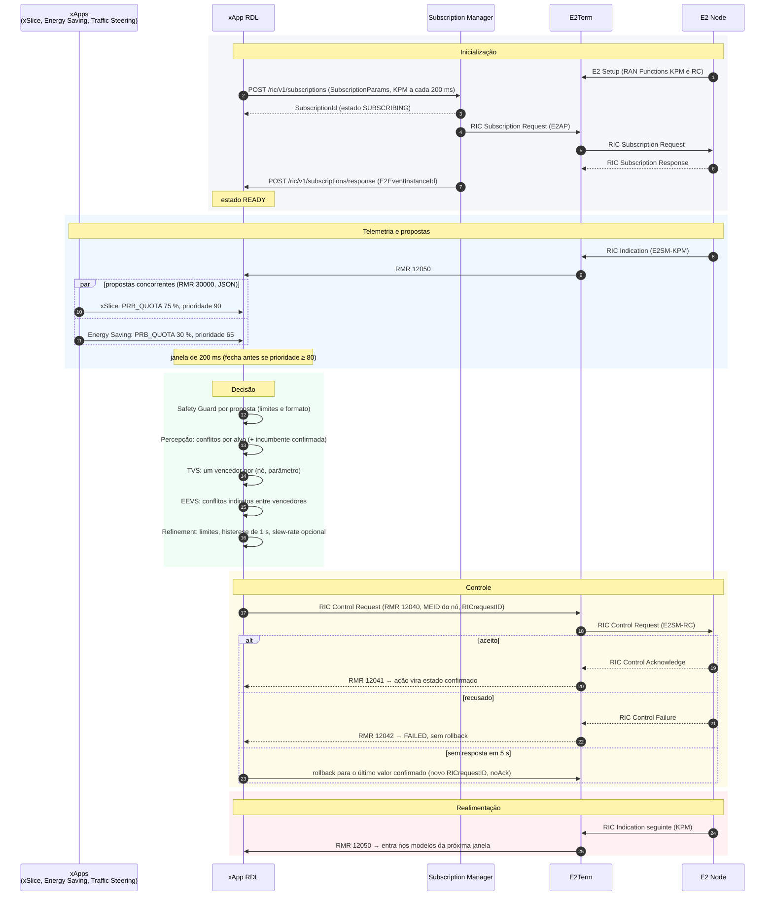

# 23 — Fluxo de mensagens da H-RDL

Diagrama de sequência do ciclo implementado: subscrição, telemetria, propostas, decisão, controle e resposta. **Nenhum trecho deste fluxo foi exercitado contra um E2 Node e um Near-RT RIC reais**; os tempos indicados são parâmetros de configuração, não medições.

## Mensagens

| Mensagem | Transporte | Identificador | Origem → destino | Código |
| :-- | :-- | :-- | :-- | :-- |
| Pedido de subscrição | REST | `POST /ric/v1/subscriptions` | xApp → SubMgr | `src/infrastructure/subscription_manager.py` |
| Notificação de subscrição | REST | `POST /ric/v1/subscriptions/response` | SubMgr → xApp | `src/observability/health_server.py`, `RDLxApp._subscription_notification_handler` |
| RIC Indication | RMR | 12050 | E2Term → xApp | `RDLxApp._kpm_indication_handler` |
| Proposta de ação | RMR | 30000 | xApp → xApp RDL | `RDLxApp._action_proposal_handler` |
| RIC Control Request | RMR com MEID | 12040 | xApp RDL → E2Term | `ControlDispatcher.dispatch_control`, `rmr_transport.send_rmr_message` |
| RIC Control Acknowledge | RMR | 12041 | E2Term → xApp RDL | `ControlDispatcher.handle_ack` |
| RIC Control Failure | RMR | 12042 | E2Term → xApp RDL | `ControlDispatcher.handle_failure` |

## Parâmetros de tempo

| Parâmetro | Valor | Onde |
| :-- | :-- | :-- |
| Janela de decisão | 200 ms | `RDLxApp.WINDOW_DURATION_MS` |
| Histerese por alvo | 1000 ms | `Refinement.config["minimum_control_interval_ms"]` |
| Timeout de controle | 5 s | `ControlDispatcher(default_timeout_s=5.0)` |
| Período KPM pedido | 200 ms | backend (`default_kpm_period_ms`) |
| Retenção de transações finalizadas | 5 min | `ControlDispatcher.prune_finalized` |

Versões das figuras para a dissertação: [`figures/diagrama_sequencia_compacto_dissertacao.mermaid`](figures/diagrama_sequencia_compacto_dissertacao.mermaid), [`.puml`](figures/diagrama_sequencia_compacto_dissertacao.puml) e [`.tex`](figures/diagrama_sequencia_compacto_dissertacao.tex).
