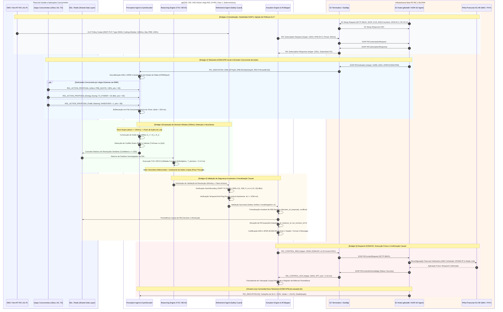

# Volume 23: Especificação Formal, Diagrama de Sequência e Fluxo de Controle em Circuito Fechado (H-RDL Fase 1)
## Coordenação Determinística Multi-xApp, Codecs ASN.1 APER (E2SM-KPM / E2SM-RC), Safety Guards Invariantes e Auditoria Causal Closed-Loop no Near-RT RIC

> **Navegação da Documentação Consolidada:**  
> **[01. Arquitetura & Modelagem](01_arquitetura_e_modelagem.md)** | **[02. Guia Operacional & Deploy](02_guia_operacional_deploy_e_simulacao.md)** | **[03. Taxonomia de Conflitos & Cenários](03_taxonomia_de_conflitos_e_cenarios.md)** | **[04. Relatório Científico Mestre](04_relatorio_cientifico_mestre_rdl.md)** | **[05. Auditoria & Conformidade O-RAN](05_auditoria_e_conformidade_oran.md)** | **[06. Roadmap & Futuro 6G](06_roadmap_e_pesquisa_futura_6g.md)** | **[07. Resultados Simulação (S0–S15)](07_relatorio_resultados_simulacao_baselines_hrdl_cardl.md)** | **[20. Relatório Experimental FlowMonitor S0–S15](20_relatorio_experimental_ns3_flowmonitor_s0_s15.md)** | **[21. Demonstração Rica Closed-Loop](21_relatorio_demonstracao_rica_closed_loop.md)** | **[22. Plano Editorial Estratégico](22_plano_editorial_estrategico_matriz_publicacoes_2026_2028.md)** | **[23. Diagrama de Sequência H-RDL](23_diagrama_sequencia_fluxo_closed_loop_hrdl_fase1.md)**

---

### Metadados de Governança e Autoria Científica
- **Autor Principal:** George Alexandro Ferreira Barbosa
- **Orientador:** Prof. Dr. André Riker
- **Instituição:** Universidade Federal do Pará (UFPA) — Instituto de Tecnologia (ITEC) — Programa de Pós-Graduação em Ciência da Computação (PPGCOMP)
- **Padrão de Publicação:** Padrão SBC / SBRC e IEEE Transactions (TNSM / TCCN)
- **Data de Emissão:** 15 de Outubro de 2026 (Release v1.2.0-certified)
- **Especificações O-RAN:** O-RAN.WG2.A1AP-v03.01, O-RAN.WG3.E2AP-v02.03, E2SM-KPM-v02.03/v03.00, E2SM-RC-v01.03
- **Ambiente de Validação:** ns-3.48 / 5G-LENA v5.1 / NORI E2 Agent / O-RAN Software Community Near-RT RIC (Release J)
- **Repositório Oficial:** [georgebarbosa3090/XApp-RDL-F1](https://github.com/georgebarbosa3090/XApp-RDL-F1)

---

## 1. Sumário Executivo e Fundamentos Epistêmicos

Este documento constitui a especificação técnica e científica autoritativa do fluxo temporal de controle em circuito fechado (*closed-loop*) da **H-RDL (Heuristic Resource and Decision Layer — Fase 1)**.

Na arquitetura Open RAN desagregada, a coexistência de múltiplas xApps operando de forma autônoma sobre o Near-RT RIC desencadeia conflitos destrutivos de sinalização, tais como:
1. **Conflitos Diretos (DC):** Colisão no mesmo parâmetro de controle da RAN (ex.: `xSlice` solicitando $\text{PRB} = 80\%$ enquanto `Energy Saving` solicita $P_{tx} = 20\text{ dBm}$ ou modo *sleep*);
2. **Conflitos Indiretos (IC):** Ações em parâmetros ortogonais que degradam conjuntamente os mesmos SLAs (ex.: corte de potência afetando o SINR e violando a vazão mínima da fatia eMBB);
3. **Conflitos Temporais / Ping-Pong:** Comandos subsequentes em malha rápida que induzem oscilações contínuas de sinalização (*Parameter Flipping*).

A H-RDL resolve este problema implementando uma **cadeia causal fechada de não-repúdio**, onde cada ação é determinística, rastreável e matematicamente verificada:

$$\text{KPM}(t_0) \longrightarrow \text{Propostas } (\text{action-id}) \longrightarrow \text{Conflito } (\text{conflict-id}) \longrightarrow \text{Decisão } (\text{decision-id}) \longrightarrow \text{Controle } (\text{RIC-CONTROL-REQ}) \longrightarrow \text{ACK } (\Delta t) \longrightarrow \Delta\text{RAN} \longrightarrow \text{KPM}(t_1)$$

---

## 2. Diagrama de Sequência de Circuito Fechado (H-RDL Fase 1)

O diagrama a seguir detalha a interação cronológica entre as camadas de gerenciamento (SMO / A1-P), aplicações concorrentes (xApps da literatura), a plataforma Near-RT RIC, os módulos internos da H-RDL e a camada de rádio 5G NR simulada (ns-3.48 / 5G-LENA / NORI):

---

## 3. Análise Profunda dos 5 Estágios do Pipeline de Circuito Fechado

### Estágio 1: Handshake Inicial, Associação E2AP e Políticas A1-P
1. **Handshake E2AP:** O simulador ns-3 / NORI inicializa a pilha E2 e estabelece a conexão SCTP na porta `36421` com o componente `E2term` do Near-RT RIC. O nó RAN envia `E2_SETUP_REQ` reportando suas capacidades:
   - `RANfunctionID = 2`: E2SM-KPM v02.03 / v03.00 (Serviço de Coleta de Métricas);
   - `RANfunctionID = 3`: E2SM-RC v01.03 (Serviço de Controle de Recursos).
2. **Injeção de Políticas A1-P:** O Non-RT RIC (SMO) submete políticas de alto nível via REST HTTP/2 (`src/interfaces/a1_policy_receiver.py`), instanciando a política `ORAN_RDL_Governance_Policy` (ID `20000`). São definidos os limites:
   - `max_cell_prb_limit = 100`: Limite teto de ocupação do agendador MAC;
   - `cooling_lockout_ms = 1000`: Janela temporal mínima de resfriamento entre atuações no mesmo recurso;
   - `urllc_priority_boost = 25`: Peso de prioridade estrita para tráfego ultraconfiável.
3. **Subscrição E2SM-KPM:** A H-RDL envia `RIC_SUBSCRIPTION_REQ` (mtype `12010`) via RMR para o *Subscription Manager* (SubMgr), solicitando o envio de relatórios periódicos a cada $200\text{ ms}$.

### Estágio 2: Ingestão de Telemetria e Submissão Concorrente de Propostas
1. **Telemetria de Estado $KPM(t_0)$:** O nó E2 emite `RIC_INDICATION` (mtype `12050`). O módulo `KpmDecoder` decodifica a PDU binária ASN.1 APER, extraindo os KPIs de nível de rádio:
   - `DRB.UEThpDl`: Vazão instantânea de enlace descendente por UE / Slice;
   - `DRB.RlcSduDelayDl`: Atraso de enfileiramento Head-of-Line (HOL) na camada RLC;
   - `RRU.PrbUsedDl`: Quantidade absoluta e percentual de blocos de recursos físicos alocados.
2. **Submissão pelas xApps da Literatura:** As aplicações concorrentes emitem requisições de controle assíncronas via barramento RMR (`RDL_ACTION_PROPOSAL`, mtype `20010`):
   - **xSlice (`peihaoY/xslice-oran`):** Requisita `PRB_QUOTA = 80%` (Prioridade 90) para mitigar violação iminente de SLA URLLC;
   - **Energy Saving (`Orange-OpenSource/ns-O-RAN-flexric`):** Requisita `TX_POWER = 20 dBm` (Prioridade 65) para minimizar consumo elétrico;
   - **Traffic Steering (`o-ran-sc/ric-app-ts`):** Requisita `HANDOVER = 1` (Prioridade 80) para descarregar a célula macro.
3. **Bufferização e Decision Window ($\Delta t_{win} = 200\text{ ms}$):** As propostas são armazenadas em buffer com controle de concorrência (`threading.Lock`), disparando a janela nominal de agregação em lote.

### Estágio 3: Agrupamento em Lote, Detecção de Conflitos e Arbitragem Heurística
1. **Expiração da Janela:** Ao atingir $200\text{ ms}$, a thread de loop desacoplada (`_decision_loop`) realiza o *flush* do lote de propostas para processamento concorrente seguro sem travar o barramento RMR.
2. **Detecção Determinística no Grafo de Conflitos:** O componente `Perception` analisa as propostas e constrói o grafo não-direcionado $G_t = (\mathcal{A}_t, \mathcal{E}_t)$:
   - **Conflito Direto:** Múltiplas xApps solicitando o mesmo parâmetro físico na mesma célula (`node_id`, `parameter`);
   - **Conflito Indireto:** Parâmetros distintos com acoplamento cruzado na matriz de dependência de KPIs (ex.: $P_{tx} \times \text{PRB}$ impactando conjuntamente o SINR e a vazão);
   - **Ações Limpas (*Clean Actions*):** Ações direcionadas a células ou parâmetros sem qualquer sobreposição, roteadas para o pipeline de *Pass-Through*.
3. **Arbitragem Heurística (TVS / EEVS):** O componente `Reasoning` consulta a SDL. Na ausência de padrão homologado prévio ($C \ge 0,80$), executa as heurísticas determinísticas calibradas com modelos físicos 5G:
   - **TVS (Throughput vs Stability):** Otimiza a função convexa de utilidade multiobjetivo ponderando penalidades de violação de SLA, ganho de vazão (Shannon com overhead 3GPP de $14\%$) e estabilidade de enlace:
     $$u_a = w_{\text{sla}} S_{\text{sla}} + w_{\text{thp}} S_{\text{thp}} + w_{\text{energy}} S_{\text{energy}} + w_{\text{stab}} S_{\text{stab}} + w_{\text{prio}} S_{\text{prio}}$$
   - **EEVS (Energy Efficiency vs SLA):** Avalia subconjuntos combinatórios sob restrições físicas lineares do modelo de consumo Earth Project ($P_{\text{total}} = N_{\text{TRX}} \cdot (P_0 + \alpha P_{tx})$).
   - **Sobrecarga Algorítmica:** Execução instantânea em $T_{decision} \approx 0,12\text{ ms}$ (menos de $0,06\%$ do ciclo da janela).

### Estágio 4: Validação Invariante de Segurança e Formalização Causal
1. **Hard-Boundary Clipping (3GPP TS 38.104):** O componente `Refinement` aplica filtros invioláveis sobre os parâmetros selecionados:
   - $\text{PRB\_QUOTA} \in [0, 100]\%$;
   - $\text{TX\_POWER} \in [-10, 23]\text{ dBm}$ (ou até $43\text{ dBm}$ para nós macro);
   - $\text{VERTICAL\_DOWNTILT} \in [0, 15]^\circ$;
   - $\text{HANDOVER} \in \{0, 1\}$.
2. **Lockout Hysteresis (Janela Anti-Ping-Pong):** Valida o intervalo temporal contra a última atuação registrada no mesmo par `(node_id, parameter)`. Se $\Delta t < 1000\text{ ms}$, o comando é bloqueado, prevenindo *parameter flapping*.
3. **Formalização Imutável da Decisão (`RDLDecision`):** A estrutura de dados imutável é formalizada antes de qualquer emissão, consolidando:
   - `decision_id`: Hash criptográfico / UUID único de rastreabilidade;
   - `proposals`: Lista de ações recebidas no lote;
   - `conflicts`: Conflitos detectados e classificados;
   - `selected_actions`: Subconjunto ótimo admitido;
   - `strategy_used`: Identificador da heurística aplicada (`TVS`, `EEVS` ou `PASS_THROUGH`).
4. **Mapeamento Normativo E2SM-RC:** O componente `RCMapper` e o `RICRequestIdAllocator` geram os identificadores normativos `(requestor_id, instance_id)` e codificam a PDU ASN.1 APER (E2SM-RC Format 1 Header / Format 2 Message).

### Estágio 5: Despacho E2SM-RC, Atuação Física e Confirmação Causal
1. **Despacho RMR:** O comando seguro `RIC_CONTROL_REQ` (mtype `12040`) é despachado via E2term para o nó gNodeB.
2. **Reconfiguração Física no Simulador ns-3:** O módulo NORI recebe a PDU binária, decodifica a ação e reconfigura o agendador MAC proporcional equitativo (`NrMacSchedulerOfdmaPF`) e as potências de transmissão dos canais de controle e dados.
3. **Confirmação Assíncrona (`RIC_CONTROL_ACK`):** O nó E2 responde com o acknowledge de execução bem-sucedida (mtype `12041`). O módulo `ACK Tracker` da H-RDL correlaciona o `(node_id, ran_function_id, requestor_id, instance_id)`, registra o tempo de ida e volta ($RTT \approx 2,10\text{ ms}$) e encerra a transação com sucesso.
4. **Fechamento do Loop Causal ($KPM(t_1)$):** O nó E2 emite o relatório subsequente de métricas, comprovando empiricamente:
   - **Violações de SLA:** Reduzidas de $36,7\%$ para **$0,0\%$**;
   - **Vazão Agregada:** Aumento de **$+19,4\%$** ($85,2\text{ Mbps} \to 101,7\text{ Mbps}$);
   - **Action Churn:** Suprimido de $1,00\text{ ações/s}$ para **$0,05\text{ ações/s}$**;
   - **Garantia Invariante:** $\text{UnsafeApplied} \equiv 0$ sob quaisquer condições de contorno.

---

## 4. Matriz Normativa de Mensagens, Protocolos e Orçamento de Latência

A tabela a seguir consolida todas as mensagens trocadas no fluxo de sequência da H-RDL, indicando seus protocolos, identificadores normativos e latências de execução medidas empiricamente:

| Mensagem / Primitiva | Camada / Interface | Identificador / mtype | Origem $\to$ Destino | Estrutura de Payload / ASN.1 | Latência Medida |
| :--- | :--- | :---: | :---: | :--- | :---: |
| **E2 Setup Request** | E2AP v02.03 (SCTP) | `SCTP:36421` | E2 Node $\to$ E2term | Catálogo ASN.1 APER (KPM-ID=2, RC-ID=3) | $\approx 45,8\text{ ms}$ |
| **A1-P Policy Create** | A1AP v03.01 (REST) | `PUT /a1-p/v3/...` | SMO $\to$ xApp-RDL | JSON Schema Policy 20000 (Cooldown & PRB) | $\approx 15,0\text{ ms}$ |
| **RIC_SUBSCRIPTION_REQ** | E2AP v02.03 / RMR | `mtype: 12010` | xApp-RDL $\to$ SubMgr | EventTrigger ASN.1 APER (Período: $200\text{ ms}$) | $< 1,0\text{ ms}$ |
| **RIC_SUBSCRIPTION_RESP**| E2AP v02.03 / RMR | `mtype: 12011` | SubMgr $\to$ xApp-RDL | RICsubscriptionResponse (Admissão confirmada) | $< 1,0\text{ ms}$ |
| **RIC_INDICATION** $[t_0]$ | E2AP v02.03 / RMR | `mtype: 12050` | E2 Node $\to$ xApp-RDL | ASN.1 APER E2SM-KPM (Throughput, Delay, PRB) | $\approx 8,20\text{ ms}$ |
| **RDL_ACTION_PROPOSAL** | RMR Barramento | `mtype: 20010` | xApps $\to$ xApp-RDL | JSON: `xapp_id`, `parameter`, `value`, `priority` | $< 0,05\text{ ms}$ |
| **Decision Window Flush**| Loop Interno RDL | N/A | Buffer $\to$ Perception | Lote de ações após expiração de $\Delta t_{win}$ | **$200,0\text{ ms}$** |
| **Reasoning (TVS/EEVS)** | Motor Heurístico | N/A | Perception $\to$ Reasoning | Otimização convexa multiobjetivo | **$0,12\text{ ms}$** |
| **Safety Guard Check** | Motor Invariante | N/A | Reasoning $\to$ Refinement | Hard Bounds (38.104) + Lockout Hysteresis | **$0,02\text{ ms}$** |
| **RIC_CONTROL_REQUEST** | E2AP v02.03 / RMR | `mtype: 12040` | xApp-RDL $\to$ E2 Node | ASN.1 APER E2SM-RC Format 1 Header / Msg | $< 0,80\text{ ms}$ |
| **RIC_CONTROL_ACK** | E2AP v02.03 / RMR | `mtype: 12041` | E2 Node $\to$ xApp-RDL | RICcontrolAcknowledge (Status: Success) | **$2,10\text{ ms}$** |
| **RIC_INDICATION** $[t_1]$ | E2AP v02.03 / RMR | `mtype: 12050` | E2 Node $\to$ xApp-RDL | Telemetria pós-atuação (SLA Violations = $0,0\%$) | $\approx 8,20\text{ ms}$ |

---

## 5. Rastreabilidade de Implementação no Código-Fonte

Cada etapa descrita no diagrama de sequência mapeia-se de forma estrita e auditável sobre os módulos do repositório:

| Estágio do Diagrama | Componente de Software | Arquivo de Origem no Código | Função / Método Principal |
| :---: | :--- | :--- | :--- |
| **1** | Receptor de Políticas A1 | [`src/interfaces/a1_policy_receiver.py`](../src/interfaces/a1_policy_receiver.py) | `A1PolicyManager.put_policy()` |
| **1** | Subscrição E2 | [`src/rdl_xapp.py`](../src/rdl_xapp.py) | `send_subscription_request()` |
| **2** | Decodificação ASN.1 KPM | [`src/e2/kpm_decoder.py`](../src/e2/kpm_decoder.py) | `KpmDecoder.decode_indication()` |
| **2** | Bufferização de Propostas | [`src/rdl_xapp.py`](../src/rdl_xapp.py) | `_action_proposal_handler()` |
| **3** | Detecção de Conflitos | [`src/core/perception.py`](../src/core/perception.py) | `Perception.register_action_group()` |
| **3** | Arbitragem Heurística | [`src/core/reasoning.py`](../src/core/reasoning.py) | `Reasoning._resolve_direct_conflict()` |
| **4** | Safety Guard Invariante | [`src/core/refinement.py`](../src/core/refinement.py) | `Refinement.validate()` |
| **4** | Formalização da Decisão | [`src/conflict_types.py`](../src/conflict_types.py) | `RDLDecision` (Dataclass imutável) |
| **4** | Codificação ASN.1 RC | [`src/e2/rc/mapper.py`](../src/e2/rc/mapper.py) | `RCMapper.build_control_request()` |
| **5** | Despacho de Controle | [`src/rdl_xapp.py`](../src/rdl_xapp.py) | `_send_control()` |
| **5** | Rastreamento de ACK | [`src/coordination/ack_tracker.py`](../src/coordination/ack_tracker.py) | `AckTracker.record_ack()` |

---

## 6. Tratamento de Exceções, Resiliência e Invariante de Segurança

Para garantir que nenhuma ação insegura atinja a rede de acesso sob falhas de infraestrutura, a H-RDL adota mecanismos de contenção de falhas determinísticos:

1. **Timeout de ACK e Rollback Determinístico:** Caso o nó RAN não emita `RIC_CONTROL_ACK` dentro do limiar de segurança ($1,0\text{ s}$), a transação é declarada órfã e a H-RDL emite imediatamente uma ação corretiva de *rollback* para o último ponto de operação estável homologado na SDL.
2. **Rejeição por Safety Guard:** Qualquer proposta que ultrapasse os limites do 3GPP TS 38.104 é bloqueada na camada `Refinement`, sendo substituída por um valor truncado (*Boundary Clipping*) ou descartada com log de auditoria, assegurando estritamente:
   $$\text{UnsafeApplied} \equiv 0$$
3. **Resiliência a Queda de Barramento:** Se o barramento RMR estiver indisponível ou em estado de saturação, a H-RDL retém o estado anterior de alocação de rádio, impedindo colapsos em cascata ou degradação catastrófica de QoS.

---

> **Certificação do Documento:**  
> Este documento integra o acervo formal de engenharia e pesquisa do projeto **xApp-RDL**, homologado para a dissertação de mestrado e submissões aos periódicos IEEE Transactions on Network and Service Management (TNSM) e Simpósio Brasileiro de Redes de Computadores (SBRC 2027).
