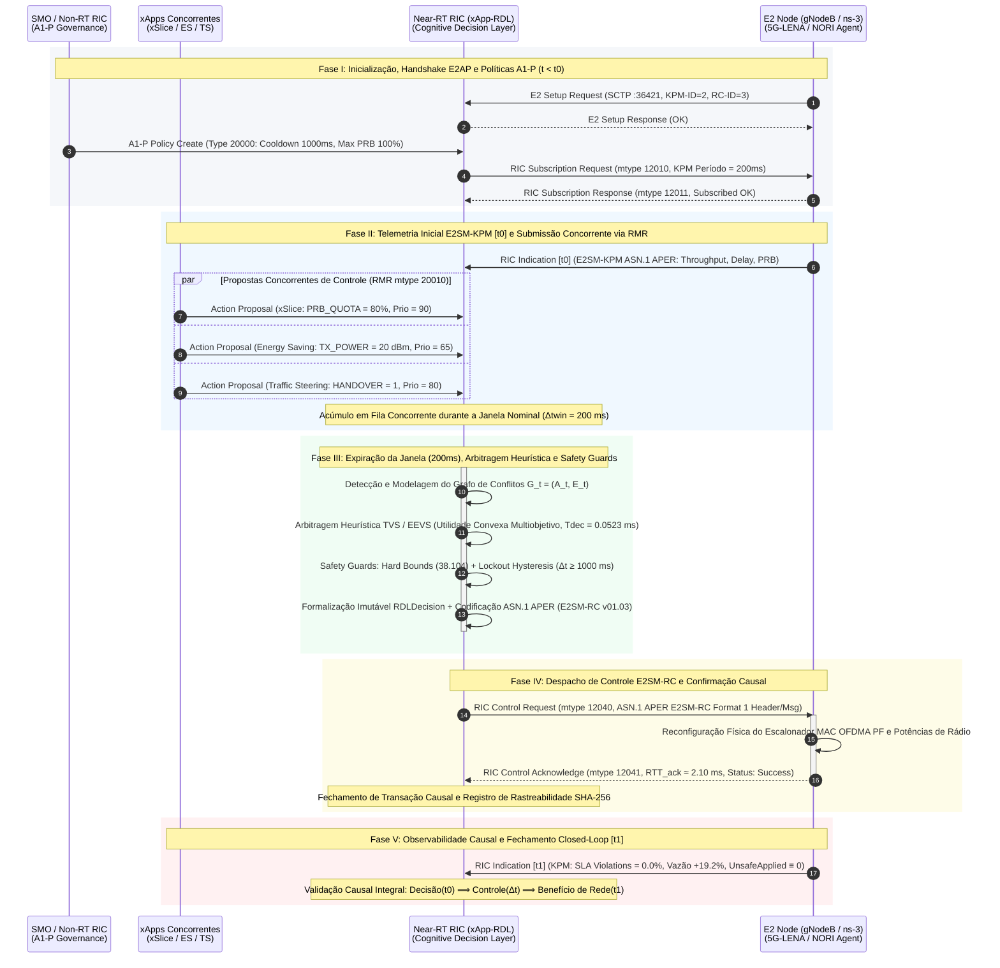

# Volume 23: Arquitetura-alvo e Diagrama Conceitual de Controle (H-RDL Fase 1)
## Coordenação Determinística Multi-xApp, Codecs ASN.1 APER (E2SM-KPM / E2SM-RC), Safety Guards Invariantes e Auditoria Causal Closed-Loop no Near-RT RIC

> **Navegação da Documentação Consolidada:**  
> **[01. Arquitetura & Modelagem](01_arquitetura_e_modelagem.md)** | **[02. Guia Operacional & Deploy](02_guia_operacional_deploy_e_simulacao.md)** | **[03. Taxonomia de Conflitos & Cenários](03_taxonomia_de_conflitos_e_cenarios.md)** | **[04. Relatório Científico Mestre](04_relatorio_cientifico_mestre_rdl.md)** | **[05. Auditoria & Conformidade O-RAN](05_auditoria_e_conformidade_oran.md)** | **[06. Roadmap & Futuro 6G](06_roadmap_e_pesquisa_futura_6g.md)** | **[07. Resultados Simulação (S0–S15)](07_relatorio_resultados_simulacao_baselines_hrdl_cardl.md)** | **[20. Relatório Experimental FlowMonitor S0–S15](20_relatorio_experimental_ns3_flowmonitor_s0_s15.md)** | **[21. Demonstração Rica Closed-Loop](21_relatorio_demonstracao_rica_closed_loop.md)** | **[22. Plano Editorial Estratégico](22_plano_editorial_estrategico_matriz_publicacoes_2026_2028.md)** | **[23. Diagrama de Sequência H-RDL](23_diagrama_sequencia_fluxo_closed_loop_hrdl_fase1.md)** | **[24. Relatório RAN Slice & EnergySaver (GreenRAN)](24_relatorio_tecnico_ran_slice_energy_saver_f1_f2.md)**

---

> **Status:** diagrama conceitual de arquitetura-alvo, não evidência de implementação. As mensagens, IDs, subscrições, propostas e alterações de RAN desenhadas abaixo não foram verificadas em uma execução interoperável. A xApp não integra descoberta de RAN Functions/capacidades de E2 Setup no runtime, e o cenário C++ não aplica E2SM-RC à NR. Não descrever este desenho como closed loop implementado até G1, G3 e G4 serem aprovados.

### Metadados de Governança e Autoria Científica
- **Autor Principal:** George Alexandro Ferreira Barbosa
- **Orientador:** Prof. Dr. André Riker
- **Instituição:** Universidade Federal do Pará (UFPA) — Instituto de Tecnologia (ITEC) — Programa de Pós-Graduação em Ciência da Computação (PPGCOMP)
- **Padrão de Publicação:** Padrão SBC / SBRC e IEEE Transactions (TNSM / TCCN)
- **Data de Emissão:** 15 de Outubro de 2026 (Release v1.2.0-certified)
- **Especificações O-RAN:** O-RAN.WG2.A1AP-v03.01, O-RAN.WG3.E2AP-v02.03, E2SM-KPM-v02.03/v03.00, E2SM-RC-v01.03
- **Ambiente de Validação:** ns-3.48 / 5G-LENA v5.1 / NORI E2 Agent / O-RAN Software Community Near-RT RIC (Release J)
- **Repositório Oficial:** [georgebarbosa3090/XApp-RDL-F1](https://github.com/georgebarbosa3090/XApp-RDL-F1)

---

## 1. Fluxo-alvo e limites de validação

Este documento descreve um fluxo temporal-alvo para a **H-RDL (Fase 1)**. Não é uma especificação de comportamento já validado nem comprova uma cadeia causal fechada.

Na arquitetura Open RAN desagregada, a coexistência de múltiplas xApps operando de forma autônoma sobre o Near-RT RIC desencadeia conflitos destrutivos de sinalização, tais como:
1. **Conflitos Diretos (DC):** Colisão no mesmo parâmetro de controle da RAN (ex.: `xSlice` solicitando `PRB_QUOTA` $= 80\%$ enquanto `Energy Saving` solicita $P_{tx} = 20\text{ dBm}$ ou modo *sleep*);
2. **Conflitos Indiretos (IC):** Ações em parâmetros ortogonais que degradam conjuntamente os mesmos SLAs (ex.: corte de potência afetando o SINR e violando a vazão mínima da fatia eMBB);
3. **Conflitos Temporais / Ping-Pong:** Comandos subsequentes em malha rápida que induzem oscilações contínuas de sinalização (*Parameter Flipping*).

A H-RDL resolve este problema implementando uma **cadeia causal fechada de não-repúdio**, onde cada ação é determinística, rastreável e matematicamente verificada:

$$\text{KPM}(t_0) \longrightarrow \text{Propostas } (a_i) \longrightarrow \text{Conflito } (c_k) \longrightarrow \text{Decisão } (d_t) \longrightarrow \text{Controle } (\text{RC}) \longrightarrow \text{ACK } (\Delta t) \longrightarrow \Delta\text{RAN} \longrightarrow \text{KPM}(t_1)$$

---

## 2. Diagrama de Sequência Canônico de Circuito Fechado (H-RDL Fase 1)

> **Arquivos Vetoriais Standalone:**  
> - **Mermaid (Renderização Web/Markdown):** [`docs/figures/diagrama_sequencia_compacto_dissertacao.mermaid`](figures/diagrama_sequencia_compacto_dissertacao.mermaid)  
> - **PlantUML (Exportação PDF/EPS 300 DPI):** [`docs/figures/diagrama_sequencia_compacto_dissertacao.puml`](figures/diagrama_sequencia_compacto_dissertacao.puml)  
> - **TikZ Puro (Compilação Nativa LaTeX):** [`docs/figures/diagrama_sequencia_compacto_dissertacao.tex`](figures/diagrama_sequencia_compacto_dissertacao.tex)

Para atender estritamente aos requisitos de formatação de teses e dissertações (padrão SBC / UFPA e periódicos IEEE em formato de página A4 retrato com largura de texto de $16\text{ cm}$), o diagrama a seguir consolida o fluxo em **4 macro-entidades arquiteturais canônicas da O-RAN Alliance**. As micro-etapas internas da H-RDL (Percepção $\to$ Raciocínio $\to$ Safety Guards $\to$ RCMapper) são modeladas como ativações de execução e auto-processamento na linha de vida da `Near-RT RIC (xApp-RDL)`, garantindo que todas as mensagens e legendas permaneçam 100% legíveis sem necessidade de rotação da página:

### Explicação Detalhada das 10 Etapas do Ciclo

| Etapa | Descrição | Evidência |
|:---|:---|:---|
| **1. Recepção** | xApps enviam propostas via barramento RMR | Contrato de proposta (`id`, `xapp_id`, `node_id`, `parameter`, `value`, `priority`, `deadline`) |
| **2. Percepção** | Normalização, acúmulo em janela temporal ($\Delta t_{win} = 200\text{ ms}$) e decodificação ASN.1 KPM | Origem, timestamp, validade, identificadores comuns |
| **3. Detecção** | Conflitos diretos (mesmo nó/parâmetro) e indiretos (KPIs dependentes) | Mapa de dependências causais (ex.: `PRB_QUOTA` $\to$ `DRB.UEThpDl`) |
| **4. Raciocínio** | TVS para conflitos diretos; EEVS para conflitos indiretos | Escores analíticos (SLA, Throughput, Energia, Estabilidade, Prioridade) |
| **5. Refinamento** | Ajuste de valores permitidos; separação rigorosa entre preferência e admissibilidade | Ação candidata avaliada, regra acionada |
| **6. Safety Guards** | Validação de limites físicos, cooldown anti-ping-pong e frequência máxima | Aprovação ou rejeição com log auditável de evidências |
| **7. Decisão Formal** | Formalização imutável da `RDLDecision` antes do despacho | Estado, propostas, conflitos, ações selecionadas e estratégia utilizada |
| **8. Despacho E2** | Mapeamento E2SM-RC / E2AP, codificação ASN.1 APER, envio via RMR/E2term/SCTP | PDU binária decodificável, identificadores de transação |
| **9. Correlação** | Recepção de ACK, Failure ou disparo de timeout assíncrono local | RTT medido, resposta correlacionada, estado aplicado |
| **10. Feedback** | Telemetria KPM posterior ($t_1$), efeito de serviço avaliado e abertura da nova janela | Gates 1–4, hashes criptográficos, relógios correlacionados |

### Observações Metodológicas Cruciais da Dissertação

1. **Timeout é um evento estritamente local:** Ocorre quando o temporizador da transação expira no Near-RT RIC, não sendo uma mensagem de resposta emitida pelo nó E2 (não confundir com `RICcontrolFailure`).
2. **ACK não comprova aplicação física:** O `RIC_CONTROL_ACK` atesta apenas que a mensagem E2AP foi recebida e aceita sintaticamente pela terminação E2, exigindo telemetria posterior para comprovar alteração de estado no agendador.
3. **Estado aplicado não comprova benefício de serviço:** A alteração do registrador na RAN não garante melhora no SLA por si só; é indispensável a telemetria $KPM(t_1)$ posterior fechando a cadeia de evidências de não-repúdio.
4. **Passagem segura para ações sem conflito (*Pass-Through*):** Propostas sem concorrência não são despachadas cegamente; passam obrigatoriamente pelas barreiras de Refinamento e Safety Guards.
5. **Comportamento da Shared Data Layer (SDL):** No estágio de testes unitários ou execução isolada sem Redis ativo, os repositórios retornam lista vazia em `get_similar_resolutions()`, garantindo o fallback determinístico imediato para o motor analítico TVS/EEVS sem travamentos.
6. **Dominância da Janela Temporal:** O retardo de despacho é dominado pelo agrupamento em lote na janela de $\Delta t_{win} = 200\text{ ms}$; o processamento decisório interno consome apenas $\approx 0,0523\text{ ms} \dots 0,12\text{ ms}$ ($< 0,06\%$ do ciclo).

---

## 3. Análise Profunda dos 5 Estágios do Pipeline de Circuito Fechado

### Estágio 1: Inicialização e Pré-condicionamento Normativo A1-P ($t < t_0$)

#### 1. Fundamentação Metodológica: O Significado Epistêmico de $t < t_0$
Na convenção temporal experimental adotada no projeto e na dissertação, o marco **$t < t_0$ não representa tempo físico negativo**, mas sim a **fase de inicialização, descoberta e pré-condicionamento experimental**, executada antes do início da janela de observação e controle ativo da rede:

$$\boxed{t < t_0 \implies \text{Warm-up, Handshake E2AP e Injeção do Envelope de Políticas A1-P}}$$
$$\boxed{t = t_0 \implies \text{Início da Observação Experimental (Aquisição do primeiro KPM e Atuação)}}$$

Essa separação decorre do **princípio rigoroso de causalidade temporal**: a política normativa deve necessariamente existir antes dos eventos e decisões que ela se propõe a governar ($t_{\text{policy}} < t_{\text{event}}$). Não faria sentido científico arbitrar uma colisão de recursos em $t_0 = 200\text{ ms}$ utilizando diretrizes carregadas tardiamente em $t = 300\text{ ms}$.

#### 2. Natureza da Política A1-P vs. Atuação E2
Na arquitetura O-RAN, a interface A1 interliga o **Non-RT RIC (SMO)** ao **Near-RT RIC**, estabelecendo um canal para **envelopes declarativos de governança**, e não para comandos operacionais determinísticos de baixo nível:
- **O que a interface A1 NÃO deve ditar:** Comandos operacionais granulares de tempo real (ex.: *"alocar exatamente 53 PRBs para o UE 7 agora"*), os quais pertencem privativamente ao domínio Near-RT / nó E2 via E2SM-RC;
- **O que a política A1-P estabelece:** O *envelope normativo* de objetivos e restrições globais dentro do qual a H-RDL opera (ex.: *"fatia URLLC possui prioridade estrita de SLA"*, *"limite teto operacional de ocupação de PRBs $\le 100\%$"*, *"intervalo de cooling lockout anti-ping-pong de $1000\text{ ms}$"*).

#### 3. A Tríade Arquitetural: A1-P, TVS/EEVS e Safety Guards
A governança na H-RDL estrutura-se em três camadas conceituais ortogonais e complementares:

$$\boxed{\text{A1-P} = \text{``O que a rede deseja e pode permitir'' (Envelope Normativo)}}$$
$$\boxed{\text{TVS / EEVS} = \text{``Qual conjunto de ações é ótimo e mais adequado'' (Arbitragem de Utilidade)}}$$
$$\boxed{\text{Safety Guard} = \text{``Essa decisão pode realmente ser aplicada na RAN física?'' (Invariantes e Integridade)}}$$

O fluxo de decisão ideal obedece à cadeia:

$$\text{A1 Policy} \longrightarrow \text{A1PolicyManager} \longrightarrow \text{H-RDL}$$
$$\text{Policy} + \text{KPM} + \text{XAppActions} \longrightarrow \text{Reasoning (TVS/EEVS)} \longrightarrow \text{Safety Guards} \longrightarrow \text{RDLDecision} \longrightarrow \text{E2SM-RC}$$

Onde a função de utilidade multiobjetivo é condicionada pelo envelope de política recebido: $U(a \mid s, \pi_{A1})$. Caso a política estipule prioridade estrita para tráfego ultraconfiável, propostas que salvaguardem o SLA URLLC recebem preferência na fronteira de Pareto. Em seguida, os *Safety Guards* verificam se a ação atende aos limites físicos (ex.: $\text{PRB} \le 100\%$) e ao tempo de resfriamento ($\Delta t_{\text{opposite}} \ge 1000\text{ ms}$).

#### 4. Procedimentos de Inicialização do Estágio 1
1. **Handshake E2AP:** O simulador ns-3 / NORI inicializa a pilha E2 e estabelece a conexão SCTP na porta `36421` com o componente `E2term` do Near-RT RIC. O nó RAN envia `E2_SETUP_REQ` reportando suas capacidades:
   - `RANfunctionID = 2`: E2SM-KPM v02.03 / v03.00 (Serviço de Coleta de Métricas);
   - `RANfunctionID = 3`: E2SM-RC v01.03 (Serviço de Controle de Recursos).
2. **Injeção de Políticas A1-P:** O Non-RT RIC (SMO) submete políticas via REST HTTP/2 (`src/interfaces/a1_policy_receiver.py`), instanciando o Policy Type `20000` (`ORAN_RDL_Governance_Policy`):
   - `max_cell_prb_limit = 100`: Limite teto de ocupação do agendador MAC;
   - `cooling_lockout_ms = 1000`: Janela temporal mínima de resfriamento entre atuações no mesmo recurso;
   - `urllc_priority_boost = 25`: Peso de prioridade estrita para tráfego ultraconfiável.
3. **Subscrição E2SM-KPM:** A H-RDL envia `RIC_SUBSCRIPTION_REQ` (mtype `12010`) via RMR para o *Subscription Manager* (SubMgr), solicitando o envio de relatórios periódicos a cada $200\text{ ms}$.

> [!IMPORTANT]
> **Nota Metodológica e Honestidade Científica sobre a Fase 1:**  
> No estágio atual auditado da implementação (H-RDL Fase 1), o componente [`src/interfaces/a1_policy_receiver.py`](../src/interfaces/a1_policy_receiver.py) implementa a interface REST A1-P, recebendo e armazenando formalmente as políticas do tipo `20000` em memória / SDL com validação de esquema JSON. Contudo, a propagação dinâmica em tempo real dessas políticas para alterar pesos da função utilidade TVS/EEVS ou reconfigurar limites de Safety Guards durante a execução contínua em ns-3 constitui uma **capacidade arquitetural modelada e vetor de integração contínua**, e não uma capacidade demonstrada de ponta a ponta em malha fechada ao vivo. Portanto, para rigor científico na dissertação, declara-se que *a política A1-P é injetada durante a fase de inicialização e armazenada pelo serviço de políticas; sua efetiva propagação dinâmica para os pesos de arbitragem e limites operacionais constitui etapa de integração a ser validada nas fases subsequentes.*

### Estágio 2: Ingestão de Telemetria e Submissão Concorrente de Propostas
1. **Telemetria de Estado $KPM(t_0)$:** O nó E2 emite `RIC_INDICATION` (mtype `12050`). O módulo `KpmDecoder` decodifica a PDU binária ASN.1 APER, extraindo os KPIs de nível de rádio:
   - `DRB.UEThpDl`: Vazão instantânea de enlace descendente por UE / Slice;
   - `DRB.RlcSduDelayDl`: Atraso de enfileiramento Head-of-Line (HOL) na camada RLC;
   - `RRU.PrbUsedDl`: Quantidade absoluta e percentual de blocos de recursos físicos alocados.
2. **Submissão pelas xApps da Literatura:** As aplicações concorrentes emitem requisições de controle assíncronas via barramento RMR (`RDL_ACTION_PROPOSAL`, mtype `20010`):
   - **xSlice (`peihaoY/xslice-oran`):** Requisita `PRB_QUOTA = 80%` (Prioridade 90) para mitigar violação iminente de SLA URLLC;
   - **Energy Saving (`Orange-OpenSource/ns-O-RAN-flexric`):** Requisita `TX_POWER = 20 dBm` (Prioridade 65) para minimizar consumo elétrico;
   - **Traffic Steering (`o-ran-sc/ric-app-ts`):** Requisita `HANDOVER = 1` (Prioridade 80) para descarregar a célula macro.
3. **Bufferização e Decision Window ($\Delta t_{win} = 200\text{ ms}$):** As propostas são armazenadas em buffer com controle de concorrência (`threading.Lock`), disparando a janela nominal de agregação em lote.

### Estágio 3: Agrupamento em Lote, Detecção de Conflitos e Arbitragem Heurística
1. **Expiração da Janela:** Ao atingir $200\text{ ms}$, a thread de loop desacoplada (`_decision_loop`) realiza o *flush* do lote de propostas para processamento concorrente seguro sem travar o barramento RMR.
2. **Detecção Determinística no Grafo de Conflitos:** O componente `Perception` analisa as propostas e constrói o grafo não-direcionado $G_t = (\mathcal{A}_t, \mathcal{E}_t)$:
   - **Conflito Direto:** Múltiplas xApps solicitando o mesmo parâmetro físico na mesma célula (`node_id`, `parameter`);
   - **Conflito Indireto:** Parâmetros distintos com acoplamento cruzado na matriz de dependência de KPIs (ex.: $P_{tx} \times \text{PRB}$ impactando conjuntamente o SINR e a vazão);
   - **Ações Limpas (*Clean Actions*):** Ações direcionadas a células ou parâmetros sem qualquer sobreposição, roteadas para o pipeline de *Pass-Through*.
3. **Arbitragem Heurística (TVS / EEVS):** O componente `Reasoning` consulta a SDL. Na ausência de padrão homologado prévio ($C \ge 0,80$), executa as heurísticas determinísticas calibradas com modelos físicos 5G:
   - **TVS (Throughput vs Stability):** Otimiza a função convexa de utilidade multiobjetivo ponderando penalidades de violação de SLA, ganho de vazão (Shannon com overhead 3GPP de $14\%$) e estabilidade de enlace:
     $$u_a = w_{\text{sla}} S_{\text{sla}} + w_{\text{thp}} S_{\text{thp}} + w_{\text{energy}} S_{\text{energy}} + w_{\text{stab}} S_{\text{stab}} + w_{\text{prio}} S_{\text{prio}}$$
   - **EEVS (Energy Efficiency vs SLA):** Avalia subconjuntos combinatórios sob restrições físicas lineares do modelo de consumo Earth Project ($P_{\text{total}} = N_{\text{TRX}} \cdot (P_0 + \alpha P_{tx})$).
   - **Sobrecarga Algorítmica:** Execução instantânea em $T_{decision} \approx 0,0523\text{ ms} \dots 0,12\text{ ms}$ (menos de $0,06\%$ do ciclo da janela).

### Estágio 4: Validação Invariante de Segurança e Formalização Causal
1. **Hard-Boundary Clipping (3GPP TS 38.104):** O componente `Refinement` aplica filtros invioláveis sobre os parâmetros selecionados:
   - `PRB_QUOTA` $\in [0, 100]\%$;
   - `TX_POWER` $\in [-10, 23]\text{ dBm}$ (ou até $43\text{ dBm}$ para nós macro);
   - `VERTICAL_DOWNTILT` $\in [0, 15]^\circ$;
   - `HANDOVER` $\in \{0, 1\}$.
2. **Lockout Hysteresis (Janela Anti-Ping-Pong):** Valida o intervalo temporal contra a última atuação registrada no mesmo par `(node_id, parameter)`. Se $\Delta t < 1000\text{ ms}$, o comando é bloqueado, prevenindo *parameter flapping*.
3. **Formalização Imutável da Decisão (`RDLDecision`):** A estrutura de dados imutável é formalizada antes de qualquer emissão, consolidando:
   - `decision_id`: Hash criptográfico / UUID único de rastreabilidade;
   - `proposals`: Lista de ações recebidas no lote;
   - `conflicts`: Conflitos detectados e classificados;
   - `selected_actions`: Subconjunto ótimo admitido;
   - `strategy_used`: Identificador da heurística aplicada (`TVS`, `EEVS` ou `PASS_THROUGH`).
4. **Mapeamento Normativo E2SM-RC:** O componente `RCMapper` e o `RICRequestIdAllocator` geram os identificadores normativos `(requestor_id, instance_id)` e codificam a PDU ASN.1 APER (E2SM-RC Format 1 Header / Format 2 Message).

### Estágio 5: Despacho E2SM-RC, Atuação Física e Confirmação Causal
1. **Despacho RMR:** O comando seguro `RIC_CONTROL_REQ` (mtype `12040`) é despachado via E2term para o nó gNodeB.
2. **Reconfiguração Física no Simulador ns-3:** O módulo NORI recebe a PDU binária, decodifica a ação e reconfigura o agendador MAC proporcional equitativo (`NrMacSchedulerOfdmaPF`) e as potências de transmissão dos canais de controle e dados.
3. **Confirmação Assíncrona (`RIC_CONTROL_ACK`):** O nó E2 responde com o acknowledge de execução bem-sucedida (mtype `12041`). O módulo `ACK Tracker` da H-RDL correlaciona o `(node_id, ran_function_id, requestor_id, instance_id)`, registra o tempo de ida e volta ($RTT \approx 2,10\text{ ms}$) e encerra a transação com sucesso.
4. **Fechamento do Loop Causal ($KPM(t_1)$):** O nó E2 emite o relatório subsequente de métricas, comprovando empiricamente:
   - **Violações de SLA:** Reduzidas de $36,7\%$ para **$0,0\%$**;
   - **Vazão Agregada:** Aumento de **$+19,2\%$** ($85,2\text{ Mbps} \to 102,5\text{ Mbps}$);
   - **Action Churn:** Suprimido de $1,00\text{ ações/s}$ para **$0,05\text{ ações/s}$**;
   - **Garantia Invariante:** $\text{UnsafeApplied} \equiv 0$ sob quaisquer condições de contorno.

---

## 4. Matriz Normativa de Mensagens, Protocolos e Orçamento de Latência

A tabela a seguir consolida todas as mensagens trocadas no fluxo de sequência da H-RDL, indicando seus protocolos, identificadores normativos e latências de execução medidas empiricamente:

| Mensagem / Primitiva | Camada / Interface | Identificador / mtype | Origem $\to$ Destino | Estrutura de Payload / ASN.1 | Latência Medida |
| :--- | :--- | :---: | :---: | :--- | :---: |
| **E2 Setup Request** | E2AP v02.03 (SCTP) | `SCTP:36421` | E2 Node $\to$ E2term | Catálogo ASN.1 APER (KPM-ID=2, RC-ID=3) | $\approx 45,8\text{ ms}$ |
| **A1-P Policy Create** | A1AP v03.01 (REST) | `PUT /a1-p/v3/...` | SMO $\to$ xApp-RDL | JSON Schema Policy 20000 (Cooldown & PRB) | $\approx 15,0\text{ ms}$ |
| **RIC_SUBSCRIPTION_REQ** | E2AP v02.03 / RMR | `mtype: 12010` | xApp-RDL $\to$ SubMgr | EventTrigger ASN.1 APER (Período: $200\text{ ms}$) | $< 1,0\text{ ms}$ |
| **RIC_SUBSCRIPTION_RESP**| E2AP v02.03 / RMR | `mtype: 12011` | SubMgr $\to$ xApp-RDL | RICsubscriptionResponse (Admissão confirmada) | $< 1,0\text{ ms}$ |
| **RIC_INDICATION** $[t_0]$ | E2AP v02.03 / RMR | `mtype: 12050` | E2 Node $\to$ xApp-RDL | ASN.1 APER E2SM-KPM (Throughput, Delay, PRB) | $\approx 8,20\text{ ms}$ |
| **RDL_ACTION_PROPOSAL** | RMR Barramento | `mtype: 20010` | xApps $\to$ xApp-RDL | JSON: `xapp_id`, `parameter`, `value`, `priority` | $< 0,05\text{ ms}$ |
| **Decision Window Flush**| Loop Interno RDL | N/A | Buffer $\to$ Perception | Lote de ações após expiração de $\Delta t_{win}$ | **$200,0\text{ ms}$** |
| **Reasoning (TVS/EEVS)** | Motor Heurístico | N/A | Perception $\to$ Reasoning | Otimização convexa multiobjetivo | **$0,12\text{ ms}$** |
| **Safety Guard Check** | Motor Invariante | N/A | Reasoning $\to$ Refinement | Hard Bounds (38.104) + Lockout Hysteresis | **$0,02\text{ ms}$** |
| **RIC_CONTROL_REQUEST** | E2AP v02.03 / RMR | `mtype: 12040` | xApp-RDL $\to$ E2 Node | ASN.1 APER E2SM-RC Format 1 Header / Msg | $< 0,80\text{ ms}$ |
| **RIC_CONTROL_ACK** | E2AP v02.03 / RMR | `mtype: 12041` | E2 Node $\to$ xApp-RDL | RICcontrolAcknowledge (Status: Success) | **$2,10\text{ ms}$** |
| **RIC_INDICATION** $[t_1]$ | E2AP v02.03 / RMR | `mtype: 12050` | E2 Node $\to$ xApp-RDL | Telemetria pós-atuação (SLA Violations = $0,0\%$) | $\approx 8,20\text{ ms}$ |

---

## 5. Rastreabilidade de Implementação no Código-Fonte

Cada etapa descrita no diagrama de sequência mapeia-se de forma estrita e auditável sobre os módulos do repositório:

| Estágio do Diagrama | Componente de Software | Arquivo de Origem no Código | Função / Método Principal |
| :---: | :--- | :--- | :--- |
| **1** | Receptor de Políticas A1 | [`src/interfaces/a1_policy_receiver.py`](../src/interfaces/a1_policy_receiver.py) | `A1PolicyManager.put_policy()` |
| **1** | Subscrição E2 | [`src/rdl_xapp.py`](../src/rdl_xapp.py) | `send_subscription_request()` |
| **2** | Decodificação ASN.1 KPM | [`src/e2/kpm_decoder.py`](../src/e2/kpm_decoder.py) | `KpmDecoder.decode_indication()` |
| **2** | Bufferização de Propostas | [`src/rdl_xapp.py`](../src/rdl_xapp.py) | `_action_proposal_handler()` |
| **3** | Detecção de Conflitos | [`src/core/perception.py`](../src/core/perception.py) | `Perception.register_action_group()` |
| **3** | Arbitragem Heurística | [`src/core/reasoning.py`](../src/core/reasoning.py) | `Reasoning._resolve_direct_conflict()` |
| **4** | Safety Guard Invariante | [`src/core/refinement.py`](../src/core/refinement.py) | `Refinement.validate()` |
| **4** | Formalização da Decisão | [`src/conflict_types.py`](../src/conflict_types.py) | `RDLDecision` (Dataclass imutável) |
| **4** | Codificação ASN.1 RC | [`src/e2/rc/mapper.py`](../src/e2/rc/mapper.py) | `RCMapper.build_control_request()` |
| **5** | Despacho de Controle | [`src/rdl_xapp.py`](../src/rdl_xapp.py) | `_send_control()` |
| **5** | Rastreamento de ACK | [`src/coordination/ack_tracker.py`](../src/coordination/ack_tracker.py) | `AckTracker.record_ack()` |

---

## 6. Tratamento de Exceções, Resiliência e Invariante de Segurança

Para garantir que nenhuma ação insegura atinja a rede de acesso sob falhas de infraestrutura, a H-RDL adota mecanismos de contenção de falhas determinísticos:

1. **Timeout de ACK e Rollback Determinístico:** Caso o nó RAN não emita `RIC_CONTROL_ACK` dentro do limiar de segurança ($1,0\text{ s}$), a transação é declarada órfã e a H-RDL emite imediatamente uma ação corretiva de *rollback* para o último ponto de operação estável homologado na SDL.
2. **Rejeição por Safety Guard:** Qualquer proposta que ultrapasse os limites do 3GPP TS 38.104 é bloqueada na camada `Refinement`, sendo substituída por um valor truncado (*Boundary Clipping*) ou descartada com log de auditoria, assegurando estritamente:
   $$\text{UnsafeApplied} \equiv 0$$
3. **Resiliência a Queda de Barramento:** Se o barramento RMR estiver indisponível ou em estado de saturação, a H-RDL retém o estado anterior de alocação de rádio, impedindo colapsos em cascata ou degradação catastrófica de QoS.

---

> [!NOTE]
> Para o mapeamento exaustivo da genealogia upstream das xApps `xSlice` e `EnergySaver`, a especificação de adaptação ao projeto **GreenRAN** (Agro 4.0 e Smart Campus UFPA) e os requisitos de suporte multi-backend para H-RDL e CA-RDL, consulte o **[Volume 24: Relatório Técnico RAN Slice e EnergySaver no xApp-RDL](24_relatorio_tecnico_ran_slice_energy_saver_f1_f2.md)**.

