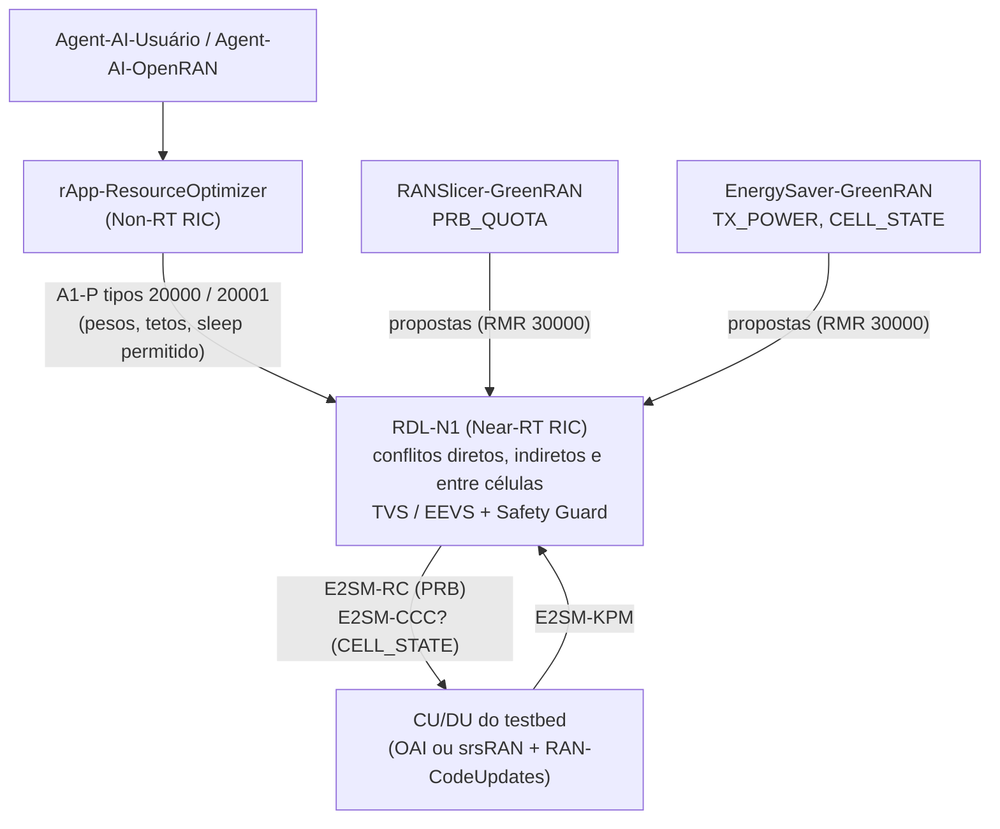

# Perfil de integração no testbed UFPA (GreenRAN / OpenRAN@Brasil)

**Situação:** a xApp está preparada no código (2026-11-10); **nenhum gate de testbed foi executado**. As versões da RAN, do RIC e do núcleo do testbed ainda não foram informadas e estão marcadas `A_CONFIRMAR` em [`configs/testbed_ufpa/profile.yaml`](../../configs/testbed_ufpa/profile.yaml).

Contexto: a proposta *GreenRAN: Open RAN Sustentável para o Agro e Campi Inteligentes* (Programa OpenRAN@Brasil, Etapa 2, hospedeiro POP-PA/UFPA) prevê o RANSlicer-GreenRAN (cota de PRB por fatia), o EnergySaver-GreenRAN (potência e desligamento de células e *layers*) e o rApp-ResourceOptimizer no Non-RT RIC coordenando os dois. A análise de adequação está em [`reports/avaliacao/adequacao_f1_f2_greenran_ufpa_20261110.md`](../../reports/avaliacao/adequacao_f1_f2_greenran_ufpa_20261110.md).

## 1. Papel da RDL-N1 no GreenRAN

O rApp decide objetivos em escala não-RT (> 1 s). A RDL-N1 garante, em cada janela de 200 ms, que as ações de RANSlicer-GreenRAN e EnergySaver-GreenRAN não se contradigam na mesma célula ou em células vizinhas e respeitem os limites físicos e os da política A1. Ela não substitui nenhum dos entregáveis da proposta.

## 2. O que já está no código

| Necessidade do GreenRAN | Implementação na RDL-N1 | Verificação |
| :-- | :-- | :-- |
| Conflito RANSlicer × EnergySaver na mesma célula | TVS (direto) e EEVS (indireto), já existentes | G4 e G5 na bancada NORI (cota de PRB) |
| EnergySaver-GreenRAN atuando em células vizinhas (UEs na borda de duas RUs) | `ConflictType.INTER_CELL`: `HANDOVER_INTO_REDUCED_CELL`, `HANDOVER_PING_PONG`, `NEIGHBOR_SLEEP` ([02 §4.1](../02_modelo_de_decisao_h_rdl.md#41-percepção-conflitos-agrupados-por-alvo)) | testes unitários; decisão nova de S4/S5 no catálogo NORI; sem execução nova |
| Desligamento de células (atividade A1.3) | parâmetro `CELL_STATE` (0/1) com limites, pontuação de energia e bloqueio por política | testes unitários; **despacho fail-closed** até o nó anunciar a capacidade |
| Coordenação pelo rApp | política A1 efetiva aplicada à decisão; tipo 20001 `GreenRAN_Intent_Policy` ([02 §7.1](../02_modelo_de_decisao_h_rdl.md#71-políticas-a1)) | testes unitários; sem Non-RT RIC real |
| Topologia das RUs | `RDL_TOPOLOGY_FILE` ([exemplo](../../configs/testbed_ufpa/topology.example.json)) | testes unitários |
| Robustez contra xApp maliciosa (atividade A1.11) | Safety Guard por proposta antes da arbitragem | S7 nas pilhas nativa e NORI |

## 3. O que depende do testbed

| Item | Dependência | Pergunta para a equipe do hospedeiro |
| :-- | :-- | :-- |
| Pilha da CU/DU e agente E2 | atividades 1.1–1.4 | OAI ou srsRAN? Qual agente E2 e quais versões de E2AP, KPM e RC? |
| Cota de PRB por fatia | atividade 1.1 | O controle sai em E2SM-RC Style 2 / Action 6 (como no NORI)? Com quais RAN Parameter IDs? |
| Potência | atividade 1.2 | Qual Style/Action ou modelo de serviço? Potência por PRB no DL e por UE no UL tem semântica diferente do `TX_POWER` de setor da RDL-N1 |
| Desligamento de células e *layers* | atividade 1.3 | Será E2SM-CCC, RC com parâmetro próprio ou O1? Há *layers* SDM endereçáveis por E2? |
| KPM | atividade 1.4 | Quais métricas por fatia e de energia (ex.: PEE) estarão disponíveis, e com qual período? |
| Near-RT e Non-RT RIC | infraestrutura | Qual release do O-RAN SC (a bancada usa a I)? Onde roda o rApp e por qual A1 ele publica políticas? |
| Identificação dos nós | topologia | IDs de E2 Node de cada RU e a vizinhança real entre elas |
| Recursos | infraestrutura | Servidor para RIC + xApps (a bancada local, com 7,7 GB de RAM, não suporta a integração; achados 50–51) |

## 4. Gates

Os gates TB0–TB10 de [OPENRAN_BRASIL_INTEGRATION.md](OPENRAN_BRASIL_INTEGRATION.md) continuam valendo. Os específicos do GreenRAN:

| Gate | Critério | Artefatos | Situação |
| :-: | :-- | :-- | :-: |
| GR1 | Política A1 publicada pelo Non-RT RIC do testbed muda a decisão da RDL-N1 (mesmas propostas, decisão diferente, registrada) | política, log JSONL da xApp, decisões antes/depois | não executado |
| GR2 | Conflito entre células com RUs reais: handover para uma célula que o EnergySaver desliga é resolvido de forma reprodutível | `conflicts.jsonl`, `decisions.jsonl`, PCAP E2 | não executado |
| GR3 | `CELL_STATE` despachado pelo modelo de serviço que o testbed anunciar, com ACK correlacionado | PCAP E2, log causal | não executado |
| GR4 | Cenário GreenRAN pré-registrado (fatia eMBB de câmeras a 25 Mb/s por câmera com atraso < 100 ms + fatia mMTC de sensores) com consumo de energia medido | pré-registro, manifestos, KPM e energia | não executado |

## 5. Cenário de referência proposto (para GR4)

- **Fatias:** `embb_vigilancia` (N câmeras × 25 Mb/s, atraso < 100 ms) e `mmtc_sensores` (tráfego intermitente de baixa taxa).
- **Propostas:** RANSlicer-GreenRAN pede cota de PRB para a fatia de câmeras; EnergySaver-GreenRAN propõe reduzir a potência ou desligar a RU com menos carga nos períodos de baixa demanda.
- **Hipóteses a pré-registrar:** (1) com a RDL-N1 (B3), nenhuma janela com UEs movidos para uma célula desligada; (2) o atraso da fatia de câmeras fica abaixo de 100 ms quando a política A1 prioriza SLA; (3) a economia de energia aparece nas janelas de baixa demanda quando a política permite.
- O cenário pode rodar antes na bancada NORI, mas só a cota de PRB é atuável lá (docs/03 §4).
