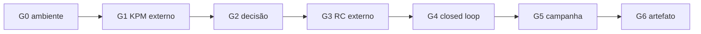

# Matriz de rastreabilidade

Níveis de verificação usados (do mais fraco ao mais forte): `IMPLEMENTED` (código existe), `UNIT_TESTED` (testes com dependências simuladas), `SIMULATION_EVIDENCE` (execução ns-3 com proveniência), `INTEROP_VERIFIED` (contra implementação externa real).

## 1. Requisitos da xApp

| Requisito | Componente | Testes | Evidência | Nível atual |
| :-- | :-- | :-- | :-- | :-: |
| Subscrição E2SM-KPM via SubMgr REST | `SubscriptionManager`, `RDLxApp._subscription_notification_handler` | `tests/unit/test_evaluation_fixes.py` | — | UNIT_TESTED |
| Decodificação de RIC Indication (KPM) | `KpmDecoder` | `tests/codec/test_kpm_codec.py`, `tests/test_kpm_decoder_e2ap.py` | *golden vectors* gerados pelo próprio codec | UNIT_TESTED |
| RIC Control (RC) com MEID | `ControlDispatcher`, `rmr_transport` | `tests/test_control_dispatcher_mtype.py`, `tests/unit/test_evaluation_fixes.py` | — | UNIT_TESTED (codec RC fora da norma) |
| Correlação ACK/Failure, timeout e rollback | `ControlDispatcher` | `tests/test_rollback_timeout.py`, `tests/unit/test_control_dispatcher_fault_injection.py` | — | UNIT_TESTED |
| Detecção de conflitos por alvo | `Perception` | `tests/unit/test_conflict_detection.py`, `tests/unit/test_evaluation_fixes.py` | `experiments/runs/nr_*` (`decision_log.json`) | SIMULATION_EVIDENCE |
| Arbitragem TVS/EEVS em dois estágios | `Reasoning`, `RDLxApp._process_action_group` | `tests/unit/test_reasoning_models.py`, `tests/unit/test_conflict_experiment.py` | `experiments/runs/nr_*_B3_*` | SIMULATION_EVIDENCE |
| Safety Guard (limites, histerese, slew-rate, pré-filtro) | `Refinement` | `tests/unit/test_safety_guards.py`, `tests/unit/test_safety_guard_fuzzing.py` | `experiments/runs/nr_S7_*` | SIMULATION_EVIDENCE |
| Modo estrito sem IDs estáticos | `RanFunctionCapabilityRegistry` | `tests/unit/test_negative_cases.py` | — | UNIT_TESTED |
| Closed loop causal | `CausalTracker` + pilha NORI | `tests/interoperability/test_closed_loop.py` (local) | — | IMPLEMENTED |
| Descoberta E2 (RAN Function Definition) | — | — | — | não implementado |

`SIMULATION_EVIDENCE` aqui significa que a decisão da H-RDL foi aplicada na RAN simulada (malha aberta, sem E2). Nenhum requisito está em `INTEROP_VERIFIED`.

## 2. Gates

| Gate | Critério | Veredito |
| :-: | :-- | :-: |
| G0 | Manifestos completos; versões e commits iguais ao lock | CERTIFIED (nativa) |
| G1 | E2 Setup, Subscription e Indication KPM externos numa execução NORI elegível | NOT_CERTIFIED |
| G2 | Conflito detectado e decisão determinística com Safety Guard | LOCAL_ONLY |
| G3 | RIC Control e ACK/Failure externos correlacionados | BLOCKED |
| G4 | KPM_t0 → decisão → RC → ACK → KPM_t1, em ordem e com efeito medido | BLOCKED |
| G5 | ≥ 30 sementes pareadas elegíveis por baseline B0–B3 com E2 | CERTIFIED (S8, 30 pares) |
| G6 | G4 e G5 + reprodução independente | NOT_CERTIFIED (falta reprodução independente) |

## 3. Testbeds planejados

| Perfil | Documento | Situação |
| :-- | :-- | :-- |
| srsRAN + Open5GS | [HRDL_F1_SRSRAN_TESTBED_PROFILE.md](HRDL_F1_SRSRAN_TESTBED_PROFILE.md) | adaptadores existem (`src/e2/backends/srsran_e2_adapter.py`, `SrsRanBackendAdapter`); não executados |
| OpenRAN@Brasil | [OPENRAN_BRASIL_INTEGRATION.md](OPENRAN_BRASIL_INTEGRATION.md) | plano com gates TB0–TB10; não executado |
