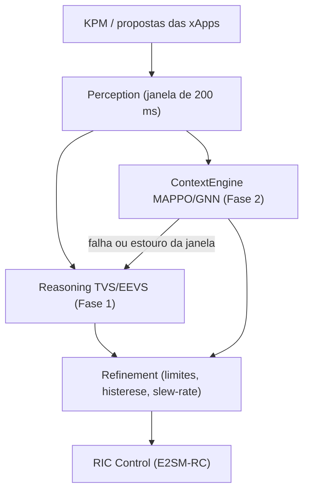

# Contrato entre a Fase 1 (H-RDL) e a Fase 2 (CA-RDL)

**Situação:** especificação. Do lado da Fase 1 existem os campos opcionais em `src/conflict_types.py`; o mecanismo de reserva (fallback) pertence à Fase 2 e não é exercitado neste repositório.

## 1. Princípios

1. **Segurança primeiro.** O `Refinement` da Fase 1 é a última etapa antes do despacho, qualquer que seja a origem da ação.
2. **Esquema estável.** Os campos da Fase 1 não mudam de nome nem de semântica; a Fase 2 só acrescenta campos opcionais.
3. **Reserva determinística.** Se o motor da Fase 2 falhar ou não decidir dentro da janela de 200 ms, a decisão é tomada pela arbitragem TVS/EEVS da Fase 1.

## 2. Fluxo

## 3. Tipos compartilhados (`src/conflict_types.py`)

| Tipo | Campos da Fase 1 | Campos opcionais da Fase 2 (padrão `None`) |
| :-- | :-- | :-- |
| `XAppAction` | `xapp_id`, `node_id`, `parameter`, `value`, `priority`, `action_id`, `timestamp`, marcas de tempo `t_*` | `context_features`, `confidence_score` |
| `ConflictSet` | `conflict_id`, `conflicting_actions`, `affected_kpis` | `graph_embedding`, `topology_state` |
| `RDLDecision` | `decision_id`, `proposals`, `conflicts`, `safety_result`, `selected_actions`, `reason`, `strategy_used`, `affected_node`, `affected_cell`, `previous_safe_value`, `conflict_ids` | `marl_agent_id`, `reward_estimate` |

## 4. Repositórios

| Repositório | Papel |
| :-- | :-- |
| `georgebarbosa3090/XApp-RDL-F1` | H-RDL, cenários S0–S7, Safety Guard, certificação |
| `georgebarbosa3090/XApp-RDL-F2` | CA-RDL, MAPPO/GNN, cenários S9–S15 |

## 5. Verificação

| Item | Onde se verifica | Situação |
| :-- | :-- | :-- |
| Tipos importam com os campos opcionais | testes deste repositório | coberto (os campos têm padrão `None`) |
| Reserva determinística em ≤ 200 ms | repositório da Fase 2 | não verificado aqui |
| Mesma política de evidência | `reproducibility/provenance_policy.yaml` | aplicada na Fase 1 |
